# G2 Watch – Firmware für die Even Realities G2 direkt von der Uhr

Eine eigenständige Wear-OS-App: Die Uhr lädt die Firmware, prüft sie und spielt sie über Bluetooth auf
die **Even Realities G2** – wahlweise die **Original-Firmware** von Even oder die **Custom-Firmware**
von Faceclaw. Ein Handy braucht es dafür nicht. Die Uhr-Oberfläche mit Touchpad, Maus-Zeiger und
Einstellungen stammt aus dem Uhr-Paket (`G2Watch_Uhr-UI_und_Maus`) und läuft auf der Brille, sobald
die Custom-Firmware drauf ist.

Die Uhr-App ist außerdem die **Hauptapp für Apps auf der Brille**: Apps wie **YouTube** und der **Browser**
werden als eigene Pakete dazu installiert ([Eigene Apps installieren](#eigene-apps-installieren)). Für den
[Browser](#web-browser-auf-der-brille) bringt die Uhr-App die Browser-Engine **GeckoView** mit und wandelt
Web-Seiten mit dem Modul `web-raster` ins Brillenbild, Text immer lesbar. Die Test-APK **„Gecko-Test“** misst,
ob GeckoView auf der Uhr gut genug läuft.

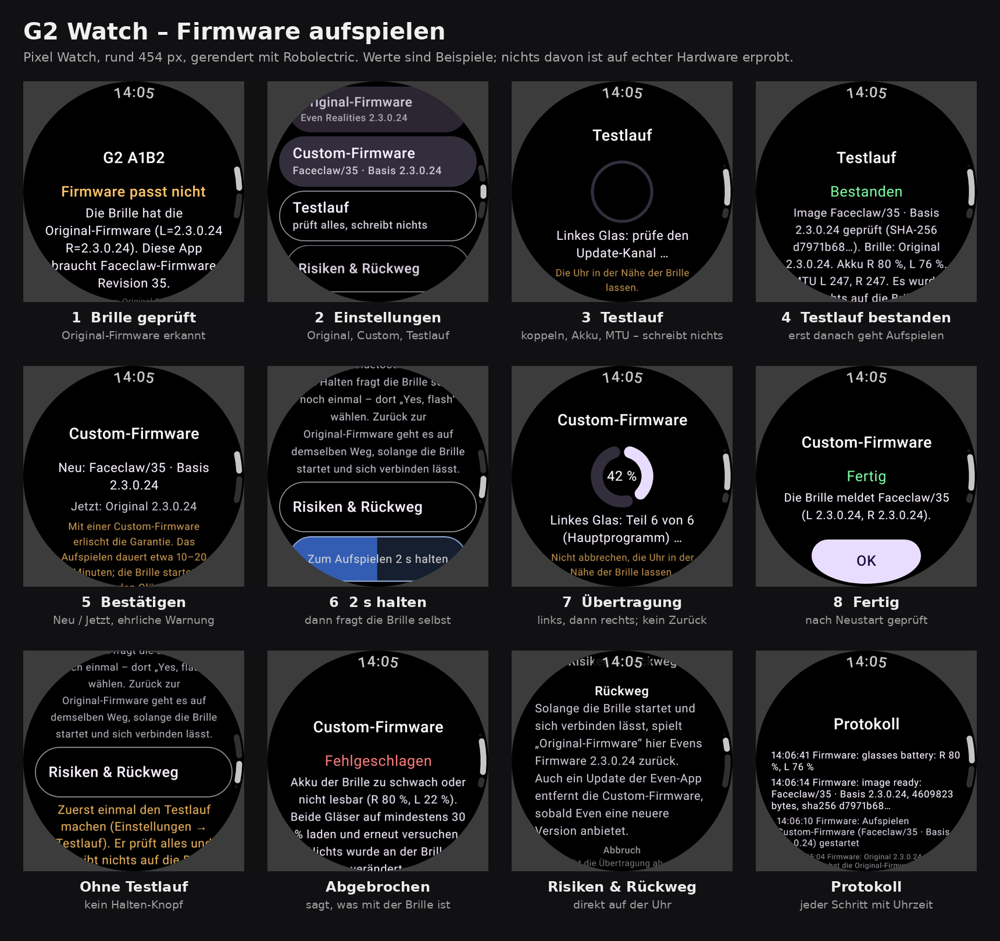

> **Ehrlicher Stand (v0.14.0):** Auf echter Uhr und Brille erprobt ist bisher das **Aufspielen der
> Custom-Firmware**: Pixel Watch 5 und G2, linkes Glas im ersten Anlauf; beim rechten brach der erste Anlauf
> ab, nach dem angezeigten Weg (Brille laden, neu starten, erneut aufspielen) klappte es. Alles andere läuft
> bisher nur gegen eine simulierte Brille, dazu das echte Custom-Image bitgenau durch den echten Flasher. Seit
> 0.4.0 gibt es den **App-Host** – eigene Apps auf der Brille, mit Starter und App-Menü
> ([Apps auf der Brille](#apps-auf-der-brille)). Seit 0.5.0 die App **YouTube** – Videos suchen und
> als Graustufen-Raster auf der Brille ansehen, alles auf der Uhr ([YouTube auf der Brille](#youtube-auf-der-brille)).
> Neu in 0.5.2: [Emoji](#emoji) erscheinen in allen Texten als Strichzeichnung statt als Kleckse.
> Neu in 0.6.0: **App-Pakete** – eigene Apps als Datei auf die Uhr legen und dort installieren, ohne die
> Uhr-App neu zu bauen ([Eigene Apps installieren](#eigene-apps-installieren)). Seit 0.7.0 ist auch YouTube
> ein solches Paket; die Uhr-App selbst bringt keine App mehr mit.
> Neu in 0.7.0: die **Vorarbeit für einen Browser** – Web-Seiten fürs Brillenbild und die Test-App
> „Gecko-Test“ (M2). Neu in 0.8.0: der **[Browser](#web-browser-auf-der-brille)** selbst (M7) – GeckoView in
> der Uhr-App, die Browser-Oberfläche als App-Paket. **Nicht auf Hardware erprobt**, und die Messwerte des
> Gecko-Tests von der echten Uhr fehlen noch; was davon abhängt, steht im Browser-Abschnitt.
> 0.8.1: Das Projekt enthält nur noch die Uhr-App, Android Studio kann nichts anderes aufspielen; der
> Gecko-Test ist ein eigenes Projekt ([Gecko-Test](#gecko-test-m2-auf-die-uhr-bringen-und-messen)).
> Neu in 0.9.0: **[Bildtiefe](#bildtiefe)** Nah/Mittel/Fern wie in der Even-App, und das Bild bleibt im Bereich,
> den auch Evens Firmware nutzt (beide Gläser geprüft, kein Versatz gefunden); der **Starter zeigt Symbole**
> statt einer Liste; **YouTube** schärfer und mit bis zu 15 Bildern pro Sekunde (randlos, 512 × 288);
> **[Bluetooth-Tastatur und -Maus](#tastatur-und-maus)** zusätzlich zur Bedienung an der Uhr. Pakete YouTube
> und Browser 1.1.0 (Schnittstelle 3). Nichts davon ist auf Hardware erprobt.
> Neu in 0.10.0: **[Apps auf dem Handy](#apps-auf-dem-handy-g2-handy-und-fluency)** – eine App auf der Brille
> spricht mit einer App auf dem gekoppelten Handy und bekommt das Mikrofon der Uhr (Schnittstelle 4), über die
> neue Handy-App **„G2 Handy“**. Erste Nutzerin: das Paket **Fluency** 1.1.0, die Live-Übersetzung des
> Übersetzers Fluency auf dem Handy als Untertitel auf der Brille. Uhr-App und G2 Handy haben dafür einen
> **gemeinsamen Schlüssel**: Eine ältere Uhr-App einmal deinstallieren (ihre Einstellungen und Pakete gehen
> dabei verloren). Nichts davon ist auf Hardware erprobt.
> Neu in 0.11.0: Der **[Starter](#apps-auf-der-brille)** ist das Hauptmenü der Brille. Er steht nach dem
> Verbinden auf der Brille, jede App kehrt zu ihm zurück, und Zurück bleibt auf ihm stehen. Die Kacheln Uhr,
> Notiz, Zähler, Info und Hilfe sind weg. Nicht auf Hardware erprobt.
> Neu in 0.12.0: Apps bekommen das **GPS der Uhr**, einen **eigenen Ordner für große Dateien mit Downloads**
> (WLAN, auf Wunsch LTE, abgebrochene gehen weiter) und **Hintergrundarbeit** (Schnittstelle 5). Erste Nutzerin:
> die **[Navigation „Navi“](#navigation-offline-navi)** 1.0.0 – Karten jedes Landes der Welt einzeln auf die Uhr
> laden, Ziel suchen, Start und Ziel wählen, Abbiegehinweise im Stil von Evens Navigation, alles ohne Netz.
> Nicht auf Hardware erprobt.
> Neu in 0.13.0: Apps **sehen und steuern die Musik der Uhr** (Spotify und jeden anderen Player) und spielen
> einen **eigenen Ton**, etwa Radio (Schnittstelle 6). Erste Nutzerin: die App **[Musik](#musik-spotify-und-radio-auf-der-brille)**
> 1.0.0 – Spotify von der Brille aus bedienen (Titel, Cover, Play/Pause, weiter, Lautstärke) und Radio mit den
> 44 Schweizer Sendern von DAB+ als Internet-Stream, dazu jeder Sender der Welt. Der Ton kommt von der Uhr
> (Kopfhörer oder Lautsprecher). Nicht auf Hardware erprobt.
> Neu in 0.14.0: **Apps im [Starter](#apps-auf-der-brille) verschieben** wie am Handy: Finger auf der Uhr
> liegen lassen (oder Maustaste halten), während der Zeiger auf einer App steht – nach 2 Sekunden hängt sie
> am Zeiger, die anderen machen Platz, Loslassen legt sie ab. Nicht auf Hardware erprobt.

## Was aufgespielt werden kann

| Knopf auf der Uhr | Image | Größe | SHA-256 |
|---|---|---|---|
| **Original-Firmware** | Evens Firmware 2.3.0.24, von Evens Server | 4.537.963 B | `187ccf2b…0979` |
| **Custom-Firmware** | **Faceclaw/35** = 2.3.0.24 + Patch-Set von g2flash, auf der Uhr gebaut | 4.609.823 B | `d7971b68…2817` |

Nur diese beiden Images sind erlaubt; die Werte stehen fest in
[`FirmwareCatalog.kt`](firmware-image/src/main/kotlin/ch/madtreasures/g2watch/firmware/FirmwareCatalog.kt).
Evens Firmware liegt **nie** im Repo und nie in der App: Die Uhr lädt sie von Evens Server (oder du
legst sie per `adb` ab) und prüft sie per SHA-256.

**Warum Revision 35 und nicht 34?** Die Übergabe-Pakete beschreiben Faceclaw/34. Revision 34 war aber
nur ein Zwischenstand von Faceclaw (wenige Stunden); das veröffentlichte **Faceclaw 0.8.0 verlangt
genau 35**, und g2flash baut heute 35. Revision 35 hat außerdem das Format der Zeichenbefehle geändert:
Ein Kern für 34 kann auf einer 35er-Brille nicht zeichnen und umgekehrt. Deshalb gehören Firmware und
der mitgelieferte Faceclaw-Kern (0.8.0) zusammen, und die App prüft die Revision **exakt**. So bleibt
die Brille auch mit der Faceclaw-Handy-App verwendbar, ohne hin und her zu flashen.

## Bedienung auf der Uhr

1. **Brille wählen.** App starten, Bluetooth erlauben, Brille aus dem Etui nehmen. Die Even-App auf
   dem Handy beenden oder am Handy Bluetooth ausschalten – die Brille nimmt nur eine Verbindung an.
2. **Prüfung.** Die Uhr liest nur die Firmware-Version. Mit Original-Firmware erscheint
   „Firmware passt nicht“ und darunter **Einstellungen**. (Mit Custom-Firmware geht es direkt zum
   Touchpad; die Einstellungen öffnen sich dort, wenn man das Zahnrad 0,9 s hält. Die Statusseite bietet
   die Einstellungen an, sobald keine Verbindung läuft.)
3. **Custom-Firmware** (oder **Original-Firmware**) antippen → Bestätigungsseite lesen →
   **„Zum Aufspielen 2 s halten“**.
4. **Auf der Brille bestätigen:** Die Brille zeigt selbst eine Frage – mit Bügel oder Ring zu
   **„Yes, flash“** wischen und tippen. „No, cancel“ bricht ab, ohne etwas zu verändern.
5. **Übertragung:** erst das linke Glas, dann startet die Brille kurz neu, dann das rechte. Bis etwa
   35 Minuten (etwa 17 pro Glas). Die Uhr bleibt an, die Seite hat keinen Zurück-Knopf. Uhr bei der Brille lassen,
   Brille nicht ins Etui legen.
6. **Kontrolle:** Nach dem Neustart fragt die Uhr jedes Glas einzeln und meldet z. B.
   „Beide Gläser melden Faceclaw/35“. Mit **OK** verbindet sie sich neu – mit Custom-Firmware startet
   dann das Touchpad mit dem Maus-Zeiger und dem Starter auf der Brille. Die Even-App auf dem Handy muss danach
   eventuell neu mit der Brille gekoppelt werden.

Verbunden zeigt die Uhr unter dem Akku, welche Firmware die Brille hat und was jeder Bügel meldet
(z. B. „Faceclaw/35“, „Links 2.3.0.24 · Rechts 2.3.0.24“); dasselbe steht in den Einstellungen unter
*Firmware*. Während des Aufspielens füllt sich ein blauer Ring auf grauem Grund genau mit dem Fortschritt
und ist erst bei 100 % geschlossen.

**Protokoll von der Uhr holen:** *Einstellungen → Protokoll → Als Datei speichern* einschalten (aus ist
die Voreinstellung). Dann schreibt die Uhr das Protokoll, samt allem, was es beim Einschalten schon
enthielt, nach `Android/data/ch.madtreasures.g2watch/files/protokoll/protokoll.txt` (höchstens etwa 1 MB,
ältere Zeilen in `protokoll-alt.txt`). Holen: Android Studio *Device Explorer* → Uhr → diesen Ordner →
Rechtsklick → *Save As*, oder `adb pull /sdcard/Android/data/ch.madtreasures.g2watch/files/protokoll/ .`.
Ist die Uhr mit Android Studio verbunden, stehen dieselben Zeilen auch in *Logcat* (Filter `tag:G2Watch`).

**Zurück zur Original-Firmware** geht auf demselben Weg (Einstellungen → *Original-Firmware*),
solange die Brille startet und sich verbinden lässt. Die Seite **Risiken & Rückweg** in den
Einstellungen fasst zusammen, was schiefgehen kann ([Recherche](docs/RECHERCHE_FIRMWARE.md)).

## Bildtiefe

Wie nah das Bild der Brille wirkt, stellt man auf der Uhr ein: Zahnrad halten → *Einstellungen →
Bildtiefe* → **Nah**, **Mittel** (Standard) oder **Fern**, die drei Stufen der Even-App. Die Wahl gilt
sofort; die Uhr merkt sie sich und stellt sie bei jeder Verbindung wieder ein. Wer vom Bild Kopfweh
bekommt, probiert eine andere Stufe.

| Bildtiefe auf der Uhr | Starter auf der Brille, alles zwischen x = 32 und 607 |
|---|---|
| 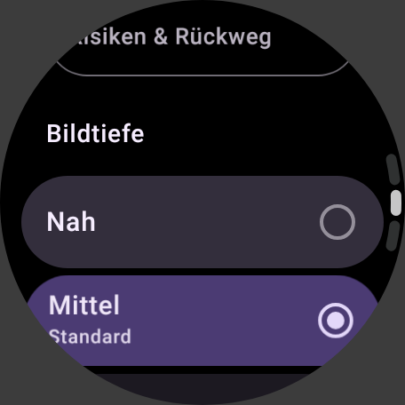 | 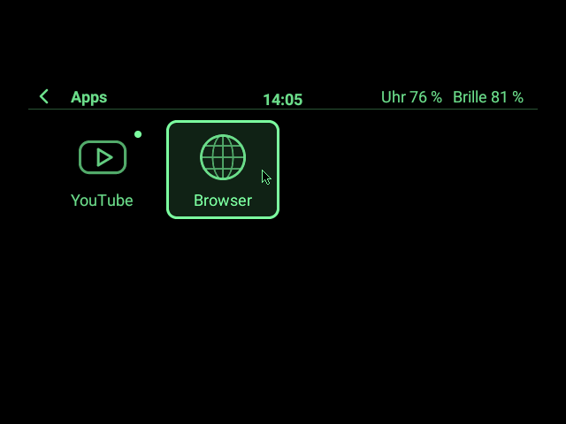 |

So geht es: Evens Firmware schiebt ihr Bild je nach Stufe in jedem Glas um 8 Pixel zur Nase hin oder nach
außen. Diese Einstellung übernimmt die Custom-Firmware nicht; sie zeigt das Bild der Uhr
immer wie „Mittel“. Deshalb verschiebt die Uhr das ganze Bild selbst, mit der Stereo-Tiefe von Faceclaw
um genau dieselben Pixel (Tiefe +16, 0, −16). Über Bluetooth kostet das nichts. Die Einstellung in der
Even-App selbst bleibt unberührt. Der Zeiger ist dafür keine eigene Fläche mehr, sondern ins Bild
gezeichnet.

**Beide Gläser geprüft** (im Code und in Evens Firmware, nicht an der Brille): Linkes und rechtes Glas
bekommen dasselbe Bild an derselben Stelle, genau wie bei Evens Firmware auf „Mittel“. Die Justierung ab
Werk für jedes Glas steckt im Display selbst und gilt auch mit der Custom-Firmware. Es gibt also keinen
Versatz zu beheben. Ein Unterschied war der Rand: Die Linie der Kopfzeile ging über die ganze Breite, ihre
Texte reichten von x = 12 bis 628 und der Zeiger bis an den Bildrand; Evens Firmware lässt dagegen nie
Pixel außerhalb von x = 24 bis 615 leuchten. Was so weit außen liegt, sieht womöglich nur ein Auge, und
das strengt an. Jetzt liegt alles, auch der Zeiger, zwischen x = 32 und 607, wo Evens Bild auf „Mittel“
liegt. So fällt auch bei „Nah“ und „Fern“ nichts über den Rand.

Nicht auf Hardware erprobt. Dass +16 näher wirkt, folgt aus der Geometrie und aus Faceclaws Bezeichnung;
welche Stufe die Even-App „Nah“ nennt, ist nicht belegt. Details:
[03 §5.3](docs/app-entwicklung/03_Uhr-Apps.md#53-bildtiefe-und-bildrand).

## Apps auf der Brille

Seit 0.4.0 hat die Uhr einen **App-Host** (Meilenstein M1 aus
[`docs/app-entwicklung`](docs/app-entwicklung/00_LIES_MICH.md)): Apps beschreiben ihre Oberfläche als
Seiten aus Bausteinen (wie im [G2 Baukasten](designer/README.md)), der Host zeichnet sie auf die Brille und
verteilt die Eingaben. Jede App ist ein App-Paket, zurzeit **YouTube** ([YouTube auf der Brille](#youtube-auf-der-brille)),
**Browser** ([Web-Browser auf der Brille](#web-browser-auf-der-brille)), **Fluency**
([Apps auf dem Handy](#apps-auf-dem-handy-g2-handy-und-fluency)), **Navi** ([Navigation offline](#navigation-offline-navi))
und **Musik** ([Spotify und Radio](#musik-spotify-und-radio-auf-der-brille)).
Im Starter steht eine App, sobald man sie installiert hat ([Eigene Apps installieren](#eigene-apps-installieren)).

| Starter | App-Menü | Berechtigung beim ersten Start |
|---|---|---|
|  | 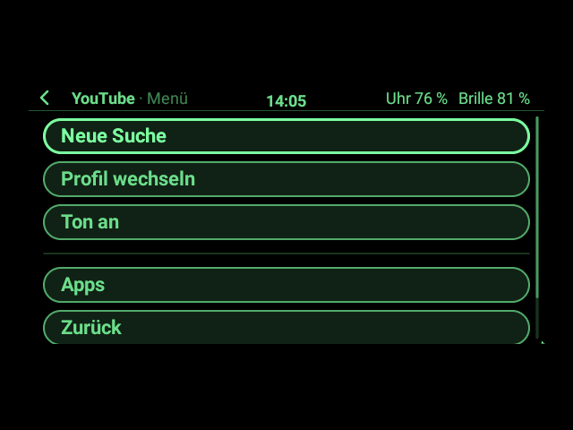 | 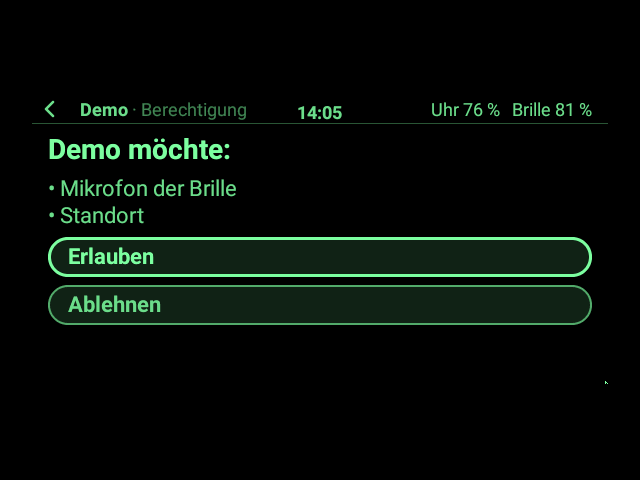 |
| **Vollbild-Seite mit randlosem Bild** | **App verschieben** (2 Sekunden halten) | |
| 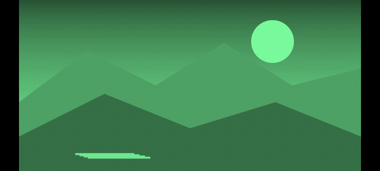 | 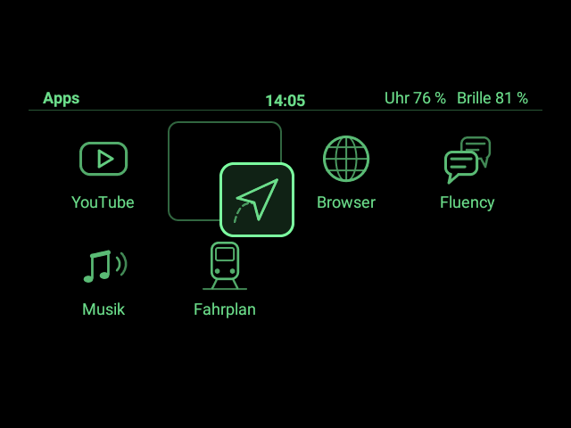 | |
| **Alle Bausteine** | **… gescrollt, Fokus unten** | **Uhr im Gesten-Modus** |
| 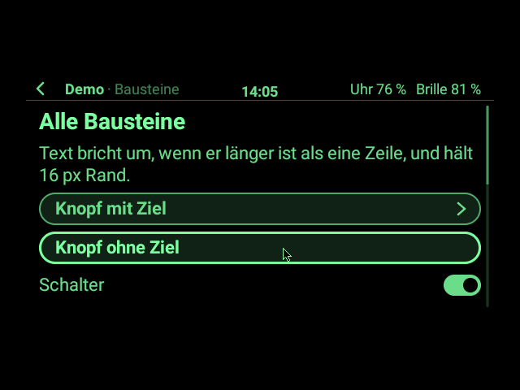 | 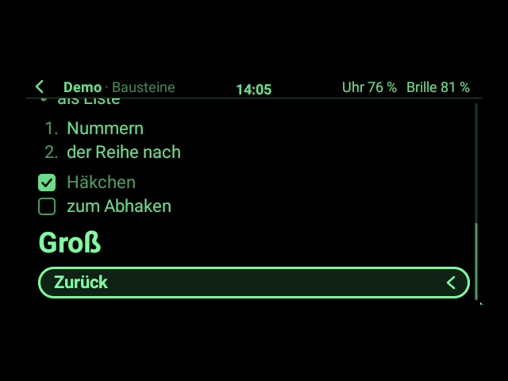 | 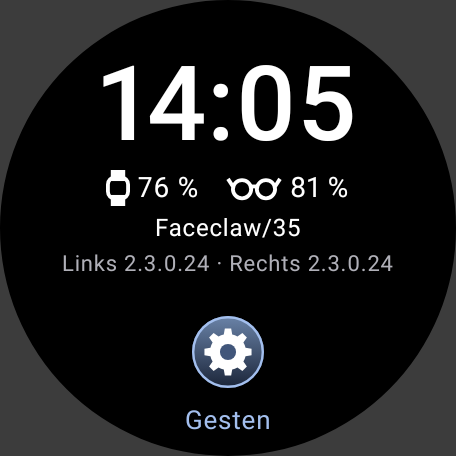 |

**Bedienen:**

- Der **Starter** ist das Hauptmenü der Brille (seit 0.11.0): Er steht nach dem Verbinden auf der Brille, jede
  App, die endet, kehrt zu ihm zurück, und Zurück bleibt auf ihm stehen. Er zeigt alle Apps als Symbol mit
  Namen, vier nebeneinander, acht auf einen Blick (mehr scrollen). Ein Punkt rechts oben am Symbol heißt:
  Die App läuft. Eine App ohne Symbol zeigt ihre Anfangsbuchstaben. Ohne Apps steht dort „Noch keine Apps“.
  Bügel und Ring springen von Symbol zu Symbol (Zeile für Zeile), Tippen startet; mit dem Zeiger leuchtet
  das Symbol darunter auf, Doppeltipp auf der Uhr startet es.
- **Apps verschieben** (seit 0.14.0), wie am Handy: Den Zeiger auf eine App stellen und den Finger auf der
  Uhr **2 Sekunden liegen lassen** (mit einer Maus: linke Taste gedrückt halten). Die Uhr tickt, und die App
  hängt sich an den Zeiger. Mit dem Finger (oder der Maus) trägt man sie frei herum; wo sie landen wird, ist
  eine Lücke, für die die anderen Apps beiseiterücken. Loslassen legt sie in die Lücke. Rechts neben der
  letzten App oder darunter heißt: ans Ende. Die Reihenfolge bleibt gespeichert, neue Apps kommen hinten dazu.
  Wer vor den 2 Sekunden weiterzieht, verschiebt nichts.
- **Zeiger** (Finger auf der Uhr): Was unter dem Zeiger liegt, ist hervorgehoben; Doppeltipp auf der Uhr
  klickt es. Den Zeiger über den oberen oder unteren Rand hinaus schieben scrollt lange Seiten.
- **Bügel oder Ring:** Wischen springt zum nächsten/vorigen Knopf, Schalter oder Häkchen (die Seite scrollt
  mit), Tippen klickt ihn, Doppeltippen geht zurück.
- **Zurück** geht immer: Doppeltipp am Bügel, „‹“ in der Kopfzeile, „Zurück“ im App-Menü. Auf der ersten
  Seite schließt Zurück die App.
- **App-Menü:** am Bügel tippen und dann halten, oder den App-Namen in der Kopfzeile anklicken. Es zeigt die
  eigenen Einträge der App, dann „Apps“ (App läuft im Hintergrund weiter), „Zurück“ und „Schließen“.
- **Gesten-Modus:** Apps mit `input: "gestures"` (Spiele, später Even-Hub-Apps) bekommen rohe Gesten, seit
  0.5.0 auch einzelne Seiten (etwa das Video der YouTube-App). Der Zeiger verschwindet, auf der Uhr steht
  „Gesten“: Wischen in vier Richtungen (nach rechts = zurück), Tippen, Doppeltippen, lang Drücken. Das
  Zahnrad öffnet weiter die Einstellungen.
- **Texteingabe:** Fragt eine App nach Text (etwa die Suche), öffnet die Uhr ihre Tastatur mit
  Spracheingabe; auf der Brille steht „Bitte auf der Uhr eingeben“. Mit einer Bluetooth-Tastatur erscheint
  die Frage auf der Brille, getippt wird dort ([Tastatur und Maus](#tastatur-und-maus)).
- Braucht eine App Mikrofon, Standort o. Ä., fragt die Brille beim ersten Start einmal nach („Erlauben“ /
  „Ablehnen“). Sensoren, Mikrofon und Summer kommen erst mit M6 bei den Apps an.

Eine eigene Uhr-App ist eine kleine Kotlin-Klasse in einem eigenen Ordner unter [`packages/`](packages)
und kommt als App-Paket auf die Uhr (nächster Abschnitt); wie man sie schreibt, steht in
[03 – Uhr-Apps](docs/app-entwicklung/03_Uhr-Apps.md). Apps berühren nie den Firmware-Pfad
(`AppsBoundaryTest`, `FlashingBoundaryTest`).

### Emoji


Die Uhr zeichnet jeden Text selbst als Pixel. Androids Emoji sind Farbbilder, und davon blieb in den
16 Grünstufen der Brille nur der Umriss – ein gefüllter Klecks. Seit 0.5.2 bringt die App deshalb eine
Schwarz-Weiß-Emoji-Schrift mit: [Noto Emoji](https://fonts.google.com/noto/specimen/Noto+Emoji) von Google
(SIL Open Font License 1.1; mit Lizenztext in `app/src/main/assets/fonts/`; die APK wird 1,3 MB größer, geladen
belegt die Schrift 2 MB Speicher).
Emoji erscheinen damit in allen Apps als Strichzeichnung – in Video-Titeln, Knöpfen, Listen und Meldungen –,
fett in Überschriften. Flaggen werden zu Kästchen mit Länderkürzel, Hautfarben sind nicht zu sehen, farbige
Herzen sind schraffiert. „…“ und Zeilenumbruch schneiden nie ein Emoji entzwei. Emoji ab Unicode 16 (2024)
kennt die Schrift noch nicht; sie bleiben Kleckse. Details: [03 §11](docs/app-entwicklung/03_Uhr-Apps.md#11-emoji-v052).

## Tastatur und Maus

Eine Bluetooth-Tastatur und eine Bluetooth-Maus (etwa eine Magic Mouse) bedienen die Brille, sobald die Uhr
sie verbunden hat: den Starter, den Browser, YouTube und jede andere App. **Nicht auf Hardware
erprobt** – und ob Wear OS auf der Pixel Watch Tastaturen und Mäuse überhaupt annimmt, ist offen (unten).
Wie es gebaut ist: [03 §5.4](docs/app-entwicklung/03_Uhr-Apps.md#54-tastatur-und-maus).

| Uhr: *Einstellungen → Tastatur & Maus* | Touchpad mit Tastatur und Maus | Frage auf der Brille, mit der Tastatur getippt |
|---|---|---|
| 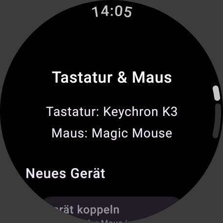 | 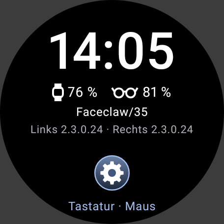 | 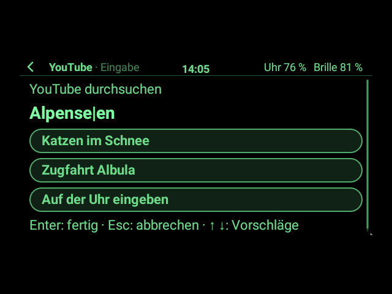 |

**Koppeln:** Zahnrad halten → *Einstellungen → Tastatur & Maus → Gerät koppeln*. Die Uhr sucht etwa 15 s
nach Tastaturen und Mäusen in der Nähe (das Gerät vorher in den Kopplungsmodus bringen); Antippen koppelt.
Eine Tastatur verlangt dabei vielleicht einen Code, den man auf ihr eintippt und mit Enter bestätigt. Die
Bluetooth-Liste von Wear OS zeigt solche Geräte nicht; der Knopf *Bluetooth-Einstellungen* führt trotzdem
dorthin. Verbundene Geräte stehen oben auf der Seite und auf dem Touchpad unter dem Zahnrad.

**Maus:** Bewegen führt den Zeiger der Brille (Tempo wie beim Finger: Krone oder Einstellungen). Links =
Klick, rechts = App-Menü, Mitte oder Zurück-Taste = zurück, Rad = scrollen (über einer Web-Seite die Seite).
Im Gesten-Modus (Video) ist links ein Tippen und das Rad ein Wischen (10 s vor oder zurück).

**Tastatur** – so in jeder App, auch in Paketen für ältere Uhr-Apps:

| Taste | Wirkung |
|---|---|
| Pfeile, Tab, Umschalt+Tab | nächster oder voriger Knopf; im Starter gehen ↑ ↓ eine Reihe hoch oder runter |
| Enter | Klick (steht der Zeiger auf einer Web-Seite: dort) |
| Esc, Alt+←, Rücktaste | zurück |
| Menütaste, F10 | App-Menü |
| Leertaste, Bild↓, Bild↑ | scrollen (über einer Web-Seite die Seite) |
| Play/Pause, Leertaste, Pfeile | im Video: Pause/weiter, 10 s vor oder zurück |

Apps können die Tasten auch selbst nehmen (Schnittstelle 3): der [Browser](#web-browser-auf-der-brille) und
[YouTube](#youtube-auf-der-brille) tun es. Esc, Alt+←, die Menütaste und F10 bleiben aber immer beim Host. Hält
man eine Taste, wiederholen sich Pfeile, Tab, Leertaste und Bild↑/↓; zurück, App-Menü und Klick gelten einmal
je Druck.

**Text tippen:** Fragt eine App nach Text, erscheint die Frage auf der Brille statt auf der Uhr: die Zeile mit
Cursor, darunter die Vorschläge. ← und →, Pos1 und Ende bewegen den Cursor, Rücktaste und Entf löschen,
↑ und ↓ holen die Vorschläge in die Zeile. Enter schickt den Text, Esc bricht ab. *Auf der Uhr eingeben*
öffnet stattdessen Tastatur und Spracheingabe der Uhr.

**Belegung:** Ohne eigene Einstellung tippt Android mit der amerikanischen Belegung: Y und Z wären vertauscht,
Umlaute fehlten. Wear OS hat dafür keine Einstellung. Die App hat deshalb eigene Belegungen für **Schweiz**
(mit den Akzent-Tasten ^ ´ ` ~ ¨), **Deutschland** (Akzent-Tasten ^ ´ `; ~ mit AltGr direkt) und **USA**.
Standard ist *Automatisch*: nach der Sprache der Uhr (Deutsch (Schweiz) → Schweiz, anderes Deutsch →
Deutschland, sonst die Belegung der Tastatur). Die Belegung gilt nur, wenn die Tastatur selbst keine hat.

**Wann es geht:** Tastatur und Maus wirken auf die Brille nur, solange die Uhr das Touchpad zeigt und die
Brille verbunden ist; auf allen anderen Seiten bedienen sie die Uhr wie gewohnt. G2 Watch muss vorne sein
und der Bildschirm an (der bleibt an, solange die Brille verbunden ist). Ist eine Maus da, hält die App den
Mauszeiger fest: Android zeigt dann keinen Zeiger auf der Uhr, und die Bewegung endet nicht am Rand der Uhr.
Die Bedienung an der Uhr bleibt, wie sie ist: Touchpad, Doppeltippen, Zahnrad, Krone, Gesten und Bügel gehen
auch mit verbundener Tastatur und Maus und mit festgehaltenem Mauszeiger unverändert (Android hält nur die Maus
fest, nie den Bildschirm der Uhr).

**Offen, auf der Uhr zu prüfen:**

- ob Wear OS auf der Pixel Watch Tastaturen und Mäuse überhaupt annimmt (Bluetooth-HID-Host). Wenn nicht,
  kann keine App das ändern.
- ob das Koppeln aus der App klappt, und ob eine Taste die dunkle Uhr zurück zur App weckt.
- ob das Festhalten des Mauszeigers auf Wear OS geht; sonst liest die App die Bewegung ohne (Androids
  Mauszeiger ist dann auf der Uhr zu sehen).
- **Magic Mouse:** Bewegen und Klicken sollten gehen. Scrollen über ihre Oberfläche braucht den
  Linux-Treiber `hid-magicmouse`, den die Uhr vielleicht nicht hat.
- ob GeckoView Tasten auch direkt annimmt. Der Browser tippt deshalb über sein Skript in die Seite.
- ob die Zurück-Taste der Maus G2 Watch vorne lässt: Seit Android 16 gibt Android ihr Zurück zuerst dem
  System; die App fängt es ab, solange die Taste gedrückt ist. Die Zurück-Taste einer Tastatur (falls sie
  eine hat) kann sie so nicht abfangen; Esc oder Alt+← gehen immer.

## Eigene Apps installieren

Seit 0.6.0 ist jede eigene App ein **App-Paket**: eine Datei `<app-id>-<version>.g2app` (eine ZIP-Datei).
Die Uhr-App installierst du einmal (unten, [App auf die Uhr bringen](#app-auf-die-uhr-bringen)); Apps
kommen danach einzeln dazu, ändern und entfernen sich ohne neue Uhr-App. Alles Weitere, auch wie ein
Paket gebaut wird: [09 – App-Pakete](docs/app-entwicklung/09_App-Pakete.md).

| Seite „Apps“ auf der Uhr |
|---|
| 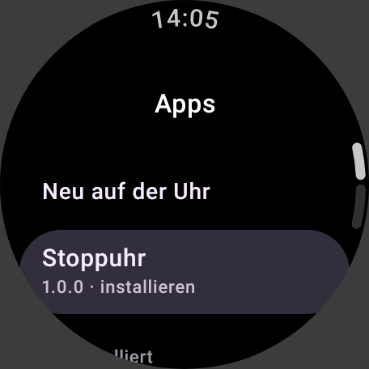 |

1. **Paket-Datei holen:** vom App-Chat, aus GitHub (Actions → *Build* → Artefakt `g2-apps`, enthält alle
   Pakete aus `packages/`) oder selbst bauen: `./gradlew :packages:youtube:g2app`.
2. **Auf die Uhr legen** (Uhr mit Android Studio verbunden, wie beim Installieren der Uhr-App): *View →
   Tool Windows → Device Explorer* → Uhr → `sdcard/Android/data/ch.madtreasures.g2watch/files/apps/` →
   Rechtsklick → *Upload*. Oder:
   ```sh
   adb push ch.madtreasures.youtube-1.1.0.g2app /sdcard/Android/data/ch.madtreasures.g2watch/files/apps/
   ```
3. **Installieren:** auf der Uhr Zahnrad halten → *Einstellungen → Apps installieren* → unter „Neu auf der
   Uhr“ die App antippen. Sie steht sofort im Starter der Brille.

Eine neuere Version installiert man genauso (die laufende alte endet). **Entfernen:** unter „Installiert“
zweimal antippen. Fertige Pakete: **YouTube**, **Browser**, **Fluency**, **Navi** und **Musik**, alle mit Symbol für den Starter (ein
Paket bringt sein Symbol als `assets/apps/<app-id>/icon.png` mit, [09 §2](docs/app-entwicklung/09_App-Pakete.md#2-das-paket)).
Pakete ab 0.8.0 (Schnittstelle 2) brauchen die Uhr-App 0.8.0 oder neuer, Pakete mit Schnittstelle 3 (Tastatur,
seit 0.9.0) die Uhr-App 0.9.0, Pakete mit Schnittstelle 4 (Apps auf dem Handy, seit 0.10.0) die Uhr-App 0.10.0,
Pakete mit Schnittstelle 5 (GPS, große Dateien, Hintergrundarbeit, seit 0.12.0) die Uhr-App 0.12.0, Pakete mit
Schnittstelle 6 (Musik der Uhr und eigener Ton, seit 0.13.0; jedes Paket, das ab jetzt gebaut wird) die Uhr-App
0.13.0; ältere Pakete laufen weiter.

## Apps auf dem Handy: „G2 Handy“ und Fluency

Seit 0.10.0 kann eine App auf der Brille mit einer **App auf dem gekoppelten Handy** sprechen und ihr das
**Mikrofon der Uhr** geben (Schnittstelle 4, [03 §13](docs/app-entwicklung/03_Uhr-Apps.md#13-apps-auf-dem-handy-v0100-schnittstelle-4)).
Den Weg auf dem Handy macht die kleine Handy-App **„G2 Handy“** (Modul [`phone/`](phone)). Google Play Services
stellt zwischen Uhr und Handy nur Nachrichten zwischen Apps mit derselben App-ID und demselben Schlüssel zu;
deshalb hat G2 Handy die App-ID der Uhr-App, und beide werden mit dem Schlüssel aus [`signing/`](signing/README.md)
gebaut, auf jedem Rechner und in GitHub Actions gleich.

Erste Nutzerin ist das Paket **Fluency** ([`packages/fluency`](packages/fluency/README.md)): Der Übersetzer
[Fluency](https://github.com/MADTreasures/playground) auf dem Handy hört über das Mikrofon der Uhr oder das des
Handys zu und übersetzt offline; die Brille zeigt die Übersetzung als rollenden Untertitel.

| Fluency: Start | Fluency: Live (Verbindung simuliert) |
|---|---|
| 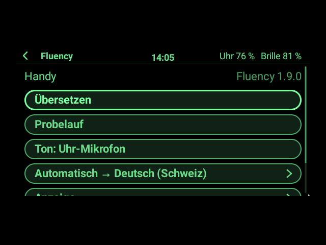 | 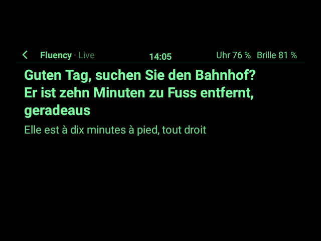 |

**Einmal einrichten:**

1. **Uhr-App ab 0.10.0 installieren** ([App auf die Uhr bringen](#app-auf-die-uhr-bringen)). Sie hat jetzt einen
   festen Schlüssel; eine ältere Uhr-App mit anderem Schlüssel vorher deinstallieren (Uhr verbunden:
   `adb uninstall ch.madtreasures.g2watch`, oder Android Studio fragt beim ▶ Run selbst). Dabei gehen ihre
   Einstellungen und die installierten App-Pakete verloren; die Pakete danach neu installieren
   ([Eigene Apps installieren](#eigene-apps-installieren)). Nur einmal: Spätere Versionen passen wieder darüber.
2. **G2 Handy aufs Handy**, mit dem die Uhr gekoppelt ist: die APK aus GitHub (Actions → *Build* → Artefakt
   `g2-handy-debug-apk`) aufs Handy kopieren und dort öffnen (Installation aus dieser Quelle erlauben), oder
   per ADB:
   ```sh
   ./gradlew -Pg2.phone=true :phone:assembleDebug   # → phone/build/outputs/apk/debug/phone-debug.apk
   adb -s <handy> install -r phone/build/outputs/apk/debug/phone-debug.apk
   ```
   Aus Android Studio: in `gradle.properties` die Zeile `g2.phone=true` ergänzen, *Sync Project with Gradle
   Files*, das Handy als Gerät wählen, **▶ Run**; danach die Zeile wieder entfernen, sonst fehlt die Uhr-App.
   G2 Handy **einmal öffnen**: Es fragt nach Mitteilungen (die dauernde Mitteilung „Bereit für die Uhr“ hält es
   wach) und zeigt, ob die Uhr erreichbar ist. „Für die Uhr bereit“ bleibt an, auch nach einem Neustart.
3. **Fluency 1.9.0** auf dem Handy, dort **Optionen → „Brille (G2 Watch)“** einschalten.
4. **Paket Fluency 1.1.0** auf die Uhr legen und installieren (Artefakt `g2-apps`). Beim ersten Start fragt die
   Brille nach „Verbindung zum Handy“ und „Mikrofon der Uhr“; beim ersten Einschalten des Uhr-Mikrofons fragt
   zusätzlich Android auf dem Bildschirm der Uhr.

Steht alles, zeigt die Startseite des Pakets „Handy: Fluency 1.9.0“; sonst „getrennt“ und einen Hinweis, woran
es liegt (etwa „Kein Handy mit G2 Handy erreichbar“ oder „In Fluency ist „Brille (G2 Watch)“ aus“).
**Übersetzen** startet Fluency mit dem Mikrofon der Uhr (oder, unter *Ton*, dem des Handys). Wie die Teile
zusammenhängen und was auf echter Hardware zu klären ist: [PLATTFORM.md](packages/fluency/PLATTFORM.md).
**Nicht auf Hardware erprobt.**

## Navigation offline: Navi

Seit 0.12.0 navigiert die Brille **ohne Netz** zu Fuß und mit dem Velo: Das Paket **Navi**
([`packages/navi`](packages/navi/README.md)) lädt die Karten einzelner Länder auf die Uhr, **jedes Land der
Welt**, große auch nach Regionen (OpenStreetMap-Daten von download.mapsforge.org, mit Erkennung neuerer Stände),
nimmt den Standort vom **GPS der Uhr** und zeigt Karte und Abbiegehinweise im Stil von Evens Navigation: unten
links der Hinweis, rechts eine kleine Karte, die sich mit der Fahrtrichtung dreht, Tippen zeigt die ganze Karte.
Ziel und Start sucht man auf der Uhr (Orte, Straßen, Haltestellen …); Route, Suche und Bilder rechnet die Uhr
selbst. Die Schweiz braucht 340 MB, Deutschland 3,2 GB, ganz Europa 26 GB – auf die 64 GB der Pixel Watch 5
passt viel, nur nicht die ganze Welt (rund 85 GB).

| Navigation | Karte mit Standort | Karten auf der Uhr |
|---|---|---|
| 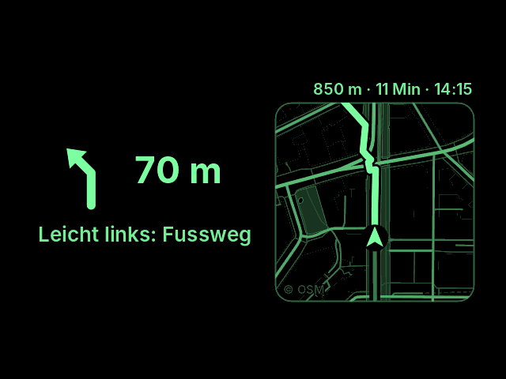 | 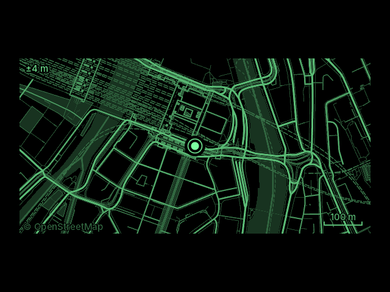 | 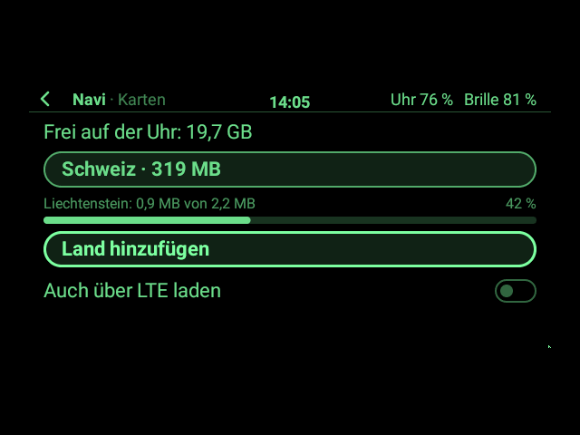 |

Installieren wie jedes Paket ([Eigene Apps installieren](#eigene-apps-installieren)); dann im Menü der App
*Karten → Land hinzufügen*, das Land über WLAN laden, Standort auf der Uhr erlauben und ein Ziel suchen. Die
**Demo-Fahrt** zeigt die Navigation im Sitzen. Gebaut und getestet mit der echten Karte der ganzen Schweiz,
**nicht auf Hardware erprobt**.

## Musik: Spotify und Radio auf der Brille

Seit 0.13.0 steuert die Brille die **Musik der Uhr**: Das Paket **Musik** ([`packages/musik`](packages/musik/README.md))
zeigt, was Spotify (oder ein anderer Player auf der Uhr) spielt – Titel, Interpret, Cover, Zeit – und bedient
ihn mit Gesten: **Tippen** = Play/Pause, **Wischen** = nächster oder voriger Titel, **lange drücken** = Lautstärke,
dann wischen. Dazu **Radio**: die 44 Schweizer Sender, die man über DAB+ hört (SRF, RTS, RSI, Swiss Pop/Jazz/
Classic, Energy, Radio 24 …), als Stream über WLAN oder LTE der Uhr – die Uhr hat keinen DAB-Empfänger –, mit
Favoriten, Wischen von Sender zu Sender und der Suche nach jedem Sender der Welt (radio-browser.info). Der Ton
kommt von der Uhr, über Kopfhörer oder ihren Lautsprecher; die Brille hat keinen.

| Spotify | Ein Sender | Senderliste |
|---|---|---|
| 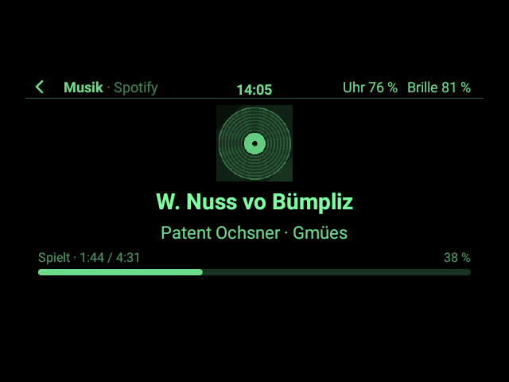 | 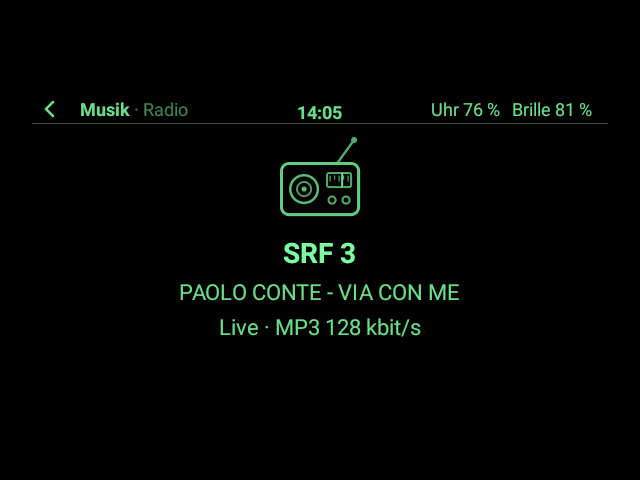 | 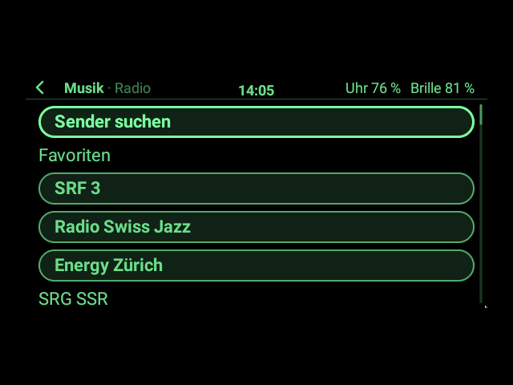 |

**Einmal einrichten:** Uhr-App ab 0.13.0 installieren, das Paket wie jedes andere
([Eigene Apps installieren](#eigene-apps-installieren)). Damit die App **Titel und Cover** sieht, braucht die Uhr-App
einmal den Zugriff auf die Mediensteuerung der Uhr; Wear OS hat dafür meist keinen Schalter, deshalb einmal am
Computer (Uhr verbunden wie beim Aufspielen):

```sh
adb shell cmd notification allow_listener ch.madtreasures.g2watch/ch.madtreasures.g2watch.apps.media.MediaAccessService
```

Ohne ihn gehen Play/Pause, Titel weiter und zurück, die Lautstärke und das ganze Radio trotzdem. Die Uhr-App liest
damit keine Benachrichtigungen. **Nicht auf Hardware erprobt.**

## YouTube auf der Brille

Die App **YouTube** (seit 0.5.0, seit 0.7.0 als App-Paket `ch.madtreasures.youtube-1.1.0.g2app`, zu
installieren wie in [Eigene Apps installieren](#eigene-apps-installieren)) läuft **ganz auf der Uhr**, ohne
Handy und ohne Rechner: Sie sucht auf
YouTube, lädt das Video über WLAN oder LTE, dekodiert es und rechnet jedes Bild in das Raster der Brille
um – Graustufen in Grün, wie bei „G2 Agent Cam“ im Even Hub, nur mit Videos. Wie das gebaut ist, steht in
[03 §10](docs/app-entwicklung/03_Uhr-Apps.md#10-video-auf-der-brille-v050).

| Start | Treffer (Suche per Tastatur/Sprache der Uhr) | Video |
|---|---|---|
| 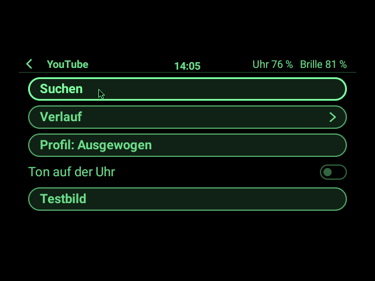 | 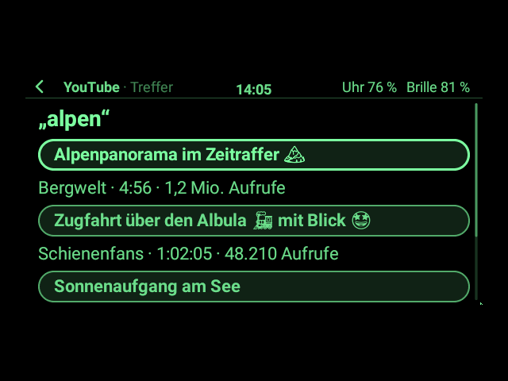 | 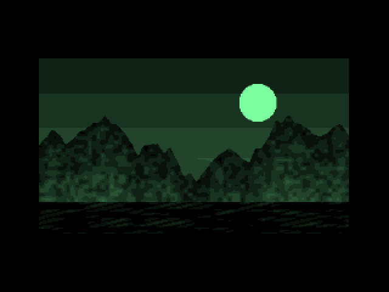 |
| **Pause** | **Testbild der Uhr** (ohne Internet) | **Raster fein (Stabil, Ausgewogen) / grob (Schnell)** |
| 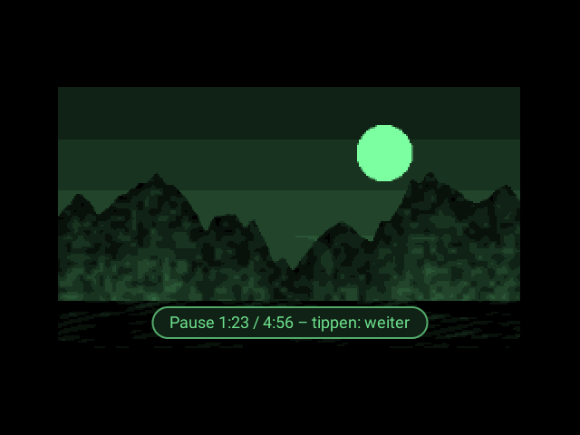 | 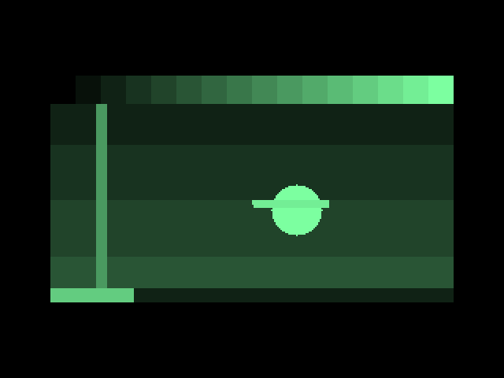 | 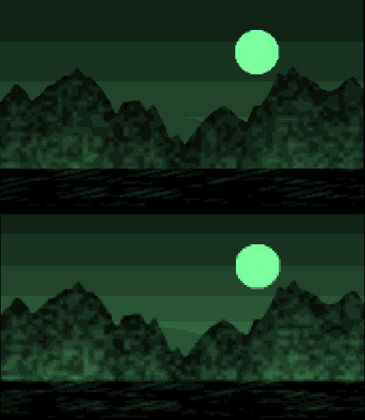 |

Die Videobilder oben sind ein erfundenes Landschafts-Video (keine echten YouTube-Inhalte im Repo), durch
dieselbe Umrechnung wie auf der Uhr. Das Video füllt die Brille ohne Rand (512 × 288 Pixel); was es gerade
tut (Titel, Pause, Laden, Ende), steht kurz als Hinweis darüber.

**Bedienen:**

- **Suchen** anklicken → auf der Uhr erscheint die Tastatur (mit Spracheingabe und den letzten Suchen als
  Vorschlag). Die Treffer zeigen Titel, Kanal, Länge und Aufrufe; der erste ist schon ausgewählt, ein Tipp
  am Bügel spielt ihn ab.
- **Im Video** (Vollbild ohne Rand, Gesten-Modus): **Tippen** = Pause/weiter, **Wischen** = 10 s
  zurück/vor, **Doppeltippen** = zurück zur Liste, **lange drücken** = nächstes Profil. Auf der Uhr gilt
  dasselbe (Wischen hoch/runter, nach links = Profil, nach rechts = zurück). Zu Beginn steht der Titel ein
  paar Sekunden im Bild, bei Pause die Zeit.
- **Tastatur** ([Tastatur und Maus](#tastatur-und-maus)) im Video wie auf youtube.com: Leertaste, K oder
  Play/Pause = Pause/weiter, J oder ← und L oder → = 10 s zurück/vor, P = Profil, M = Ton, / = neue Suche
  (das Video endet, sobald sie eingegeben ist). Die Maus: links = Pause/weiter, Rad = 10 s.
- **Profil** (Startseite oder App-Menü). Die Uhr macht höchstens so viele Bilder, wie das Profil sagt; wie
  viele davon ankommen, entscheidet die Bluetooth-Verbindung (etwa 41 KB/s). Ist sie mit einem Bild noch
  beschäftigt, ersetzt das nächste das wartende – es staut sich nichts, die Brille zeigt immer das neueste.

  | Profil | Bilder pro Sekunde, höchstens | Raster (Punkte) | Normale Szene: Bilder/s, Anteil der Verbindung | Viel Detail (Laub, Menge): Bilder/s |
  |---|---|---|---|---|
  | **Stabil** | 5 | 256 × 144 (2 × 2 Pixel) | 5, ≈ 11–37 % | ≈ 2 |
  | **Ausgewogen** (Standard) | 10 | 256 × 144 (2 × 2 Pixel) | 10, ≈ 19–68 % | ≈ 2 |
  | **Schnell** | 15 | 170 × 96 (3 × 3 Pixel) | 15, ≈ 23–69 % | ≈ 4 |

  Alle Profile mit 16 Graustufen. Die Werte hat `VideoBudgetTest` mit Faceclaws eigenem Weg zur
  Custom-Firmware ausgerechnet (erfundene Videos, Verbindung mit 41 KB/s angenommen), **nicht gemessen**.
  **Stabil** lässt der Verbindung bei normalen Szenen über die Hälfte frei, für den Fall, dass sie auf der
  echten Brille langsamer ist. Mitteltöne rechnet die Uhr dunkler, als sie im Video stehen: Die Brille gibt
  Licht fast linear ab, sonst wirkt das Bild vor dem durchsichtigen Hintergrund milchig. Auf der Brille ist
  das noch nicht verglichen.
- **Ton auf der Uhr** (Schalter): spielt den Ton über den Lautsprecher der Uhr oder daran gekoppelte
  Kopfhörer. Die Brille selbst hat keinen Lautsprecher.
- **Verlauf:** die letzten 20 Videos, bleiben auf der Uhr gespeichert. **Testbild:** ein eigenes
  Ein-Minuten-Video der Uhr (Graustufen-Treppe, Ball, Zeiger) – zeigt ohne Internet, wie flüssig die Bilder
  ankommen.
- Verdeckt eine andere App das Video oder ist die Brille weg, hält es an und läuft danach weiter.

**Gut zu wissen:**

- Für die Videos fragt die Uhr Wear OS nach **WLAN oder LTE** statt der Bluetooth-Verbindung übers Handy
  (die teilt sich den Funk mit der Brille). Klappt das nicht innerhalb von 8 s, geht es über das Netz, das da
  ist. Ist das Video zu Ende oder 20 s pausiert, gibt die Uhr WLAN/LTE wieder frei. Die Uhr lädt die
  kleinste Fassung mit etwa doppelt so vielen Zeilen wie das Raster, mindestens 240p: in Stabil und
  Ausgewogen meist 360p H.264, in Schnell 240p (144p ist für das feinere Raster zu verwaschen; es zählt das
  Profil beim Start des Videos, auch bei Live-Videos). Geschätzt
  150–250 MB pro Stunde, etwa dreimal so viel wie mit 144p; mit Ton etwa 20 MB mehr.
- **Akku:** Dekodieren, Funk und Bluetooth zur Brille kosten spürbar Akku der Uhr (465 mAh) – nicht gemessen.
- Die App wird dadurch rund **11 MB** größer (Debug-APK 41 statt 31 MB): NewPipeExtractor mit Rhino und
  Media3.
- YouTube-Zugriff über [NewPipeExtractor](https://github.com/TeamNewPipe/NewPipeExtractor) (GPL-3.0, wie der
  Faceclaw-Kern in dieser App) statt Googles App oder API. **YouTubes Nutzungsbedingungen untersagen den
  Abruf an YouTubes eigenen Apps und Schnittstellen vorbei**; die App ist für den privaten Gebrauch gedacht,
  auf eigenes Risiko. YouTube ändert seine Seiten öfter – dann hilft ein Update von NewPipeExtractor
  (Version in `gradle/libs.versions.toml`).
- Suche und Auflösen der Video-Adressen sind hier mit echtem Netz geprüft; **das Abspielen eines
  YouTube-Videos nicht** (YouTube bindet die Video-Adresse an die IP, und die Testumgebung ruft YouTube und
  die Videoserver über verschiedene Adressen auf). Auf der Uhr ist es dieselbe Adresse – das ist das Erste,
  was auf echter Hardware zu prüfen ist.

## Web-Browser auf der Brille

Die App **Browser** (seit 0.8.0, App-Paket `ch.madtreasures.browser-1.1.0.g2app`, zu installieren wie in
[Eigene Apps installieren](#eigene-apps-installieren)) zeigt normale Web-Seiten auf der Brille, ganz auf der
Uhr. Die Uhr-App lädt die Seite mit **GeckoView** (Mozillas Browser-Engine, die auch in Firefox steckt), zeichnet
sie unsichtbar in der Größe der App-Fläche und wandelt sie mit `web-raster` ins Brillenbild: Der Grund wird
durchsichtig, Fotos bleiben Bilder, **Text leuchtet immer in voller Helligkeit** (auf Fotos als dunkle
Schrift mit hellem Umriss). Wie das gebaut ist: [05 §10](docs/app-entwicklung/05_EvenHub-Apps.md#10-und-ein-richtiger-browser-auf-der-brille).

| Startseite | Eine Seite (der Zeiger tippt Links an) | Lesemodus |
|---|---|---|
| 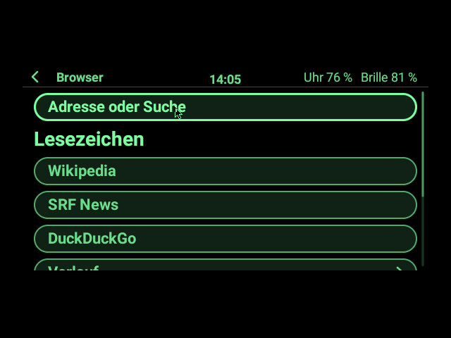 | 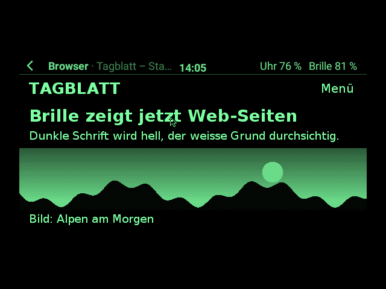 | 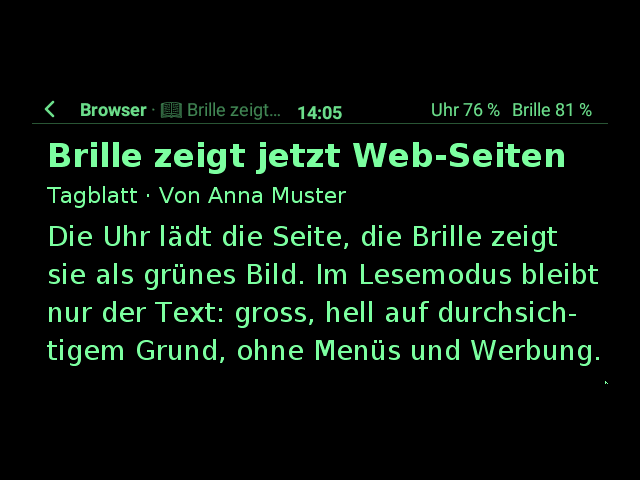 |

Die Seiten in den Bildern sind erfunden und mit Java2D gezeichnet (keine fremden Inhalte im Repo), dann durch
denselben Weg wie auf der Uhr: Layout-Bericht, Raster, App-Host, Desktop.

**Bedienen:**

- **Adresse oder Suche** → auf der Uhr erscheinen Tastatur und Spracheingabe (mit den letzten Eingaben als
  Vorschlag). Eine Adresse (`srf.ch`, gesprochen auch „srf punkt ch“) öffnet die Seite, alles andere sucht bei
  DuckDuckGo (Textfassung, ohne Cookie-Dialog).
- **Lesezeichen** stehen auf der Startseite (zum Ausprobieren: Wikipedia, SRF News, DuckDuckGo) und im
  App-Menü jeder Seite (Tippen-dann-Halten am Bügel oder Klick auf den App-Namen); dort auch *Lesezeichen
  setzen/entfernen*, *Neu laden*, *Vorwärts*, *Lesemodus an/aus*, *Adresse eingeben*.
- **Auf der Seite ist der Zeiger der Finger:** Doppeltippen auf der Uhr, oder Tippen am Bügel, während der
  Zeiger auf der Seite steht, tippt dort an (Link, Knopf, Eingabefeld). **Scrollen:** am Bügel wischen (¾
  Bildhöhe) oder den Zeiger oben/unten über den Rand schieben.
- **Eingabefelder:** Tippt man ein Feld an, fragt die Uhr nach dem Text (Tastatur oder Sprache); Enter wird
  gleich mitgeschickt, die Suche startet. Hat eine Seite ein Feld von sich aus ausgewählt, steht im App-Menü
  *Text eingeben*.
- **Zurück** (Doppeltippen am Bügel, „‹“ in der Kopfzeile) geht erst durch die besuchten Seiten zurück, dann
  zur Startseite. **Verlauf:** die letzten 20 Seiten.
- **Mit Tastatur** ([Tastatur und Maus](#tastatur-und-maus)): Getippt wird direkt ins Feld mit dem Cursor,
  ohne Frage auf der Uhr; Enter schickt. Ohne Feld scrollen Pfeile, Leertaste und Bild↑/↓, Tab springt von
  Link zu Link und Feld zu Feld, Enter folgt dem Link. Strg+L oder F6 = Adresse, Strg+R oder F5 = neu laden,
  Alt+→ = vorwärts, Strg+D = Lesezeichen setzen/entfernen, Rücktaste = vorige Seite. Mit der Maus: Klick
  tippt an, das Rad scrollt die Seite.
- **Lesemodus** (Standard: an): Artikel erscheinen als reiner Text, groß und hell auf durchsichtigem Grund,
  ohne Menüs und Werbung (Mozillas Readability, wie die Leseansicht von Firefox). In der Kopfzeile steht dann
  📖. Seiten, die kein Artikel sind, zeigt der Browser normal.
- **Schrift auf Bildern** (Startseite): Umriss (Standard), Leuchtschrift oder Platte – wie Text auf Fotos
  abgesetzt wird.

**Was die Uhr-App dafür mitbringt** (seit 0.8.0): GeckoView 157 nur für die 32-Bit-Architektur der Pixel
Watch 5 (`armeabi-v7a`). Die Uhr-App wird dadurch **≈ 106 MB größer** (Debug-APK 136,6 statt 30,7 MB,
gemessen): GeckoViews Bibliotheken und Daten ≈ 90 MB (komprimiert), dazu ≈ 16 MB Java-Code von GeckoView und
dem, was es mitbringt (u. a. Google Play Services FIDO für Passkeys, SnakeYAML), der in der APK unkomprimiert
liegt. Beim Installieren entpackt Android die Bibliotheken noch einmal: **≈ 137 MB** zusätzlich auf der Uhr.
Sie braucht zum Bauen die Android-Plattform **API 37.1** (siehe [App auf die Uhr bringen](#app-auf-die-uhr-bringen)).
Werbe- und Tracking-Blocker (Firefox' Standard-Schutz) und dunkles Design, wo Seiten eines haben, sind an;
Seiten bekommen keinen Standort, keine Kamera, kein Mikrofon und keine Mitteilungen; Downloads, Links in
andere Apps und Auswahllisten (`<select>`) gehen nicht.

**Nicht auf Hardware erprobt.** Geprüft ist alles ohne Uhr: Host, Browser-App und der Weg vom Seitenbild
zum Brillenbild mit Tests, das Inhalts-Skript in Chromium ([`bridge-check.js`](tools/page-preview/README.md)).
Ob GeckoView auf der Uhr startet und wie gut es dort läuft, zeigt erst die Uhr. **Von den Messwerten des
Gecko-Tests (M2), die noch fehlen, hängt ab:**

| Messwert (Gecko-Test) | Was davon abhängt |
|---|---|
| Kaltstart | wie lange die erste Seite nach dem Öffnen braucht (die Engine startet erst mit der ersten Seite und bleibt dann) |
| Speicher (alle Prozesse) | ob Wear OS die Uhr-App samt **Brillenverbindung** beendet, wenn der Speicher knapp wird – GeckoView läuft zum Teil im Prozess der Uhr-App |
| Akku pro Stunde | wie lange man mit offenem Browser lesen kann (Engine, Funk, zwei Aufnahmen je Bild, Bluetooth) |
| Timer bei Bildschirm aus | ob Seiten weiterarbeiten, wenn die Uhr dunkel ist (der Browser hält sie aktiv, solange er auf der Brille ist) |
| Abbrüche im Dauertest | ob Seiten vom System beendet werden („Wear OS hat die Seite beendet“) |
| „Seite rendern“ (Zeiten, Bilder) | wie schnell ein Brillenbild entsteht; ob die Aufnahme ohne Schrift und der Layout-Bericht auf der Uhr gelingen; ob die Grenzwerte von `web-raster` auf der echten Brille passen |

Ungeprüft ist außerdem, ob GeckoView ohne sichtbare Ansicht Tipp-Ereignisse annimmt (so machen es GeckoViews
eigene Tests) und ob Seiten mit strengen Regeln (CSP) die Stile des Lesemodus zulassen (die wichtigsten
setzt das Skript deshalb zusätzlich direkt am Element). Tasten einer Bluetooth-Tastatur gibt das Skript der
Seite weiter und tippt selbst ins Feld; ob GeckoViews eigener Tastenweg ohne Ansicht ginge, ist offen (er dient
nur Seiten ohne Skript, etwa Fehlerseiten).

### Web-Seiten fürs Brillenbild

Das Modul [`web-raster/`](web-raster) wandelt eine gezeichnete Web-Seite in das Bild der Brille, so wie die
Even-Apps „Photos“ und „G2 Agent Cam“ Inhalte zeigen: Der Grund der Seite wird durchsichtig (egal ob weiß
oder dunkel), Fotos bleiben Bilder, Logos und Symbole werden gegen den Grund um sie herum gerechnet, und
**Text wird immer in voller Helligkeit neu gezeichnet**. Steht Text auf einem Foto oder unruhigem Grund, oder
leuchtet um ihn etwas in einem mit Bildern **überladenen** Fenster, wird er **negativ, nur an der Schrift**:
dunkle Buchstaben mit einem schmalen hellen Umriss, das Bild bleibt rundherum sichtbar. Wählbar sind auch
„Leuchtschrift mit Rand“ und die helle Platte hinter der ganzen Zeile.

| Heller Artikel | Dunkle Seite | Text auf Foto (Umriss) | Überladen: Text auf Bildern negativ, daneben hell |
|---|---|---|---|
| 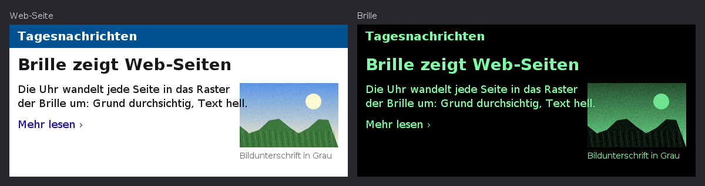 | 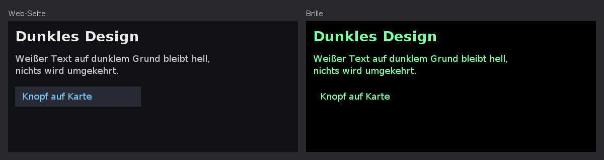 | 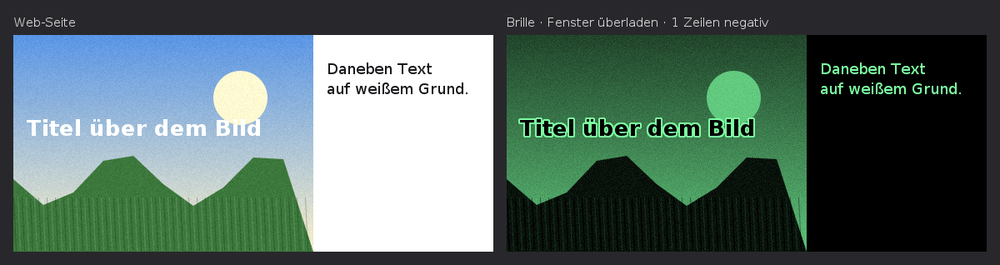 | 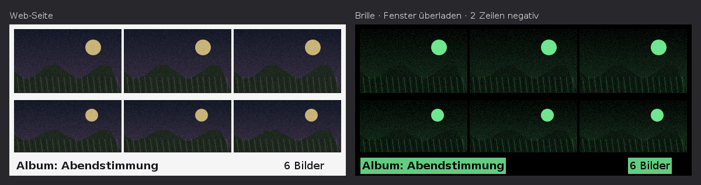 |

Links jeweils die Test-Seite, rechts das Brillenbild. Wie echte Seiten aussehen, zeigt die
[Seiten-Vorschau](tools/page-preview/README.md) (Chromium statt GeckoView). Die Regeln und Grenzwerte stehen in
[05 §10.1](docs/app-entwicklung/05_EvenHub-Apps.md#101-seiten-ins-brillen-raster-wandeln-web-raster-gebaut).

## Gecko-Test (M2) auf die Uhr bringen und messen

Wear OS hat keinen Browser-Kern. Ob Mozillas **GeckoView** auf der Uhr schnell, sparsam und stabil genug
ist, kann nur die echte Uhr zeigen. Dafür gibt es die eigene kleine App **„Gecko-Test“**
([`tools/gecko-probe/`](tools/gecko-probe), [05 §5.2](docs/app-entwicklung/05_EvenHub-Apps.md#52-die-test-apk-gecko-test)).
Sie ist getrennt von G2 Watch entstanden, als GeckoView noch nicht in der Uhr-App war, und bleibt das
Messwerkzeug: Sie misst Kaltstart, Speicher, Timer, Akku und den Bildweg ohne den Rest der Uhr-App. Seit 0.8.0
steckt dieselbe GeckoView-Version auch im Browser der Uhr-App; **was dort von den Werten abhängt**, steht in
[Web-Browser auf der Brille](#web-browser-auf-der-brille).

1. **Android Studio:** Der Gecko-Test ist ein eigenes Projekt, damit beim normalen Projekt nur G2 Watch
   auf die Uhr kommt: dieselbe ZIP, aber in `gradle.properties` die Zeile `g2.geckoTest=true` (der Hauptchat
   gibt sie dir fertig als `G2Watch-Gecko-Test-….zip`). Dieses Projekt enthält nur den Gecko-Test, nicht
   G2 Watch. In einen eigenen Ordner entpacken, öffnen, die Uhr wählen, **▶ Run**. Nichts weiter einstellen: Der Gecko-Test ist fest für die Pixel Watch 5 gebaut (32-Bit-Apps, `armeabi-v7a`; Android
   Studio meldet dort „Device supports armeabi-v7a, armeabi“) und installiert gleich die Mess-Fassung
   (Release). Das erste Mal lädt Gradle GeckoView (≈ 90 MB). GeckoView verlangt die Android-Plattform **API 37.1**; fehlt sie, bietet Android
   Studio die Installation an (sonst *Tools → SDK Manager → SDK Platforms*, *Show Package Details*, API 37.1
   ankreuzen). Die APK ist ≈ 120 MB groß; über WLAN dauert das Installieren ein paar Minuten.
   Ohne Android Studio: Artefakt `g2-gecko-test-apk` aus GitHub Actions laden und
   `adb install -r gecko-probe-release.apk`.
2. **Auf der Uhr** „Gecko-Test“ öffnen, die Mitteilungen erlauben, und die Tests der Reihe nach starten:
   **1 · Schnelltest** (≈ 1 min) → **2 · Timer-Test** (4 min; nach der Vibration das Handgelenk senken, bis
   es wieder vibriert) → **3 · Dauertest** (30 min Uhr normal tragen, nicht laden) → **4 · Seite rendern** →
   **5 · Wikipedia rendern** (braucht Internet). Den **Schnelltest als Erstes nach dem Öffnen** der App
   laufen lassen, sonst gibt es keinen Kaltstart-Wert.
3. Ganz nach unten scrollen, **Bericht** antippen (Knopf am unteren Rand) und am Rechner holen: in Android
   Studio *Device Explorer* → Uhr → `sdcard/Android/data/ch.madtreasures.g2watch.geckoprobe/files/` →
   Rechtsklick → *Save As*. Oder:
   ```sh
   adb pull /sdcard/Android/data/ch.madtreasures.g2watch.geckoprobe/files/ .
   ```
   Darin `g2-gecko-bericht.txt` (alle Werte mit ✓/~/✗ und einer Empfehlung) sowie `render-seite.png`,
   `render-ohne-schrift.png` und `render-brille.png`. Den Bericht in den nächsten Chat geben oder in
   [`quellen/E-m2-messwerte.md`](docs/app-entwicklung/quellen/E-m2-messwerte.md) eintragen.

## Wie die Uhr aufspielt – und was sie absichert

Der eigentliche Flasher ist **Faceclaws** `OtaFlashFlow` (ein Port von `g2flash.py`) samt Vorprüfung
`FlashPromptFlow` – dieselben Abläufe, mit denen Faceclaws Handy-App die Firmware aufspielt, hier
unverändert mitgeliefert. Die Uhr-App ([`FirmwareJob.kt`](app/src/main/java/ch/madtreasures/g2watch/firmware/FirmwareJob.kt))
legt die Reihenfolge und die Schranken drumherum:

| Schritt | Was passiert | Bricht ab, wenn … | Brille berührt? |
|---|---|---|---|
| 1 | Beide Bügel bekannt, Akku der Uhr | Bügel fehlt; Uhr < 50 % und nicht am Laden | nein |
| 2 | Original laden (Cache → `adb`-Import → Evens Server), Custom bauen, **SHA-256 beider Enden**, vollständige Image-Prüfung inkl. Speichergrenze | Download scheitert, Hash falsch, Image fehlerhaft | nein |
| 3 | Die Brillenverbindung der App wird sauber getrennt | – | nein |
| 4 | Versionen lesen (nur lesend) | Brille meldet nichts; **neuere** Original-Firmware als 2.3.0.24 (ungetesteter Downgrade) | nur lesen |
| 5 | Beide Bügel koppeln, **Frage auf der Brille**, Lautlos-Modus erkennen, Akku beider Gläser | „No“, keine Antwort, Lautlos-Modus, Glas < 50 % **oder unlesbar** | Frage |
| 6 | Allow-List **direkt vor dem ersten Byte** erneut prüfen, Verbindung „scharf“ schalten, links → rechts übertragen | Fehler eines Glases → Stopp, **nie** automatisch von vorn | ja |
| 7 | Nach dem Neustart **jedes Glas einzeln** fragen | meldet rot, wenn nicht beide die neue Firmware zeigen | nur lesen |

Zusätzlich sitzt vor dem Update-Kanal ein Wächter
([`GuardedStockLink.kt`](app/src/main/java/ch/madtreasures/g2watch/firmware/GuardedStockLink.kt)): Er lässt
Firmware-Bytes nur durch, wenn Schritt 6 ihn scharf geschaltet hat, **und** nur bei einer
Bluetooth-MTU ≥ 243 (sonst passen die 240-Byte-Rahmen nicht; Faceclaw prüft das selbst nicht) – eine
zu schmale Verbindung wird schon beim Aufbau getrennt, sodass Faceclaws Wiederverbindung greift; bleibt
sie zu schmal, nennt die Meldung die ausgehandelte MTU, und nichts wurde geschrieben. Die
2 s zum Bestätigen misst die Uhr mit der Uhrzeit, nicht mit der Animation (sonst würde „Animationen
aus“ in den Entwickleroptionen aus dem Halten ein Tippen machen). Ein
Test ([`FlashingBoundaryTest`](app/src/test/java/ch/madtreasures/g2watch/firmware/FlashingBoundaryTest.kt))
schlägt fehl, sobald Code einen zweiten Weg zum Aufspielen öffnet. Während der Übertragung hält ein
Vordergrund-Dienst mit Wake-Lock die Uhr wach.

Jede Fehlermeldung sagt, in welchem Zustand die Brille ist: „Nichts wurde an der Brille verändert“,
„Das linke Glas hat die neue Firmware, das rechte nicht“ oder „Welche Firmware die Brille jetzt
startet, ist unklar …“ mit dem Weg zurück – auch wenn Android die App mitten in der Übertragung
beendet hat. Details: [`docs/FIRMWARE.md`](docs/FIRMWARE.md).

## App auf die Uhr bringen

**Ohne eigene Entwicklungsumgebung:** Jeder Push baut die App auf GitHub (Actions → *Build* →
Artefakt `g2watch-debug-apk`). Auf der Uhr *Entwickleroptionen → ADB-Debugging* und *Debugging über
WLAN* einschalten, dann am Rechner:

```sh
adb pair <ip>:<pairing-port>        # Code steht auf der Uhr
adb connect <ip>:<port>
adb install -r app-debug.apk
```

**Mit Android Studio** (Quail 4 | 2026.1.4 oder neuer; ältere Versionen kennen das Android-Gradle-Plugin 9.4
dieses Projekts noch nicht):

1. Projektordner öffnen (*File → Open*). Beim ersten Öffnen lädt Gradle alle Abhängigkeiten (seit 0.8.0 auch
   GeckoView, ≈ 90 MB); fehlen die Android-Plattformen API 37 und **37.1** (GeckoView verlangt 37.1), bietet
   Android Studio die Installation an (sonst *Tools → SDK Manager → SDK Platforms*, *Show Package Details*).
2. Uhr koppeln: Auf der Uhr die Entwickleroptionen freischalten (*Einstellungen → System → Info →
   Versionen*, 7× auf *Build-Nummer* tippen), dort *ADB-Debugging* und *Debugging über WLAN* einschalten.
   Uhr und Rechner im selben WLAN. In Android Studio in der Geräteauswahl *Pair Devices Using Wi-Fi →
   Pair using pairing code*; den Code zeigt die Uhr unter *Debugging über WLAN → Neues Gerät koppeln*.
3. Oben die Uhr als Gerät wählen, **▶ Run** (das Projekt enthält nur die Uhr-App, es gibt nichts anderes auszuwählen; G2 Handy fürs Handy nur auf Wunsch, siehe [Apps auf dem Handy](#apps-auf-dem-handy-g2-handy-und-fluency)): Android Studio baut die App,
   installiert sie auf der Uhr und startet sie. Seit 0.8.0 ist die APK ≈ 137 MB groß (GeckoView); über WLAN
   dauert das Installieren ein paar Minuten. Die APK läuft nur auf Uhren mit `armeabi-v7a` (Pixel Watch 5);
   für eine andere Uhr `adb shell getprop ro.product.cpu.abilist` prüfen und `abiFilters` sowie das
   GeckoView-Artefakt in `app/build.gradle.kts` anpassen.

**Selbst bauen auf der Kommandozeile** (JDK 17 oder neuer, Android SDK mit den Plattformen 37 und 37.1):

```sh
./gradlew :app:assembleDebug            # → app/build/outputs/apk/debug/app-debug.apk
./gradlew -Pg2.geckoTest=true :gecko-probe:assembleRelease  # Gecko-Test → tools/gecko-probe/build/outputs/apk/release/
./gradlew -Pg2.phone=true :phone:assembleDebug              # G2 Handy → phone/build/outputs/apk/debug/phone-debug.apk
./gradlew g2appPackages                 # alle App-Pakete → build/g2app/
```

In Claude Code im Web richtet [.claude/hooks/session-start.sh](.claude/hooks/session-start.sh) das bei
jedem Chat-Start selbst ein: Android SDK, und für Maven Central einen lokalen Zwischenspeicher, der die
Absagen „429 Too Many Requests“ der geteilten Cloud-Rechner abfängt.

**Uhr ohne Internet:** Evens Image selbst laden und auf die Uhr legen; die App nimmt jede `.bin`-Datei
mit dem richtigen SHA-256 aus diesem Ordner:

```sh
curl -o g2_2.3.0.24.bin https://cdn.evenreal.co/firmware/1dbdf37b03a1169c384945e94d671371.bin
adb push g2_2.3.0.24.bin /sdcard/Android/data/ch.madtreasures.g2watch/files/firmware/
```

Vorausgesetzt ist Wear OS 4 (API 33) oder neuer. Ausgelegt ist die App auf die **Pixel Watch 5
(45 mm, LTE)** mit Wear OS 7 (Android 17, API 37, das Ziel-SDK der App); die Bilder in
[`docs/bilder`](docs/bilder) zeigen ihren runden 456-px-Bildschirm. Mit LTE lädt die Uhr Evens Firmware
(4,5 MB) auch ohne Handy und WLAN, und am Handy darf Bluetooth für das Aufspielen aus sein, ohne dass
die Uhr offline ist.

## Projektaufbau

| Modul | Inhalt |
|---|---|
| [`app/`](app) | Wear-OS-App: Uhr-Oberfläche, Maus, Einstellungen (aus dem Uhr-Paket), das Firmware-Paket `ch.madtreasures.g2watch.firmware`, der App-Host `ch.madtreasures.g2watch.apps` mit Starter, der Video-Wiedergabe `apps/video`, der Browser-Engine `apps/web` (GeckoView, Erweiterung in `assets/webbridge/`), der Installation von App-Paketen `apps/packages`, Bluetooth-Tastatur und -Maus `input`, den Verbindungen zu Apps auf dem Handy samt Mikrofon der Uhr `apps/phone`, dem GPS `apps/location` und den Ordnern und Downloads der Apps `apps/files` |
| [`app-api/`](app-api) | Die Schnittstelle der Apps (`G2App`, `AppContext`, Ereignisse, Seiten), reines Kotlin; App-Pakete werden dagegen gebaut ([09](docs/app-entwicklung/09_App-Pakete.md)) |
| [`packages/`](packages) | Ein Ordner je App-Paket, zurzeit [`youtube`](packages/youtube), [`browser`](packages/browser), [`fluency`](packages/fluency) und [`navi`](packages/navi). `./gradlew :packages:<name>:g2app` baut die `.g2app`-Datei |
| [`phone/`](phone) | Handy-App „G2 Handy“: vermittelt zwischen Uhr-Apps und Apps auf dem Handy (Wear-OS-Datenschicht ⇄ Android-IPC). Hat die App-ID der Uhr-App, wird deshalb nur mit `-Pg2.phone=true` gebaut |
| [`phone-link/`](phone-link) | Reines Kotlin: was Uhr-App und G2 Handy einander über die Datenschicht schicken (Pfade, Inhalte); beide benutzen es |
| [`signing/`](signing/README.md) | Der gemeinsame Debug-Schlüssel von Uhr-App und G2 Handy |
| [`firmware-image/`](firmware-image) | Reines Kotlin ohne Android: EVENOTA-Prüfung mit Speichergrenze, Patch-Set von g2flash, Allow-List. Auf dem PC testbar |
| [`faceclaw-core/`](faceclaw-core), [`faceclaw-android/`](faceclaw-android) | Faceclaw **0.8.0**, unverändert übernommen ([Herkunft](faceclaw-core/UPSTREAM.md), [`scripts/sync-faceclaw.sh`](scripts/sync-faceclaw.sh)) |
| [`web-raster/`](web-raster) | Reines Kotlin ohne Android: gezeichnete Web-Seite → Brillenbild mit lesbarem, bei Bedarf negativem Text; dazu `LayoutParser` und das Layout-Skript `src/main/js/page-layout.js`, das Browser und Gecko-Test in der Seite ausführen |
| [`tools/gecko-probe/`](tools/gecko-probe) | Test-APK „Gecko-Test“ (M2): misst GeckoView auf der Uhr; eigene App, nicht Teil von G2 Watch |
| [`tools/page-preview/`](tools/page-preview/README.md) | Seiten-Vorschau: echte Web-Seiten in Chromium im Brillenfenster öffnen und daneben das Brillenbild zeigen (zum Prüfen von `web-raster`); `bridge-check.js` prüft das Inhalts-Skript des Browsers |
| [`tools/cfw_bauen.py`](tools/cfw_bauen.py) | Baut und prüft Faceclaw/35 auf dem PC (Python, ohne Flashen) |
| [`tools/app_symbole.py`](tools/app_symbole.py) | Zeichnet die Symbole von YouTube und Browser für den Starter (Python mit Pillow) |
| [`designer/`](designer), [`designs/`](designs) | G2 Baukasten: Brillen-Seiten aus Bausteinen zusammenstellen (Web-App), und ein Beispiel |
| [`docs/app-entwicklung/`](docs/app-entwicklung/00_LIES_MICH.md) | **Spezifikation für Apps**: Uhr-Apps, Even-Hub-Apps auf der Uhr (GeckoView) oder dem Handy, Rechner-Apps, Umsetzungsplan und Texte für neue Chats |
| [`docs/`](docs) | [Firmware-Ablauf](docs/FIRMWARE.md), [Recherche mit Risiken](docs/RECHERCHE_FIRMWARE.md), [Übergabe-Paket Custom-Firmware](docs/firmware-uebergabe/00_LIES_MICH.md), [Uhr-Paket](docs/uhr-paket/LIESMICH.md), [Bilder](docs/bilder) |

## Testen

```sh
./gradlew :firmware-image:test :faceclaw-core:testAndroidHostTest :web-raster:test :app-api:test :phone-link:test :app:testDebugUnitTest
./gradlew -Pg2.phone=true :phone:testDebugUnitTest
./gradlew -Pg2.geckoTest=true :gecko-probe:testDebugUnitTest
```

Stand dieses Commits: 15 + 184 + 32 + 8 + 6 + 720 Tests grün, dazu 22 in G2 Handy und 25 im Gecko-Test (Bild-Tests werden ohne `-PsnapshotDir` übersprungen,
die Tests mit Evens echtem Image ohne `G2_STOCK_IMAGE`, der Vorschau-Test des Gecko-Tests ohne `PREVIEW_DIR`),
Lint ohne Fehler. Die wichtigsten:

- **`FirmwareJobTest`** – der ganze Ablauf mit Faceclaws echten Abläufen gegen eine simulierte Brille:
  Aufspielen beider Ziele, jedes Abbruchkriterium (Ablehnen, Lautlos, Akku, MTU, neuere Firmware,
  fremdes Image, Download-Fehler) schreibt **kein** Byte in den Update-Kanal, Fehler während der
  Übertragung melden den richtigen Zustand.
- **Mit Evens echtem Image** (nicht im Repo, einmal laden):
  ```sh
  G2_STOCK_IMAGE=/pfad/zu/g2_2.3.0.24.bin ./gradlew :firmware-image:test :app:testDebugUnitTest
  ```
  `RealImageTest` baut Faceclaw/35 bitgenau nach; `RealImageTransferTest` schickt das komplette echte
  Image (≈ 1.130 Blöcke pro Glas) durch Faceclaws Flasher an die simulierte Brille und vergleicht, was
  ankommt.
- **`DesktopControllerTest`** – Desktop und Zeiger in einer Fläche, eine Zeigerbewegung schickt nur den
  Block darum, und nach zufälligen Folgen von Ereignissen zeigt die Brille genau Desktop plus Zeiger;
  **Bildtiefe** bei jeder Verbindung und sofort bei einer Änderung. Mit Faceclaws echtem
  Compositor: die Tiefe kommt auch mit Zeiger an, und jedes Glas zeigt das ganze Bild um die halbe Tiefe
  verschoben, ohne dass etwas über den Rand fällt; nichts leuchtet außerhalb von x = 32 bis 607.
  **`DesktopTextFitTest`** – mit Androids Schrift passt jeder Text in die Kopfzeile, mit und ohne App.
- **`AppHostTest`** – der App-Host mit Test-Apps, simuliertem Desktop und virtueller Zeit: `start` vor
  `visible`, der Starter als Hauptmenü vom ersten Bild an (Zurück bleibt dort, nach einem Absturz holt ihn ein
  Tippen zurück), Zurück auf der ersten Seite schließt, Knopf-Ziele und `@back`, Schalter und Häkchen sofort, höchstens
  alle 200 ms zeichnen, Timer ruhen verdeckt ohne `background`, 2-s- und 10-s-Regel, 50/500-ms-Regel,
  Absturz einer App, Berechtigungsfrage, App-Menü mit „Apps“ und Starter (Raster in Lesereihenfolge für Bügel
  und Zeiger, Symbole einmal je App-Version gelesen, Punkt für laufende Apps), Fokus per Bügel, Zeiger,
  Gesten-Modus, abgelehnte Befehle im Protokoll, interne Sitzungen (Anschlüsse für Even-Hub-Apps).
- **`AppHostWebTest`** – Web-Seiten im Bild-Baustein: Öffnen in Größe des Bausteins, Bilder, Zustände,
  Adressen und Berechtigung, Klicks (Uhr und Bügel) und Scrollen (Bügel, Zeiger über den Rand) als Ereignisse,
  Zurück erst durch den Verlauf der Seite, Ruhen beim Verdecken und ohne Brille, Aktionen und Grenzen, Fehler.
  **`CapturePlanTest`** (wann ein Bild entsteht), **`WebBridgeTest`** (Nachrichten an das Inhalts-Skript, Dateien
  der Erweiterung), **`WebPictureTest`** (Seite → Brillenbild, Fehlerseite), **`BrowserAppTest`** (Adresse,
  Suche, Klicks, Felder, Lesezeichen, Verlauf, Lesemodus, Hinweise). Das Inhalts-Skript selbst prüft
  `node tools/page-preview/bridge-check.js` in Chromium (nicht in der CI).
- **`AppHostVideoTest`** – Texteingabe (Antwort, Abbruch, ersetzte Frage, App endet), Videos (Bilder im
  Bild-Baustein, bis 15 pro Sekunde statt 5, Zustände, Pause/Weiter/Springen/Profil/Stopp, Berechtigung,
  Pause beim Verdecken und ohne Brille), Eingabeart pro Seite, Video-Suche. **`YouTubeAppTest`** – Suche,
  Treffer, Gesten im Video, Hinweise über dem Bild, Profile, Ton, Verlauf. **`VideoBudgetTest`** – was ein Video mit Faceclaws Weg zur Custom-Firmware über
  Bluetooth kostet und wie viele Bilder pro Sekunde durchkommen; **`FrameConverterTest`**,
  **`FrameBeatTest`**, **`StreamChooserTest`**, **`TrackRulesTest`**, **`TestPatternPlayerTest`**.
- **Tastatur und Maus:** **`HardwareInputTest`** (Tastennamen, Belegungen Schweiz, Deutschland und USA,
  Akzent-Tasten, Feststelltaste, Maus-Tasten, Rad), **`HardwareEventsTest`** (Androids Tasten- und
  Mausereignisse, mit und ohne festgehaltenen Mauszeiger; Touchpad, Krone und Knöpfe der Uhr bleiben bei der
  Uhr), **`MouseCaptureTest`** (Mauszeiger nur mit Maus festgehalten, nach dem Fokus wieder),
  **`MouseBackGuardTest`** (Androids Zurück der Maus-Taste abgefangen, die Zurück-Geste der Uhr nicht),
  **`AppHostKeysTest`** (Fokus, Enter, zurück, App-Menü, Scrollen, gehaltene Tasten, Tasten nur nach Abo,
  Gesten-Seiten, Desktop, Starter, Fragen auf der Brille getippt).
- **`InputRouterTest`** (jede Zeile der Gesten-Tabelle, Ring-Doppel, Tastatur und Maus), **`AppJsonTest`**, **`PageStateTest`**,
  **`BaukastenProjectTest`**, **`AppsBoundaryTest`** (Apps berühren weder Firmware noch Bluetooth, App-Pakete
  nur die Schnittstelle).
- **App-Pakete:** **`InstalledPackagesTest`** installiert die Dateien, die `:packages:<name>:g2app` wirklich
  baut, in einen echten App-Host und startet sie (nur den DEX-Schritt ersetzt die JVM);
  **`PackageArchiveTest`**, **`PackageStoreTest`** (Prüfen, Installieren, Aktualisieren, Entfernen, Ordner
  für neue Apps, Symbole), **`AppsScreenTest`**, in `app-api` **`PackageManifestTest`**; die Tests eines Pakets liegen in
  `packages/<name>/src/test` und laufen mit `:app:testDebugUnitTest`.
- **Apps auf dem Handy:** **`AppHostPhoneTest`** (Berechtigungen, Grenzen, Mikrofon nur sichtbar, Ende mit der
  App), **`PhoneLinksTest`** (die Uhr-Seite mit simulierter Datenschicht, Mikrofon und Zeit: Öffnen, Ablehnen,
  Zeitlimit, Lebenszeichen, Übernahme, Ton-Kanal), **`PhoneLinkWireTest`**, in G2 Handy **`RelayTest`** und
  **`MessengerPartnersTest`** (Robolectric mit simuliertem Partner-Dienst, Ton durch eine echte Pipe).
- **GPS, Dateien, Hintergrundarbeit:** **`AppHostLocationTest`** (Abo, Takt, nur sichtbar, Hinweise),
  **`AppHostFilesTest`** (Ordner, Downloads, Berechtigung, Abbrechen, Ende mit der App, Hintergrundarbeit mit
  `tag`), **`HttpDownloaderTest`** (Weiterladen, Platz, Fehler); im Paket Navi **`NaviAppTest`**,
  **`NaviHostTest`** und mit `-PnaviData=<Ordner mit switzerland.map>` Tests auf der ganzen Schweiz samt
  Speicherprüfung in JVMs mit 64 MB (**`HeapTest`**).
- Bilder neu erzeugen (Uhr, Zeiger, Apps samt Starter, YouTube und Browser, Web-Raster): `./gradlew :app:testDebugUnitTest :web-raster:test --tests '*SnapshotTest*' -PsnapshotDir=$PWD/docs/bilder`
- **`GlassesRasterizerTest`** (web-raster) – Grund, Bilder, lesbarer und negativer Text; **`LayoutParserTest`** –
  der Layout-Bericht von `page-layout.js`; die Tests des Gecko-Tests (`tools/gecko-probe`) prüfen Brücke,
  Auswertung und Bildschirm ohne Uhr.
