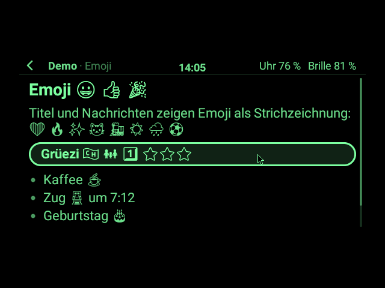

# 03 – Uhr-Apps (Kotlin, auf der Pixel Watch)

Uhr-Apps sind kleine Kotlin-Klassen. Seit v0.6.0 kommt jede eigene App als **App-Paket** (`.g2app`) auf
die Uhr und wird dort installiert, ohne die Uhr-App neu zu bauen ([09](09_App-Pakete.md)); seit v0.7.0
auch YouTube, fest eingebaut ist keine App mehr. Uhr-Apps laufen auch ohne Rechner und ohne Netz. Für alles
Rechenintensive: [Rechner-Apps](04_Rechner-Apps_und_Protokoll.md).

**Stand:** Der App-Host ist gebaut (M1, v0.4.0, aus Pull Request #2; Pull Request #1 enthält einen zweiten,
der nicht zusätzlich übernommen wird), dazu seit v0.5.0 Texteingabe auf der Uhr und Video auf der Brille mit
der App YouTube (§10), seit v0.5.2 Emoji in allen Texten (§11), seit v0.8.0 Web-Seiten in Bild-Bausteinen mit
der App Browser (§12), seit v0.9.0 Bluetooth-Tastatur und -Maus (§5.4); nichts davon ist auf Hardware erprobt.
Dieses Kapitel beschreibt erst, was eine App-Entwicklerin schreibt (§1–§4), dann die Plattform (§5–§8). Was
bei der Umsetzung dazukam oder anders wurde als ursprünglich geplant, steht in §9 bis §12.

## 1. Eine Uhr-App schreiben

Ein kleines Beispiel zum Lesen, eine Stoppuhr (sie liegt nicht im Repo; die echte Vorlage ist
[`packages/youtube`](../../packages/youtube)):

```kotlin
package ch.madtreasures.stoppuhr

import ch.madtreasures.g2watch.apps.*

/** Start/stop stopwatch; ticks only while visible to keep the link quiet. */
class StopwatchApp(private val clock: () -> Long = System::currentTimeMillis) : G2App {

    override val manifest = AppManifest(
        id = "ch.madtreasures.stoppuhr",
        name = "Stoppuhr",
        version = "1.0.0",
    )

    private var startedAt: Long? = null
    private var elapsed = 0L

    override fun onEvent(event: AppEvent, ui: AppContext) {
        when (event) {
            AppEvent.Start -> {
                ui.definePages(listOf(page()))
                ui.show("p_main")
            }
            is AppEvent.Click -> when (event.block) {
                "startstop" -> toggle(ui)
                "reset" -> { startedAt = null; elapsed = 0; ui.cancelTimer("tick"); render(ui) }
            }
            is AppEvent.Timer -> render(ui)
            AppEvent.Hidden -> ui.cancelTimer("tick")
            AppEvent.Visible -> if (startedAt != null) ui.timer("tick", 500, repeat = true)
            else -> Unit
        }
    }

    private fun toggle(ui: AppContext) {
        val since = startedAt
        if (since == null) {
            startedAt = clock()
            ui.timer("tick", 500, repeat = true)
        } else {
            elapsed += clock() - since
            startedAt = null
            ui.cancelTimer("tick")
        }
        render(ui)
    }

    private fun render(ui: AppContext) {
        val total = elapsed + (startedAt?.let { clock() - it } ?: 0)
        ui.patch("p_main") {
            text("zeit", "%d:%02d,%d".format(total / 60_000, total / 1000 % 60, total / 100 % 10))
            text("startstop", if (startedAt == null) "Start" else "Stopp")
        }
    }

    private fun page() = Page(
        id = "p_main", name = "Stoppuhr",
        blocks = listOf(
            Block.Heading(id = "zeit", text = "0:00,0", size = HeadingSize.GROSS, align = Align.CENTER),
            Block.Button(id = "startstop", text = "Start"),
            Block.Button(id = "reset", text = "Zurücksetzen"),
        ),
    )
}
```

Die App ist ein eigener Ordner `packages/<name>/` mit dem Code in `src/main/kotlin/`; daraus baut
`./gradlew :packages:<name>:g2app` die Paket-Datei, die auf der Uhr installiert wird ([09 §3–§4](09_App-Pakete.md)).
Im Starter steht eine App, sobald ihr Paket installiert ist. Ohne
Apps zeigt der Starter „Noch keine Apps“.

Symbol im Starter: ein PNG nach `packages/<name>/src/main/assets/apps/<app-id>/icon.png` legen, quadratisch,
64 × 64 empfohlen (16 bis 256 px, höchstens 64 KB), Graustufen auf Schwarz oder transparent. Gut sieht eine
ruhige Strichzeichnung aus: Linien 2–3 px, Helligkeit der Stufen 10–15 (Grauwert Stufe × 16), keine großen
hellen Flächen. Der Bau-Schritt findet die Datei selbst, prüft sie und trägt sie in `g2app.json` ein
([09 §2](09_App-Pakete.md#2-das-paket)); am Manifest der App ändert sich nichts. Ohne Symbol zeigt der Starter
die Anfangsbuchstaben des Namens in einem Rahmen. Die Symbole von YouTube und Browser zeichnet
[`tools/app_symbole.py`](../../tools/app_symbole.py) (Python mit Pillow); es taugt als Vorlage.

Seiten aus dem Baukasten statt aus Code: den Export nach `packages/<name>/src/main/assets/apps/<app-id>/ui.json`
legen und im Manifest `ui = "apps/<app-id>/ui.json"` setzen. Der Host lädt die Datei aus dem Paket vor
`Start`; die App ruft dann nur noch `show(...)` oder `patch(...)` auf.

Fest in die Uhr-App (`apps/AppRegistry.kt`, `builtInApps`) kämen nur Apps, die zur Plattform gehören;
die Liste ist leer. Neue Apps nie dort eintragen.

## 2. Die Schnittstelle

Alle Typen, die eine App braucht, liegen direkt im Paket `ch.madtreasures.g2watch.apps`
(`G2App`, `AppContext`, `AppManifest`, `AppEvent`, `Page`, `Block`, `PatchBuilder`, …), seit v0.6.0 im
eigenen Modul [`app-api/`](../../app-api), gegen das die App-Pakete gebaut werden. Die Unterpakete
`host/`, `render/`, `launcher/`, `packages/` der Uhr-App sind intern. Die Typen entsprechen den JSON-Formen in
[02 §4 und §6](02_App-Modell.md#4-oberfläche-seiten-und-bausteine). Für JSON gibt es eigene Serializer
(kotlinx.serialization, `JsonContentPolymorphicSerializer`, der nach `kind` und bei Sensoren nach `sensor`
unterscheidet), weil mehrere Kotlin-Klassen auf `kind: "sensor"` abgebildet werden.

```kotlin
interface G2App {
    val manifest: AppManifest
    /** Called on the app thread, never concurrently. Must return within 50 ms. */
    fun onEvent(event: AppEvent, ui: AppContext)
}

data class AppManifest(
    val id: String,
    val name: String,
    val version: String,
    val input: InputMode = InputMode.POINTER,
    val permissions: Set<Permission> = emptySet(),
    val ui: String? = null,                                // asset path of a Baukasten export
    val description: String = "",
)

interface AppContext {
    fun definePages(pages: List<Page>)
    fun definePages(project: BaukastenProject)
    fun show(pageId: String)
    fun replace(pageId: String)
    fun patch(pageId: String, changes: PatchBuilder.() -> Unit)
    fun setBlocks(pageId: String, blocks: List<Block>)
    fun toast(text: String, ms: Int = 2000)
    fun vibrate(pattern: Vibration = Vibration.TICK)
    fun menu(items: List<MenuItem>)                        // MenuItem(id, text); own entries in the app menu, ≤ 10
    fun buzz(notes: List<BuzzNote>)                        // BuzzNote(freqHz, dutyPercent, ms), ≤ 48; Permission.BUZZER
    fun timer(tag: String, ms: Long, repeat: Boolean = false)
    fun cancelTimer(tag: String)
    fun subscribe(sensor: Sensor, rate: Int = 0)           // needs the sensor's permission; 0 = default rate
    fun unsubscribe(sensor: Sensor)
    fun audio(on: Boolean)                                 // needs Permission.MIC
    fun fetch(request: HttpRequest, onResult: (HttpResult) -> Unit)  // needs Permission.NETWORK
    fun askText(tag: String, prompt: String, suggestions: List<String> = emptyList())  // v0.5.0: keyboard/voice on the watch → AppEvent.TextInput
    fun video(block: String, action: VideoAction)          // v0.5.0: Play(src, profile, sound, startMs), Pause, Resume, Seek, Profile, Stop → AppEvent.Video (§10)
    fun videoSearch(query: String, onResult: (VideoSearchResult) -> Unit)  // v0.5.0: YouTube search; needs Permission.NETWORK
    fun web(block: String, action: WebAction)              // v0.8.0 (interface 2): Open(url, reader), Back, Forward, Reload, Scroll, Tap, Type, Reader, Contrast, Stop → AppEvent.Web (§12); v0.9.0 (interface 3): Key, Insert
    val keyboard: Boolean                                  // v0.9.0 (interface 3): a Bluetooth keyboard is connected (§5.4)
    fun phone(action: PhoneAction)                         // v0.10.0 (interface 4): Connect(partner), Send(text), Microphone(on), Disconnect → AppEvent.Phone (§13); Permission.PHONE, the microphone also WATCH_MIC
    val storage: AppStorage                                // get(key): JsonElement?, set(key, JsonElement); ≤ 256 KiB per app
    fun log(message: String)                               // goes to Settings → Protokoll
    fun close()
}

sealed interface AppEvent {
    data object Start : AppEvent
    data object Visible : AppEvent
    data object Hidden : AppEvent
    data object Stop : AppEvent
    data class Click(val page: String, val block: String) : AppEvent
    data class Toggle(val page: String, val block: String, val on: Boolean) : AppEvent
    data class Check(val page: String, val block: String, val index: Int, val done: Boolean) : AppEvent
    data class Navigate(val from: String, val to: String, val block: String) : AppEvent
    data class Back(val page: String) : AppEvent
    data class Menu(val item: String) : AppEvent
    data class Gesture(val gesture: GestureKind, val source: InputSource) : AppEvent
    data class Timer(val tag: String) : AppEvent
    data class Imu(val x: Float, val y: Float, val z: Float, val t: Long) : AppEvent        // kind "sensor", sensor "imu"
    data class Compass(val heading: Float, val t: Long) : AppEvent                         // kind "sensor", sensor "compass"
    data class Location(val lat: Double, val lon: Double, val acc: Float, val t: Long) : AppEvent
    class Audio(val pcm: ShortArray, val seq: Int) : AppEvent                              // 16 kHz mono, 50 ms
    data class TextInput(val tag: String, val text: String?) : AppEvent                    // v0.5.0, null = cancelled
    data class Video(val block: String, val state: VideoState, val positionMs: Long, val durationMs: Long, val message: String?) : AppEvent  // v0.5.0
    data class Web(val block: String, val state: WebState, val url: String, val title: String, /* progress, canBack, canForward, reader, readable, field, message */) : AppEvent  // v0.8.0
    data class ImageClick(val page: String, val block: String, val x: Int, val y: Int) : AppEvent   // v0.8.0, on a web page
    data class ImageScroll(val page: String, val block: String, val dy: Int) : AppEvent            // v0.8.0, on a web page
    data class Key(val key: String, val text: String, val shift: Boolean, val ctrl: Boolean, val alt: Boolean, val meta: Boolean, val repeat: Boolean) : AppEvent  // v0.9.0, after subscribe(Sensor.KEYS)
    data class Phone(val state: PhoneState, val text: String?, val message: String?) : AppEvent  // v0.10.0, only after phone(Connect): CONNECTED, MESSAGE (text), DISCONNECTED (message)
}
```

Ungültige Befehle (unbekannte Seite oder Kennung, fehlende Berechtigung, falsche Werte) führt der Host
nicht aus und schreibt sie ins Protokoll; `FakeAppContext` wirft in Tests eine `IllegalArgumentException`.

`fetch`: läuft auf einem Hintergrund-Thread, Ergebnis kommt auf dem App-Thread zurück. Grenzen:
10 s Zeitlimit, 1 MB Antwort, nur `https://`. Über LTE geht das auch ohne Handy.

## 3. Regeln für Uhr-Apps

Diese Regeln gelten für Apps, nicht für Plattform-Teile wie die EvenHub-Laufzeit (die hat eigene Dienste,
Threads und GeckoView-Prozesse, [05](05_EvenHub-Apps.md)).

- **50 ms** pro `onEvent`: Der Host misst mit. Über 50 ms gibt es einen Eintrag im Protokoll, über
  500 ms wird die App mit „reagiert zu langsam“ beendet. Längere Arbeit gehört auf den Rechner.
- Keine eigenen Threads, keine Android-Dienste, kein direkter Zugriff auf `GlassesConnection`,
  Bluetooth oder den Firmware-Pfad. Alles geht über `AppContext`.
- Speicher: keine großen Bitmaps halten; Bilder als `image`-Baustein (PNG) übergeben.
- Verdeckt (`Hidden`) laufen nur Timer weiter, und nur mit `Permission.BACKGROUND`; ohne sie hält
  der Host die Timer an und setzt sie bei `Visible` fort.
- Jede App hat Unit-Tests mit `FakeAppContext` (§7).

## 4. Was eine Uhr-App nicht kann

- Keinen Code nachladen: Uhr-Apps sind Teil der APK. Wer Apps ohne neue APK installieren will, macht
  eine Rechner-App.
- Keine Web-Oberfläche: Web-Apps (Even-Hub-Apps) laufen in der EvenHub-Laufzeit mit eigener Engine
  ([05](05_EvenHub-Apps.md)), nicht als Uhr-App.

---

## 5. Plattform: der App-Host (zu bauen in M1)

```
Touchpad / Bügel / Ring /
Tastatur & Maus (seit v0.9.0) ──▶ InputRouter ──▶ AppHost (Thread „G2Watch-apps“) ──▶ G2App.onEvent
                                              │  Sitzungen, Verlauf, Fokus, Timer, Berechtigungen,
                                              │  Starter, App-Menü
                                              ▼  (neuester Stand)
                                         PageRenderer ──▶ GrayRaster (App-Fläche)
                                              ▼
                     DesktopController (Thread „G2Watch-desktop“) ──▶ CoreDisplay ──▶ Brille
```

Neue Dateien unter `app/src/main/java/ch/madtreasures/g2watch/apps/`:

| Datei | Aufgabe |
|---|---|
| `Page.kt`, `Block.kt`, `BaukastenProject.kt` | Seitenmodell, JSON, `normalize` wie im Baukasten (Stand nach M0: projektweit eindeutige Kennungen, `@back` bleibt erhalten) |
| `AppEvent.kt`, `AppCommand.kt`, `AppJson.kt` | Ereignisse und Befehle, JSON-Codec (auch für das Protokoll in M5) |
| `G2App.kt`, `AppContext.kt`, `AppManifest.kt` | die Schnittstelle aus §2 |
| `host/AppHost.kt` | Sitzungen starten/stoppen, `start` + `visible`, Verlauf (Zurück), Fokus, Timer, Zeitmessung (50/500 ms), Berechtigungsabfrage, App-Menü |
| `host/AppThread.kt` | ein Thread für alle Apps (`Scheduler`-Schnittstelle wie `ThreadScheduler`) |
| `host/InputRouter.kt` | Gesten von Uhr und Brille nach §5.1 in Zeiger, Fokus oder `gesture`-Ereignisse; seit v0.9.0 auch Tastatur und Maus (§5.4) |
| `render/PageRenderer.kt` | Seite + Zustand (Fokus, Scroll, Zeiger) → Pixel der App-Fläche, Maße aus [02 §4.2](02_App-Modell.md#42-bausteine) |
| `render/Hit.kt` | welcher Baustein unter dem Zeiger liegt |
| `launcher/Launcher.kt` | der Starter: vom Host gezeichnet (keine `G2App`), installierte Apps, ab M3 Even-Hub-Apps, ab M5 Rechner-Apps; Raster aus Symbolen mit Namen, laufende mit einem Punkt markiert |
| `AppRegistry.kt` | fest eingebaute Apps (§1), zurzeit keine |
| `packages/…` | App-Pakete prüfen, installieren, entfernen und laden ([09](09_App-Pakete.md)) |

Seit v0.6.0 liegen die Schnittstellen-Dateien (`Page.kt` … `AppManifest.kt`) im Modul `app-api/`.

Einbau in den bestehenden Desktop (`desktop/`):
- Neue Kachel **„Apps“** (`AppId.APPS`) öffnet den Starter. Die Kachelreihe hat 6 Plätze (3 × 2):
  „Zeiger“ und „Info“ wandern in die Einstellungen der Uhr oder in den Starter, damit „Apps“ Platz hat.
- Solange eine App offen ist, zeichnet `DesktopRenderer` die Kopfzeile (mit „‹“ und App-Name) und
  übernimmt für die App-Fläche das Raster aus `PageRenderer`.
- Zeiger: im Modus `pointer` sichtbar, im Modus `gestures` ausgeblendet. Seit v0.9.0 ist er keine eigene
  Fläche mehr, sondern ins Bild des Desktops gezeichnet (§5.3).
- `TouchpadScreen` bekommt einen Gesten-Modus (Wischen in 4 Richtungen, Tippen, Doppeltippen, langes
  Drücken), den der AppHost ein- und ausschaltet.

### 5.1 Gesten der Brille

`GlassesConnection.onRingEvent(kind, eventType, source)` bekommt heute alle Eingaben, lässt aber alles
außer `kind == "sys-event"` fallen. Der `InputRouter` übernimmt stattdessen diese Tabelle (nach
wissen/03 §2.11.2, der Übersetzung in Faceclaw):

| `kind` | Code | Geste | `source` |
|---|---|---|---|
| `sys-event` | 0 | `click` | 1 → `right`, 2 → `ring`, 3 → `left` |
| `sys-event` | 3 | `doubleClick` | wie oben |
| `sys-event` | 1 / 2 | `scrollUp` / `scrollDown` | nur wenn angegeben, sonst `unknown` |
| `sys-event` | 9 / 10 | `longPress` / `longPressRelease` | wie oben |
| `sys-event` | 11 | `shortThenLongPress` (→ App-Menü) | wie oben |
| `sys-event` | 14 | `press` (Berührung beginnt) | Quelle 0 oder 2 → `ring`, sonst `unknown` |
| `text-click` | 1 / 2 | `scrollUp` / `scrollDown` | `unknown` (Wischen am Bügel kommt ohne Quelle) |
| `display-wake` | 12 | `headUp` | – |

Ring-Ereignisse kommen doppelt vor (über die Brille und direkt). Faceclaw entfernt Doppelte in einem
Fenster von 100 Ticks (wissen/03 §2.11.3); der `InputRouter` macht es ebenso. Kopf-Heben meldet die
Firmware nur, solange eine Faceclaw-Seite angezeigt wird.

### 5.2 EvenHub-Sitzungen im App-Host

Even-Hub-Apps sind keine `G2App`. Der App-Host bekommt dafür in M1 schon die Anschlüsse, die M3 benutzt:

| Anschluss | Zweck |
|---|---|
| `EvenHubRegistry` | Liste der installierten Even-Hub-Apps (Name, Version, Ort Uhr/Handy, Rechte) für den Starter; in M1 leer |
| Sitzungsart „intern“ | wie der Starter: vom Host verwaltet, eigener Lebenszyklus, Start-Zeitlimit einstellbar (EvenHub: 20 s mit Seite „Startet …“) |
| `setRaster(blockId, raster)` | intern: schreibt ein fertiges Graustufen-Raster in einen randlosen Bild-Baustein, ohne PNG und ohne 48-KiB-Grenze |
| Brillen-Status | Akku, Laden, „getragen“ der Brille als beobachtbarer Wert. Akku und Laden stehen heute schon in `GlassesState`; „getragen“ braucht `enableWearDetectionAndRequestState()`, das die Uhr-App bisher nicht aufruft. |
| App-Menü-Einträge | eine interne Sitzung kann eigene Einträge setzen und bekommt die Auswahl zurück |

### 5.3 Bildtiefe und Bildrand

Seit v0.9.0. Alles in `desktop/`; Apps merken davon nichts, die App-Fläche bleibt, wo sie war.

| Punkt | So ist es gebaut |
|---|---|
| Eine Fläche | `DesktopController` schickt nur noch die deckende Fläche „desktop“ (640 × 480, z 0); der Zeiger ist in ihr Bild gezeichnet (`PointerSprite.drawInto`), am Rand der Bühne abgeschnitten. Faceclaws Compositor wendet die Tiefe nur an, wenn die oberste sichtbare Fläche deckend den ganzen Schirm füllt – mit der früheren Zeiger-Fläche darüber galt sie nur im Gesten-Modus. |
| Zeiger | Höchstens 30 Bilder pro Sekunde wie bisher. Eine Bewegung schickt nur den Block um alte und neue Zeigerstelle (`GlassesDisplay.submit` mit Rechteck), das Bild darunter liegt ohne Zeiger bereit. Über Bluetooth geht wie bisher nur die Differenz. Der Fingerabdruck enthält Desktop, Zeigerstelle und Zeigerpixel. |
| Bildtiefe | `Depth`: Nah = +16, Mittel = 0 (Standard), Fern = −16 – genau Evens Stufen 0/1/2 (Glas rechts x = 24/32/40, links 40/32/24). `GlassesDisplay.setDepth` → `setSurfaceDepth` des Kerns, dann ein neues Gesamtbild (`setSurfaceVisible`). Jede Sitzung hat einen eigenen Compositor, deshalb setzt `attach` die Tiefe jedes Mal. Gespeichert unter `depth` in den Einstellungen `g2watch`; Auswahl auf der Uhr unter *Einstellungen → Bildtiefe*. |
| Was die Brille daraus macht | Statt einer Kopie des Bildspeichers malt sie erst Schwarz und kopiert ihn dann je Glas um ±8 px verschoben. Die Liste wird nur bei einer Änderung neu geschickt, über Bluetooth kostet also kein Bild etwas extra; auf der Brille kommt bei Nah und Fern je Bild das Schwarzmalen dazu. Vielfache von 4 halten beide Verschiebungen gerade (schnelle Kopie). Evens eigene Nachrichten für Tiefe und Höhe schickt die Uhr nicht: Unter der Custom-Firmware wirken sie nicht, und sie würden die Einstellung der Even-App ändern. |
| Bühne | `DesktopLayout.stage` = x 32 … 607, y 96 … 383: wo Evens Bild auf „Mittel“ liegt (Evens Firmware lässt nie Pixel außerhalb von x 24 … 615 leuchten). Kopfzeile (Texte 16 px eingerückt, Linie), Kacheln, Fenster, Hinweise und die Spitze des Zeigers bleiben darin; `DesktopRenderer` löscht alles außerhalb. Bei ±16 fällt so nichts über den Rand. |
| Ausrichtung der Gläser | Im Code und in Evens Firmware geprüft (nicht an der Brille), kein Fehler gefunden: Beide Gläser bekommen dasselbe Bild, bei Tiefe 0 Byte für Byte. Die Werksjustierung je Glas liegt im Display-Controller und gilt auch unter der Custom-Firmware ([wissen/02 §7](../firmware-uebergabe/wissen/02-display.md#7-open-questions--uncertainties)). |
| Tests | `DesktopControllerTest`: Tiefe bei jedem `attach` und sofort bei Änderung; mit Faceclaws echtem `SurfaceCompositor` die Tiefe der Wurzel-Liste, auch mit Zeiger, und je Glas das ganze Bild um die halbe Tiefe verschoben, ohne dass ein Pixel verloren geht; Zeiger im Bild und als kleiner Block, auch nach zufälligen Folgen von Bewegungen, Klicks, Apps, Verbindungen und Tiefen genau Desktop plus Zeiger; nichts leuchtet außerhalb der Bühne. `DepthTest`: die drei Stufen je Glas genau wie Evens Tabellen, gespeicherter Name zurück, Unbekanntes wird „Mittel“. `DesktopTextFitTest`: mit Androids Schrift passt jeder Text in Kopfzeile oder Fenster. `SettingsScreenTest`: die drei Stufen. |

### 5.4 Tastatur und Maus

Seit v0.9.0 bedienen eine Bluetooth-Tastatur und -Maus die Brille (Bedienung für Trägerinnen: README,
Abschnitt „Tastatur und Maus“; was sie in welcher Eingabeart tun: [02 §7](02_App-Modell.md#7-eingabe-und-fokus)).
**Nicht auf Hardware erprobt**, und ob Wear OS auf der Pixel Watch HID-Geräte überhaupt annimmt, ist offen.

```
Tastatur, Maus ──▶ MainActivity (nur auf dem Touchpad, Brille verbunden; sonst die Uhr wie gewohnt)
                     │ dispatchKeyEvent · dispatchTouchEvent / dispatchGenericMotionEvent · festgehaltener Zeiger
                     ▼
                 HardwareEvents (input/) ──▶ HardwareInput: Taste → KeyPress, Maus-Tasten, Rad-Rasten
                     ▼
                 InputRouter ──▶ HardwareSink: Zeiger, Klick, zurück → DesktopController
                                               Tasten, Rad, App-Menü → AppHost
                             ──▶ Gesten (Gesten-Modus: links = click, Rad = scrollUp/scrollDown)
```

| Datei | Aufgabe |
|---|---|
| `input/InputDevices.kt` | Tastaturen und Mäuse von Androids `InputManager` (nur von außen verbundene, `isExternal`), als `StateFlow`; ob eine Tastatur Androids US-Belegung „Generic“ hat |
| `input/HardwareInput.kt` | reines Kotlin: Taste → `KeyPress` (Name wie `KeyboardEvent.key`, getippter Text, Umschalt/Strg/Alt/Meta, Wiederholung), Akzent-Tasten, Maus-Tasten als Flanken, Rad-Rasten (Teile summiert), die doppelt gemeldete Zurück-Taste der Maus |
| `input/KeyLayouts.kt` | eigene Belegungen nach Scan-Code (Platz der Taste): Schweiz, Deutschland, USA, nach Androids `keyboard_layout_swiss_german.kcm` und `keyboard_layout_german.kcm`; *Automatisch* nach der Sprache der Uhr |
| `input/HardwareEvents.kt` | Androids `KeyEvent`/`MotionEvent` von außen verbundenen Geräten → `HardwareInput` → `InputRouter`; `MouseCapture`: Zeiger festhalten |
| `input/HidPairing.kt` | „Gerät koppeln“: klassische Suche und LE-Suche nach dem HID-Dienst 0x1812, dann `createBond()` |
| `ui/InputDevicesScreen.kt` | Einstellungen → „Tastatur & Maus“ |

- **Wann:** Die Activity gibt Ereignisse nur weiter, solange das Touchpad zu sehen und die Brille verbunden
  ist, und nur von Geräten, die Android als von außen verbunden meldet; Lautstärke- und Ein-Taste bleiben beim
  System. Überall sonst (Einstellungen, Geräteliste) bedienen Tastatur und Maus die Uhr selbst, mit Compose'
  eigener Fokus-Steuerung. `android:configChanges="keyboard|keyboardHidden|navigation"` hält die Activity,
  wenn eine Tastatur kommt oder geht. Die Bedienung an der Uhr bleibt dabei, wie sie ist: Touchpad,
  Doppeltippen, Zahnrad, Krone, Gesten-Modus und Bügel gehen unverändert, auch mit festgehaltenem Zeiger
  (Android hält nur die Maus fest, Bildschirm und Krone nie); `HardwareEvents` nimmt nur Ereignisse mit der
  Quelle Maus oder von außen verbundener Tastatur.
- **Maus:** Ist eine Maus da, hält das Touchpad den Zeiger fest (`requestPointerCapture`, nach jedem
  Fokuswechsel neu): Android meldet dann die rohen Zählwerte der Maus und zeigt keinen eigenen Zeiger.
  Ohne Festhalten liest `HardwareEvents` die relativen Achsen `AXIS_RELATIVE_X/Y`, die auch am Rand der Uhr
  weiterlaufen. `PointerMotion.fromMouse` rechnet Zählwerte in Brillen-Pixel (0,5 Pixel je Zählwert, bei
  schneller Bewegung bis 2,4-mal mehr, mal Zeigertempo). Links = `DesktopController.click()` (also auch „‹“
  und App-Name in der Kopfzeile), rechts = App-Menü, Mitte und Zurück = zurück. Die Zurück-Taste meldet
  Android zweimal (als Taste der Maus und als `KEYCODE_BACK`, zur selben Zeit); von den beiden Meldungen
  eines Drucks zählt eine (die andere innerhalb von 200 ms fällt weg), ein zweiter Druck gleich danach
  zählt wieder. Mit Predictive Back (Standard für die Ziel-SDK der App ab Android 16) gibt das Fenster
  `KEYCODE_BACK` den Zurück-Callbacks, bevor `dispatchKeyEvent` es sieht; das Touchpad hat keinen, G2 Watch
  ginge in den Hintergrund. Deshalb hält `MouseBackGuard` einen `OnBackPressedCallback` bereit, nur solange
  die Zurück-Taste der Maus gedrückt ist und 500 ms danach; er schluckt genau dieses Zurück. Die Zurück-Geste
  der Uhr findet zu jeder anderen Zeit keinen und wirkt wie bisher. Das Rad scrollt die Seite um 48 Pixel je Raste, über einer Web-Seite gesammelt als
  `imageScroll` (wie der Zeiger über den Rand, 120 ms).
- **Tastatur:** `AppHost.key` setzt die Tasten um wie in 02 §7. Für Apps mit `Sensor.KEYS` wird jede Taste ein
  `AppEvent.Key`, außer Esc, Alt+← und `BrowserBack` (zurück) und Menütaste und F10 (App-Menü) und solange eine
  Seite des Hosts darüber liegt. Eine gehaltene Taste meldet Android wiederholt (`repeat`): Pfeile, Tab,
  Leertaste und Bild↑/↓ wiederholen sich, zurück, App-Menü und Klick (Enter; auf Seiten mit Gesten auch
  Leertaste und Play/Pause) gelten einmal je Druck, so flackert das Menü nicht, und Zurück läuft nicht aus
  der App hinaus. Ein Abo gilt für die ganze Sitzung; eine App abonniert es deshalb nur auf
  den Seiten, die die Tasten selbst brauchen (Browser: die Web-Seite, YouTube: das Video), und bestellt es
  wieder ab, damit auf den Listen die Pfeile den Fokus bewegen.
- **Belegung:** Ohne Auswahl tippt Android mit `Generic.kcm` (US). Wear OS hat keine Auswahl dafür. Gleicht die
  Zeichentabelle der Tastatur `Generic` (Probe auf Y, Z, `[`, `;` und weitere), nimmt `HardwareInput` die
  gewählte eigene Belegung nach Scan-Code; sonst die der Tastatur. Akzent-Tasten (^ ´ ` ~ ¨) warten auf den
  nächsten Buchstaben (Unicode-Komposition, NFC); Leerzeichen oder die Taste zweimal ergibt das Zeichen selbst.
- **Text:** Ist eine Tastatur verbunden (`HostPorts.hardwareKeyboard`), zeigt `askText` die Frage als Seite
  des Hosts auf der Brille (`host.text`): Frage, fett die Zeile mit Cursor „|“, die Vorschläge als Knöpfe,
  „Auf der Uhr eingeben“ und eine Zeile Hilfe. Die Tasten bearbeiten die Zeile (höchstens 500 Zeichen), Enter
  antwortet mit `AppEvent.TextInput`, Esc oder Zurück mit `null`. Nichts ist anfangs fokussiert, damit Enter
  die Zeile schickt und nicht einen Vorschlag; Zeiger und Bügel erreichen die Knöpfe wie sonst. Eine noch
  gehaltene Taste (Enter auf dem Knopf, der gefragt hat) antwortet nicht. Stand die vorige Frage noch auf der
  Uhr, nimmt die Uhr ihre Eingabe zurück.
  `AppContext.keyboard` sagt Apps, ob eine Tastatur da ist (der Browser fragt dann bei einem Feld nicht).
- **Web-Seiten:** `WebAction.Key` und `WebAction.Insert` gehen an das Inhalts-Skript (`key`, `insert`): Es meldet
  der Seite `keydown`/`keyup` und tut, was ein Browser täte, wenn die Seite die Taste nicht selbst nimmt
  (ins Feld schreiben mit `execCommand("insertText")` oder `setRangeText`, löschen, Cursor bewegen, Formular
  schicken, mit Tab zum nächsten Link oder Feld, Enter folgt dem Link). GeckoViews `SessionTextInput` bekommt
  die Tasten nur, wo kein Skript läuft (Fehlerseiten): Ob es ohne sichtbare Ansicht tippt, lässt sich ohne Uhr
  nicht prüfen, das Skript schon.
- **Koppeln:** Wear OS zeigt Tastaturen und Mäuse in seiner Bluetooth-Liste nicht. `HidPairing` sucht deshalb
  selbst (15 s, mit den Bluetooth-Rechten, die die App schon hat) und ruft `createBond()`. Verbinden muss danach
  Android selbst, über seinen HID-Host; ein Wear OS ohne diesen Teil nimmt das Gerät nicht als Eingabe. Eine App
  kann das nicht nachholen: HID über Bluetooth Classic ist nur für das System, der GATT-HID-Dienst ist für Apps
  gesperrt.
- **Grenzen:** Nur mit G2 Watch im Vordergrund und eingeschaltetem Bildschirm (der bleibt an, solange die
  Brille verbunden ist). Die Zurück-Taste mancher Tastaturen (Browser-Zurück) gibt Android ab Version 16
  vermutlich gar nicht der App, sondern dem System wie die Zurück-Geste der Uhr; vorher kündigt sie nichts
  an, das die App abfangen könnte. Esc und Alt+← gehen immer. Das Scrollen der Magic Mouse braucht den Linux-Treiber `hid-magicmouse`; ob der Kern
  der Uhr ihn hat, ist offen (im GKI-Kern der Handys ist er drin).
- **Auf der Uhr zu prüfen:** `adb shell dumpsys bluetooth_manager | grep -i -A3 hid` (HID-Host an?), Koppeln
  aus der App, `adb shell dumpsys input` nach dem Koppeln (Gerät `external`, Quellen, Belegung), Scrollen der
  Magic Mouse, Festhalten des Zeigers, ob die Zurück-Taste der Maus G2 Watch vorne lässt, ob eine Taste die
  Uhr zur App weckt, GeckoViews Tastenweg.
- **Tests:** `HardwareInputTest`, `HardwareEventsTest` (auch: Touchpad, Krone und Knöpfe der Uhr bleiben bei
  der Uhr), `MouseCaptureTest`, `MouseBackGuardTest`, `AppHostKeysTest`, Fälle in `InputRouterTest`,
  `PointerTest`, `DesktopControllerTest`, `AppHostWebTest`, `AppJsonTest`, `WebBridgeTest`, `SettingsScreenTest`,
  `TouchpadScreenTest`, `BrowserAppTest`, `YouTubeAppTest`; Bilder `uhr-tastatur-maus.png`,
  `uhr-touchpad-tastatur.png`, `apps-texteingabe.png`.

## 6. Sensoren, Mikrofon, Summer (M6)

Alles liegt in `GlassesSessionCore`. Der AppHost schaltet es nur ein, solange eine sichtbare App es
abonniert hat, und beim Verdecken oder Beenden wieder aus (Akku).

- **IMU:** `setImuReportEnabled(true, pace)` + `addImuListener`; `pace` ist ein Firmware-Code 100–1000.
- **Kompass:** `setCompassEnabled(owner, true)` + `addCompassListener`.
- **Mikrofon:** `startG2AudioCapture(listener)` liefert **LC3-Pakete** zu 205 Byte (5 × 40 Byte LC3 + Zähler),
  vom linken Glas, mit möglichen Doppeln vom rechten → nach Zähler aussortieren. Es gelingt nur, wenn die
  Sitzung bereit ist (`fixedLayoutCreated`), und endet still bei Pause, Laden oder Neuverbindung; der
  AppHost startet es danach neu, solange die App `audio(true)` hat.
  - Für **Rechner-Apps** gehen die Pakete unverändert über das Protokoll; der Rechner entschlüsselt.
  - Für **Uhr-Apps** entschlüsselt die Uhr mit liblc3 (Apache-2.0) über JNI zu 16-kHz-PCM, wie Faceclaw
    (`libfaceclaw_lc3.so`, wissen/03 §7.4).
- **Summer:** `playBuzzerSequence(bytes)` mit `[5][4][n]` und je Schritt `[freqLo, freqHi, duty, msLo, msHi]`,
  höchstens 48 Schritte.
- **Umgebungslicht:** Auf der Faceclaw-Firmware gehört der Lichtsensor der Helligkeitsregelung
  (`setAmbientLightPolling` wirkt dort nicht). Erst anbieten, wenn geklärt ist, wie Werte ohne Eingriff in
  die Regelung lesbar sind; bis dahin kein `light`.
- **Standort:** GPS der Uhr (`FusedLocationProviderClient` oder `LocationManager`), nur mit
  Berechtigung `location` und der Android-Standortberechtigung.

## 7. Tests

- `FakeAppContext` (Testquellen, Paket `ch.madtreasures.g2watch.apps`) führt die Seiten mit demselben
  `PageState` wie der Host und zeichnet alles andere auf (Timer, Hinweise, Menü, Anfragen, Protokoll).
  `FakeAppContext.forApp(app)` lädt vorher die Baukasten-Seiten aus `src/main/assets` (bei App-Paketen aus
  `packages/<name>/src/main/assets`), wie der Host.
  Eine App-Prüfung sieht so aus:
  ```kotlin
  val ui = FakeAppContext.forApp(app)
  app.onEvent(AppEvent.Start, ui)
  app.onEvent(AppEvent.Click("p_main", "startstop"), ui)
  assertEquals("Stopp", ui.page("p_main").textOf("startstop"))   // auch valueOf(…), itemsOf(…)
  ```
- `PageRendererSnapshotTest`: jede Bausteinart, lange Seiten mit Scroll, Fokus, Zeiger, randloses Bild;
  Bilder nach `docs/bilder/apps-*.png` mit `-PsnapshotDir` (wie `WatchSnapshotTest`).
- `AppHostTest` mit `FakeScheduler`: `start` gefolgt von `visible`, Zurück auf der ersten Seite schließt,
  500-ms-Grenze beendet, Timer ruhen im Hintergrund ohne `BACKGROUND`, Berechtigung verweigert → Fehler statt
  Stille, App-Menü „Apps“ verdeckt die App und der Starter holt sie zurück.
- `InputRouterTest`: jede Zeile der Tabelle §5.1, doppelte Ring-Ereignisse; Tastatur und Maus (§5.4).
- `AppHostPhoneTest` und `PhoneLinksTest`: Apps auf dem Handy und das Mikrofon der Uhr (§13), mit simulierter
  Datenschicht und virtueller Zeit.
- `FlashingBoundaryTest` bleibt grün: Apps berühren den Firmware-Pfad nicht.

## 8. Warum Kotlin auf der Uhr und kein Skript-Interpreter?

Ein eingebetteter JavaScript- oder Lua-Interpreter würde Apps ohne neue APK erlauben, kostet aber
Speicher, Akku und eine zweite Sicherheitsgrenze auf der Uhr. Die Rechner-Laufzeit deckt dynamische
Apps bereits ab. Wenn später ein Bedarf entsteht, kann ein Interpreter als weitere Laufzeit hinter
dieselbe `G2App`-Schnittstelle gelegt werden.

## 9. Umsetzung in v0.4.0 (M1) – was dazukam oder abweicht

| Punkt | So ist es gebaut |
|---|---|
| Dateien | wie in §5; dazu `host/PageState.kt` (Seitenstand, von Host und `FakeAppContext` geteilt), `host/HostPorts.kt` (Plattform-Anschlüsse, Brillen-Status, interne Sitzungen, `EvenHubRegistry`), `host/AndroidHostPorts.kt`, `host/FileAppStorage.kt`, `render/PageLayout.kt`, `render/Shapes.kt` (kantengeglättete Formen), `render/GrayImages.kt`, `desktop/AppView.kt` |
| JSON | `AppJson` mit eigenen Serializern (`AppEventSerializer`, `AppCommandSerializer`) statt `JsonContentPolymorphicSerializer`: Ereignisse werden nach `kind` und bei Sensoren nach `sensor` unterschieden. Streng: kaputte Ereignisse/Befehle sind ein Fehler (`bad_value`), nur unbekannte `kind` werden ignoriert. `definePages` nimmt `pages` oder ein ganzes Baukasten-Projekt (`project`). |
| Desktop | Die Kachel **„Apps“** ersetzt „Zeiger“ (Tempo und Zentrieren gibt es in den Einstellungen der Uhr und an der Krone). „Info“ bleibt, weil die sechs Plätze reichen. |
| Kopfzeile | „‹“, App-Name fett, dahinter „· Seitenname“, wenn er vom App-Namen abweicht; Uhrzeit und Akkus wie auf dem Desktop. Klick auf „‹“ = Zurück, auf den Namen = App-Menü. |
| Maße | wie 02 §4.2, dazu 8 px Innenabstand oben und unten; ein randloses Bild als erster Baustein beginnt ganz oben. Toggle-Schalter 46 × 26, Häkchen-Kästchen 22 × 22, Fokus als heller Rahmen (Knöpfe 3 px, Zeilen 2 px). |
| Zeiger und Scrollen | Was unter dem Zeiger liegt, bekommt den Fokus; über leerer Fläche bleibt der Fokus. Den Zeiger über den oberen/unteren Rand des sichtbaren Streifens hinaus zu schieben scrollt die Seite. |
| Fokus per Bügel | Wischen springt zum nächsten fokussierbaren Baustein, wenn er höchstens ¾ Seite entfernt ist; sonst scrollt die Seite um ¾ Höhe (lange Texte lesen). Eine neue Seite fokussiert ihren ersten sichtbaren Knopf. |
| Gesten-Modus der Uhr | Finger nach oben = `scrollDown` (das Nächste, wie am Handy), nach unten = `scrollUp`, links/rechts = `swipeLeft`/`swipeRight` (rechts = Zurück). Tippen wird erst nach 400 ms ohne zweites Tippen zum `click`. Auf der Uhr steht „Gesten“. Das App-Menü wird auch im Gesten-Modus mit Wischen und Tippen bedient. |
| Abonnierte Gesten | Eine `pointer`-App mit `subscribe(GESTURES)` bekommt nur die Gesten, die der Host nicht selbst braucht (lang drücken/loslassen, `press`, `headUp`, `swipeLeft`). |
| Zurück | Die App bekommt `back` vor dem Seitenwechsel; was sie währenddessen am Verlauf ändert, wird verworfen – Zurück verlässt die Seite immer. |
| Timer | wiederholte Timer mindestens 50 ms; verdeckt ohne `background` pausiert (Restzeit bleibt). |
| 2-s-Regel | ohne Seite nach 2 s: Baukasten-Startseite, sonst Seite „App antwortet nicht“ mit „Schließen“; Ende nach 10 s. Interne Sitzungen: eigenes Zeitlimit (Even Hub: 20 s mit „Startet …“), danach 8 s bis zum Ende. |
| M6-Befehle | `subscribe` (außer `gestures`), `audio`, `buzz` prüfen Berechtigung und Werte und merken sich das Abo; bis M6 steht einmal „… ist noch nicht angeschlossen (kommt mit M6)“ im Protokoll. |
| Speicher | eine JSON-Datei je App unter `files/apps/<id>/store.json`, höchstens 256 KiB; mehr wird abgelehnt. |
| Bilder | `data:image/…;base64,…` und `asset:<datei>` (aus `assets/apps/<app-id>/`), dekodiert mit Android, in Helligkeit umgerechnet (Transparenz = schwarz) und auf `w × h` skaliert. |
| Interne Sitzungen (§5.2) | `InternalSession` + `InternalContext` (= `AppContext` + `setRaster`, `glasses`), `onGlassesStatus`, `startTimeoutMs`, `startingText`, `ownsDoubleClick` (Doppeltippen geht an die App). Der Starter ist selbst so eine Sitzung (`launcher/Launcher.kt`). `EvenHubRegistry.NONE` bis M3. |
| Starter (seit v0.9.0) | Ein Raster statt einer Liste: Zellen 136 × 120, 4 je Zeile über die 544 px Innenbreite, ohne Lücken dazwischen; 2 Zeilen (8 Apps) passen ohne Scrollen unter die Kopfzeile. Der Starter bleibt eine Seite aus Knöpfen; nur für ihn legt der Host Knöpfe als Zellen aus (`PageLayout.of(…, tiles = true)`, gewählt in `AppHost.layoutOf`), Apps können das nicht. In der Zelle: Symbol 64 × 64 oben, Name in 18 px darunter (mit „…“ gekürzt, so dass er im Fokus-Rahmen Platz hat). Fokus = Fläche `SURFACE` und 3-px-Rahmen `STRONG`; das Symbol wird mit dem Maximum gemischt, sein Schwarz stanzt also kein Loch in die Fläche; nicht fokussierte Symbole und Namen etwas dunkler (13/15). Laufende App: Punkt rechts oben am Symbol statt „läuft“. Ohne Symbol: Rahmen mit den Anfangsbuchstaben. Bügel und Ring gehen Zelle für Zelle in Lesereihenfolge (über das Zeilenende in die nächste Zeile, eine dritte Zeile scrollt herein), der Zeiger fokussiert die Zelle darunter, Tippen startet. Symbole: Pakete über `InstalledApps.icon`, eingebaute Apps aus `assets/apps/<id>/icon.png` der APK, Even-Hub-Apps noch keine; je `id@version` einmal dekodiert und auf 64 × 64 skaliert, `packagesChanged()` leert den Speicher. |
| Brillen-Status | `AppHost.glassesStatus` (verbunden, Akku, Laden, getragen); die Uhr schaltet beim Verbinden die Trageerkennung ein (`enableWearDetectionAndRequestState`). |
| Beobachtbar | `AppHost.inputMode` schaltet das Touchpad; `AppHost.state` (sichtbare App, Seite, Fokus, Scroll, laufende Apps) für die Uhr-Oberfläche und Tests. |

## 10. Video auf der Brille (v0.5.0)

Gebaut für die App **YouTube**, auf ausdrücklichen Wunsch **ganz auf der Uhr** statt als Rechner-App (00 würde
eine Rechner-App empfehlen: dauernd im Netz, viel Rechenarbeit). Damit die Regeln aus §3 trotzdem gelten, ist
das Video ein **Plattform-Teil** mit eigenen Threads, wie die EvenHub-Laufzeit: Dekodieren macht der
Hardware-Decoder, Verkleinern die GPU der Uhr; die App gibt nur Befehle und bleibt unter 50 ms je Ereignis.

```
YouTubeApp (G2App) ── video(block, Play) ──────────▶ AppHost ──▶ VideoEngine (HostPorts.video)
     ◀── AppEvent.Video (Zustand, Position) ────────┤             AndroidVideoEngine
     ◀── Bild im image-Baustein (≤ alle 66 ms) ─────┘              ├─ NewPipeCatalog: Suche; Video-Seite → Streams
                                                                   ├─ StreamChooser: kleinste H.264-Fassung, die reicht
                                                                   ├─ ExoVideoPlayer (Media3, Thread „G2Watch-video“):
                                                                   │    Hardware-Decoder → SurfaceTexture → GlFrameGrabber
                                                                   │    (GPU: aufs Raster verkleinern, Helligkeit) → FrameConverter
                                                                   └─ TestPatternPlayer: test:muster, ohne Netz
```

| Datei (`app/…/apps/`) | Aufgabe |
|---|---|
| `Video.kt` | öffentliche Typen: `VideoProfile`, `VideoAction`, `VideoState`, `VideoItem`, `VideoSearchResult` |
| `video/VideoEngine.kt` | Anschluss des Hosts: `search`, `open(VideoRequest, VideoListener) → VideoPlayer` (pause, resume, seekTo, setProfile, release) |
| `video/FrameConverter.kt` | Helligkeitsraster → Raster des Bild-Bausteins (reines Kotlin, getestet) |
| `video/FrameBeat.kt` | welche dekodierten Bilder der Player im Takt des Profils nimmt (reines Kotlin, getestet) |
| `video/TestPattern.kt` | Testvideo der Uhr (`test:muster`, 16:9, 1 min) und sein Player |
| `video/StreamChooser.kt` | welche Fassung (reines Kotlin, getestet) |
| `video/NewPipeCatalog.kt` | YouTube-Suche und Stream-Adressen mit NewPipeExtractor (GPL-3.0) |
| `video/ExoVideoPlayer.kt`, `GlFrameGrabber.kt`, `GooglevideoDataSource.kt`, `FastNetwork.kt`, `AndroidVideoEngine.kt` | Wiedergabe auf der Uhr (Android, nicht auf Hardware erprobt) |
| `host/TextPrompts.kt` | Texteingabe: Frage des Hosts → `MainActivity` (Wear-OS-`RemoteInput`: Tastatur, Sprache, Vorschläge) → Antwort |
| `packages/youtube/…/YouTubeApp.kt` | die App (seit v0.7.0 ein App-Paket): Start, Suche, Treffer, Verlauf, Video, Profile, Ton; Titel mit ihren Emoji (§11) |

**Vom Video zum Raster** (`FrameConverter`, je Bild):

1. Die GPU zeichnet das dekodierte Bild **auf Rastergröße** (ein Wert je Rasterpunkt, Mittel aus vier
   Abtastungen), seitenrichtig mit schwarzen Rändern, und rechnet es in Helligkeit um. Zurückgelesen werden
   nur ein paar zehn KB statt eines ganzen Videobilds. Ein `ImageReader` wäre einfacher, lässt sich aber von
   vielen Qualcomm-Decodern nicht füttern (eigene YUV-Formate).
2. **Kontrast** zwischen 2. und 98. Perzentil strecken (höchstens auf 72 Stufen Spanne). Geglättet wird je
   Sekunde, nicht je Bild (75 % des Wegs in einer Sekunde, bei 5 wie bei 15 Bildern pro Sekunde), mit einer
   **Totzone** von 4 Helligkeitswerten (von 255): Rauschen in einer ruhigen Szene verschiebt die Kurve nicht,
   sonst kippten Punkte nahe einer Schwelle von Bild zu Bild.
3. **Tonkurve** `GAMMA = 1,4` (Stufe = gestreckte Helligkeit hoch 1,4): Videos sind für Bildschirme mit
   Gamma ≈ 2,2 kodiert, die Brille gibt aber Licht fast linear ab (Stufe 1 ≈ 1/15 der vollen Helligkeit,
   `firmware-uebergabe/wissen/02-display.md` §1). Unverändert wirken Mitteltöne zu hell, das Bild vor dem
   durchsichtigen Hintergrund milchig; 1,4 nimmt sie ein Stück zurück, ein volles 2,2 ließe die dunkle Hälfte
   im Hintergrund verschwinden. Bis v0.8 hob Gamma 0,85 die Mitteltöne sogar an. Auf der Brille nicht
   verglichen.
4. Auf die 16 Graustufen runden; ein Punkt wechselt seine Stufe erst, wenn der Wert **10/16 einer Stufe**
   davon weg ist (bis v0.8 13/16; 8/16 wäre einfaches Runden). Ruhige Bildteile bleiben so Byte für Byte gleich
   – das spart Funk, weil Faceclaws Kern nur Änderungen schickt und zlib Wiederholungen findet –, und langsame
   Bewegungen kommen früher an als mit 13/16. Preis: Es hält weniger Rauschen still. In ruhigen Szenen der
   erfundenen Videos lässt Rauschen von ±2 Helligkeitswerten 1–3 % der Punkte je Bild kippen, ±1 keine; in
   einer flauen Szene, die auf 72 Stufen gestreckt wird, kippen schon bei ±1 etwa 4 %, bei ±2 etwa 16 %
   (12/16: keine und 7 %, 13/16: keine und 4 %; simuliert). Flimmert das auf der Brille, ist 12/16 der
   nächste Schritt.
5. Jeder Rasterpunkt wird ein Quadrat aus `cell` × `cell` Pixeln.

**Profile.** Ein Profil legt das Raster fest und wie oft die Uhr ein Bild macht; wie viele davon ankommen,
bestimmt die Verbindung zur Brille. Faceclaws Kern hält nur das neueste noch nicht geschickte Bild und plant
es erst, wenn die Verbindung frei ist, gegen das zuletzt geschickte – ein schnelleres Profil staut also
nichts, es kostet höchstens Rechenzeit auf der Uhr für Bilder, die verworfen werden. Gewählt mit
`VideoBudgetTest`: erfundene Videos im Bild-Baustein der YouTube-App (512 × 288 bei x 64, y 96), durch
Faceclaws echten Weg zur Custom-Firmware (`ScenePlanner`: je geändertem 32-Zeilen-Band ein RLE-Rechteck, dann
PRESENT; jeder Befehl durch `CfwTransport` mit dem zlib-Strom und Paketen für MTU 244), über eine Verbindung mit
41 KiB/s, die während eines Bilds das wartende durch das neueste ersetzt (`GlassesLink.kt` im Test):

| Profil | Bild alle | Rasterpunkt | Stufen | Raster | Landschaft | Gespräch | viel Detail |
|---|---|---|---|---|---|---|---|
| `stable` Stabil | 200 ms | 2 × 2 | 16 | 256 × 144 | 5/s, 3,1 KB, 37 % | 5/s, 0,9 KB, 11 % | 2,2/s |
| `balanced` Ausgewogen | 100 ms | 2 × 2 | 16 | 256 × 144 | 10/s, 2,9 KB, 68 % | 10/s, 0,8 KB, 19 % | 2,2/s |
| `fast` Schnell | 66 ms | 3 × 3 | 16 | 170 × 96 | 15/s, 1,9 KB, 69 % | 15/s, 0,6 KB, 23 % | 4,4/s |

(Bilder pro Sekunde, die ankommen; Bytes je Bild auf der Leitung; Anteil der Verbindung.) Der Test verlangt,
dass gewöhnliche Szenen jedes Bild jedes Profils durchbringen, Ausgewogen mindestens 8 pro Sekunde, Stabil
höchstens die halbe Verbindung, und dass viel Detail mindestens 2 (Schnell: 4) pro Sekunde bewegt. Bis v0.8
waren es 1, 2 und 4 Bilder pro Sekunde mit 2 × 2, 3 × 3 und 4 × 4 (8 Stufen) bei 416 × 234 – höchstens ein
Drittel der Verbindung, und der Host zeichnete ohnehin nur alle 200 ms. Die YouTube-App zeigt das Bild seit
v0.9.0 randlos in 512 × 288 statt 416 × 234 mit Statuszeile; der Zustand kommt als Hinweis (`toast`) über das
Bild, der Titel mit dem ersten Bild. Ein Hinweis bleibt bis zu 10 s, auch über einer anderen Seite: Beim Zurück
zur Liste ersetzt ihn darum kurz „Video beendet“ (sonst stünde dort noch „Pause … – tippen: weiter“). Der Test zeigt dafür bei gewöhnlichen Szenen weiter 10 Bilder pro Sekunde, nur viel Detail fällt von 3
auf 2.

**Dithering:** keines. Fehlerverteilung (Floyd–Steinberg) lässt ruhige Bildteile flimmern: Im Gespräch
kippen in der Simulation 17–20 % der Punkte je Bild, jedes Bild kostet 5–15 KB. Ein festes Bayer-Muster
4 × 4 kostet **kein Vielfaches**, wie hier früher stand, sondern je nach Szene etwa ein Fünftel bis ein
Drittel mehr (mit halber Stärke 10–15 %); es glättet Verläufe wie den Himmel, legt aber ein feines Gitter
über jede Fläche. Im Vergleich der simulierten Bilder nicht klar besser, darum aus.

**Wiedergabe** (`ExoVideoPlayer`):

- Video-Seiten fragt `NewPipeCatalog` nach Streams; `StreamChooser` nimmt die **kleinste H.264-Fassung mit
  mindestens doppelt so vielen Zeilen wie das Raster, mindestens 240p** (YouTube-App: 360p, in Schnell 240p;
  bis v0.8 meist 144p, für das feinere Raster zu verwaschen), sonst VP9, nie AV1 und nie über 480p; mit Ton die
  kleinste AAC-Spur der Originalsprache ab 48 kbit/s. Reihenfolge der Versuche: Bild(+Ton) → HLS → Datei mit
  Ton. Schlägt ein Stream fehl (z. B. HTTP 403), kommt der nächste; sind alle durch, wird die Seite einmal neu
  aufgelöst (Adressen verfallen). Live-Videos nur über HLS. Ein HLS-Stream bietet mehrere Fassungen; davon
  nimmt ExoPlayer nach derselben Regel die mit der kleinsten Bitrate und mindestens so vielen Zeilen
  (`ExoVideoPlayer.trackRules`; bis v0.8 einfach die kleinste, also 144p). Die Fassung gilt für das Profil
  beim Start; wer während des Videos das Profil wechselt, behält sie.
- YouTubes Videoserver bekommen, was NewPipe schickt: den User-Agent des Clients, der die Adresse bekam
  (Android, iOS, visionOS), bei Web-Adressen POST und Origin/Referer, und die Bytes stückweise als
  `range=a-b` mit Zähler `rn` (je 1 MiB).
- Vor dem Abspielen bittet die Uhr Wear OS um **WLAN oder LTE** (`FastNetwork`, `bindProcessToNetwork`) und
  wartet darauf höchstens 8 s; die Bluetooth-Verbindung übers Handy würde den Funk der Brille mitbelegen. Die
  Uhr hält das Netz, solange das Video lädt oder läuft, und gibt es zurück, wenn es zu Ende ist, 20 s pausiert
  oder fehlschlägt (Akku). Suchen nehmen das Netz, das da ist. Braucht `ACCESS_NETWORK_STATE` und
  `CHANGE_NETWORK_STATE`.
- Ein Sprung während des Ladens gilt ab dem Start; ein Live-Video, das länger pausiert war, als sein Fenster
  reicht, geht an der Live-Kante weiter.
- Puffer 15–30 s, Ton nur mit `sound` (sonst ist die Tonspur abgeschaltet), Wake-Lock fürs Netz.
- Vom Decoder nimmt der Player im Takt des Profils das erste Bild ab jedem Taktschlag (`FrameBeat`): So
  bleiben es 10 pro Sekunde auch bei Videos mit 24 oder 25 Bildern pro Sekunde, nicht 8. Nach einer Pause
  beginnt der Takt neu.
- Nicht gebaut: den Takt an die Bestätigung der Brille koppeln (`onFrameFinished` des Kerns). Das spart
  Rechenzeit für Bilder, die der Kern verwirft, braucht aber ein Signal durch `GlassesConnection`,
  `CoreDisplay`, `DesktopController` und den Host. Zuerst auf der Uhr messen, was ein Bild kostet
  (`FrameTimingsCore`: composite, pack-4bpp, compress-and-plan).

**Im Host:** `video(block, …)` verlangt einen `image`-Baustein; `https://` braucht `network`, `test:` nicht.
Ein neues Video beginnt schwarz und ersetzt ein altes im selben Baustein. Bilder gehen in den Baustein wie
`setRaster`. Ein neues Videobild zeichnet der Host nach höchstens **66 ms** (etwa 15 pro Sekunde), mit allen
Befehlen bis dahin; Befehle allein weiter höchstens alle 200 ms (02 §6.2), ebenso Videobilder, solange das
App-Menü oder ein Hinweis der Uhr das Bild verdeckt. Das Video **pausiert**, solange die
App verdeckt ist oder die Brille weg ist, und läuft danach von selbst weiter – außer die App hat selbst
pausiert. Ein Fehler beendet das Video (Eintrag im Protokoll, Ereignis `error`); mit der App endet es immer.

**Weitere Änderungen am Host in v0.5.0:** Seiten können ihre Eingabeart wählen (`Page.input`, 02 §4.1).
`askText` zeigt auf der Brille „Bitte auf der Uhr eingeben“ (bis zur Antwort), die Uhr vibriert; eine neue
Frage beantwortet die offene mit `null`; endet die App, nimmt die Uhr die Frage zurück. Die Eingabe erscheint,
sobald die G2-Watch-App im Vordergrund ist (während der Verbindung hält sie den Bildschirm an). Seit v0.9.0
steht die Frage bei verbundener Bluetooth-Tastatur stattdessen auf der Brille (§5.4). Bekommt die
angezeigte Seite neuen Inhalt und ist nichts fokussiert, fokussiert der Host den ersten sichtbaren Knopf –
so spielt ein Tipp am Bügel den ersten Treffer ab, sobald die Liste da ist.

**Tests (ohne Hardware):** `AppHostVideoTest` (auch: Bilder pro Sekunde bei 10 und 30 Videobildern),
`YouTubeAppTest`, `FrameConverterTest` (auch: Glättung je Sekunde, Totzone), `FrameBeatTest`,
`StreamChooserTest`, `TrackRulesTest` (welche HLS-Fassung), `TestPatternPlayerTest`, `VideoBudgetTest`, Bilder `apps-youtube-*.png` und
`video-profile.png`. Suche und Auflösen sind einmal mit echtem Netz gegen YouTube probiert (20 Treffer; nach
der damaligen Regel 144p H.264 gewählt), nicht in der CI.

**Nicht erprobt:** alles auf der echten Uhr – GPU-Abgriff, Media3 mit dem Decoder der Pixel Watch 5,
WLAN/LTE-Anforderung, Tastatur/Sprache, Akku. Offen ist auch, ob die Verbindung zur Brille mit Firmware 2.3.0
wirklich ≈ 41 KiB/s trägt (gemessen hat Faceclaw auf 2.2.9), welche MTU die Brille gewährt, ob Brille und Uhr
10–15 Bilder pro Sekunde schaffen, und wie Tonkurve und Raster auf dem grünen Glas wirken. Zuerst prüfen mit
„Testbild“ und der Übertragungsstatistik der Uhr. Ob YouTube die Videos an die Uhr ausliefert, ist offen: In der
Testumgebung antworteten YouTubes Videoserver mit 403, weil sie die Adresse an die IP binden und die
Umgebung YouTube und die Videoserver über verschiedene Adressen erreicht.

## 11. Emoji (v0.5.2)

Apps dürfen in jedem Text Emoji verwenden – Titel, Knöpfe, Listen, Meldungen. Die Uhr zeichnet sie als
**Strichzeichnung** in der Farbe des Textes, auch fett in Überschriften und im Fokus:



**Warum eine eigene Schrift:** Die Uhr zeichnet Text als Deckungsmaske (wie viel jedes Pixel von der Schrift
bedeckt ist) und färbt sie mit der Graustufe des Textes. Androids Emoji sind Farbbilder; von ihnen bleibt in
der Maske nur der Umriss – ein gefüllter Klecks. Deshalb bringt die App **Noto Emoji** mit, Googles
Schwarz-Weiß-Emoji-Schrift (SIL Open Font License 1.1; `app/src/main/assets/fonts/NotoEmoji.ttf` mit
`NotoEmoji-OFL.txt`; 1,3 MB in der APK, 2 MB im Speicher; eine variable Schrift: Gewicht 400, fett 700).

| Datei (`app/…/g2watch/`) | Aufgabe |
|---|---|
| `desktop/EmojiText.kt` | findet Emoji wie ein Handy: ein Zeichen samt Hautfarbe, Verbindern (ZWJ), Flaggenhälften und Tastenkappe, das als Bild gemeint ist (Unicode-Eigenschaft *Emoji_Presentation*, Emoji ab U+1F000, oder ein angehängtes U+FE0F). Ein schlichtes ❤, ☀, ©, Ziffern und alles mit U+FE0E bleiben Text. |
| `desktop/AndroidTextPainter.kt` | zeichnet und misst Text und Emoji abschnittweise (Text mit der Systemschrift, Emoji mit Noto Emoji) auf einer Grundlinie. Emoji verlieren dabei ihr U+FE0F – sonst nähme Android für ☺️ oder 1️⃣ wieder die Farbschrift. Text ohne Emoji wird genau wie vorher gezeichnet. |
| `G2WatchApp.kt` | lädt die Schrift einmal (`AndroidTextPainter.emojiFont(assets)`) für beide Textmaler |
| `apps/render/PageLayout.kt` (`TextFit`) | Zeilenumbruch und „…“ schneiden nur zwischen ganzen Zeichen (`BreakIterator`): kein halbes Emoji, keine halbe Flagge, kein abgetrennter Akzent |

**Grenzen:** Flaggen erscheinen als Kästchen mit Länderkürzel (🇨🇭 → „CH“), Hautfarben sind nicht zu sehen,
farbige Herzen sind schraffiert. Emoji ab Unicode 16 (2024) kennt die Schrift noch nicht; sie bleiben Kleckse.
Text und Emoji stehen von links nach rechts in Schreibreihenfolge – für Arabisch oder Hebräisch mit Emoji
stimmt die Reihenfolge nicht.

**Tests (ohne Hardware):** `AndroidTextPainterTest` (Text ohne Emoji pixelgleich wie vorher; ein Emoji ist
eine Strichzeichnung, kein Klecks – auch mit U+FE0F; Familie, Flagge, Hautfarbe und Tastenkappe sind je ein
Bild; Emoji passen in die Zeile; fett ist kräftiger), `EmojiTextTest`, `TextFitTest`, `YouTubeAppTest`,
Bilder `apps-emoji.png` und `apps-youtube-*.png`. **Nicht erprobt:** auf der echten Uhr und Brille.

## 12. Web-Seiten auf der Brille (v0.8.0, M7)

Gebaut für die App **Browser** ([`packages/browser`](../../packages/browser)), wie das Video als **Plattform-Teil**:
Die Engine (GeckoView), das Aufnehmen und das Rastern gehören zur Uhr-App, weil ein App-Paket keine nativen
Bibliotheken mitbringen kann; die App gibt nur Befehle (`web`) und bekommt Ereignisse. Damit kam die
Schnittstellen-Version 2 ([09 §5](09_App-Pakete.md#5-schnittstellen-version)).

```
BrowserApp (G2App) ── web(block, Open/Tap/Scroll/Type …) ──▶ AppHost ──▶ WebEngine (HostPorts.web)
     ◀── AppEvent.Web (Zustand, Adresse, Titel, Feld) ──────┤              GeckoWebEngine (eine GeckoRuntime)
     ◀── AppEvent.ImageClick / ImageScroll (Zeiger, Bügel) ─┤               └─ GeckoWebPage je Seite (Hauptthread):
     ◀── Brillenbild im image-Baustein (≤ alle 200 ms) ─────┘                  GeckoSession ohne Ansicht → ImageReader
                                                                               CapturePlan: wann ein Bild entsteht
                                                                               Erweiterung assets/webbridge/: Layout,
                                                                                 Aufnahme ohne Schrift, Scrollen, Tippen,
                                                                                 Felder, Lesemodus (Readability)
                                                                               WebPicture: LayoutParser + web-raster
                                                                                 (Thread „G2Watch-web“)
```

| Datei (`app/…/apps/`) | Aufgabe |
|---|---|
| `web/WebEngine.kt` | Anschluss des Hosts: `open(WebRequest, WebListener) → WebPage` (open, back, forward, reload, scrollBy, tap, type, setReader, setContrast, setActive, release) |
| `web/CapturePlan.kt` | wann ein Bild entsteht (reines Kotlin, getestet): kurz nach Laden, Tippen, Scrollen; beim Laden alle 2,5 s; Änderungen der Seite höchstens alle 2 s und nur bis 1 min nach der letzten Eingabe; nie öfter als alle 300 ms, nie während die Seite ruht; im Lesemodus erst nach dessen Entscheidung |
| `web/WebBridge.kt` | Nachrichten zwischen Engine und Inhalts-Skript (reines Kotlin, getestet), als JSON-Text in `{ "json": … }` wie im Gecko-Test |
| `web/WebPicture.kt` | Aufnahme + Layout + Aufnahme ohne Schrift → Raster des Bausteins (`LayoutParser`, `GlassesRasterizer`); 1,5 Pixel je CSS-Pixel |
| `web/WebErrors.kt` | deutsche Fehlertexte, dunkle Fehlerseite (`data:`), Links in andere Apps (`tel:`, `intent:` …) |
| `web/GeckoWebEngine.kt`, `web/GeckoWebPage.kt` | GeckoView auf der Uhr (nicht auf Hardware erprobt) |
| `assets/webbridge/` | eingebaute Erweiterung: `content.js`, Mozillas Readability (Apache-2.0), dazu beim Bauen `page-layout.js` aus `web-raster/src/main/js/` (Haupt-`build.gradle.kts`) |

**Im Host:** `web(block, Open)` verlangt einen `image`-Baustein von mindestens 200 × 100 Pixeln und `network`;
`http://` und `https://`, sonst nichts. Die Seite wird in der Größe des Bausteins gezeichnet (der Browser nimmt
die ganze App-Fläche, 576 × 260, randlos). Ein neues `Open` im selben Baustein lädt die Adresse als nächste
Seite ihres Verlaufs. Bilder gehen in den Baustein wie beim Video; eines in anderer Größe wird verworfen.
- **Eingabe:** Der Baustein nimmt Klicks an: Doppeltippen auf der Uhr über ihm, oder Tippen am Bügel, während
  der Zeiger auf ihm steht → `ImageClick` mit der Stelle in Pixeln des Bausteins. Bügel-Wischen mit dem Zeiger
  auf dem Baustein, oder wenn kein Fokus weiterkommt und die Seite nicht mehr scrollt → `ImageScroll` um ¾ der
  Bausteinhöhe. Den Zeiger über den Rand schieben → `ImageScroll` (je 120 ms gesammelt). Die App entscheidet,
  was daraus wird; der Browser schickt `Tap` und `Scroll` an die Seite.
- **Zurück** auf einer Seite mit Web-Seite, die eine frühere Seite hat: Der Host geht in deren Verlauf zurück
  (die App bekommt das neue `Web`, kein `Back`); erst ohne frühere Seite gilt die Regel aus 02 §5.
- **Ruhen:** Verdeckt die App ein anderer, oder ist die Brille weg, ruht die Seite (`setActive(false)`:
  GeckoView drosselt sie, keine Bilder) und wacht danach mit einem frischen Bild auf. Mit der App endet sie.

**In der Engine** (`GeckoWebPage`, alles auf dem Hauptthread): eine `GeckoSession` je Seite ohne sichtbare
Ansicht, `ImageReader` in Größe des Bausteins als Fläche, `setActive`, `PRIORITY_HIGH` solange sie arbeitet.
Ein Bild: Seite anhalten (`freeze`), Layout erfragen, `capturePixels`, Schrift durchsichtig (`hide-text`),
noch einmal aufnehmen, zurückstellen, rastern; ein Bild gleich dem letzten wird nicht noch einmal geschickt
(Faceclaws Kern schickt ohnehin nur geänderte Streifen, 01 §1). **Tippen** geht als Touch-Ereignis an
GeckoViews `PanZoomController` (wie ein Finger, so testet GeckoView sich selbst), **Scrollen** und **Text** über
das Skript (Fenster oder die innere Box unter der Mitte; Text über den eigenen Setter des Felds, dann `input`,
`change` und Enter, notfalls `requestSubmit`). Der **Lesemodus** ersetzt die Seite durch den Artikel
(Readability), 18 CSS-Pixel hell auf Schwarz; aus heißt neu laden. Laufzeit einmal je Prozess:
`fissionEnabled(false)`, `extensionsProcessEnabled(false)`, dunkles Farbschema, Firefox' Standard-Schutz gegen
Tracker und Werbenetze, Cookies je Seite getrennt, kein Zoomen bei Doppeltippen oder Feldern. Seiten bekommen
keine Berechtigungen; Dialoge (`alert` …) schließen sich (ihr Text wird ein Hinweis), Verlassen ist immer
erlaubt, Downloads und Links in andere Apps nicht, ein Link in ein neues Fenster öffnet in derselben Seite.
`G2WatchApp` arbeitet nur im Hauptprozess: GeckoView startet mit derselben Klasse eigene Prozesse.

**Tests (ohne Hardware):** `AppHostWebTest` (Öffnen, Bilder, Berechtigung und Grenzen, Klicks und Scrollen,
Zurück durch den Verlauf, Ruhen, Aktionen, Fehler), `CapturePlanTest`, `WebBridgeTest` (auch: die Dateien der
Erweiterung passen zu Engine und Manifest), `WebPictureTest` (Seite → Brillenbild, Fehlerseite), `AppJsonTest`,
`BrowserAppTest`, `InstalledPackagesTest`, Bilder `apps-browser-*.png` (erfundene Seiten). Das Inhalts-Skript
prüft [`tools/page-preview/bridge-check.js`](../../tools/page-preview/README.md) in Chromium (32 Prüfungen,
davon 12 zur Bluetooth-Tastatur, nicht in der CI).

**Nicht erprobt:** alles auf der echten Uhr – ob GeckoView dort startet, Tipp-Ereignisse ohne Ansicht annimmt,
die Aufnahmen gelingen, wie schnell ein Bild entsteht, Speicher und Akku. Was davon an den Messwerten des
Gecko-Tests (M2) hängt, steht in [05 §10.2](05_EvenHub-Apps.md#102-die-browser-app-m7-gebaut-in-v080).

## 13. Apps auf dem Handy (v0.10.0, Schnittstelle 4)

Eine Uhr-App kann mit **einer App auf dem gekoppelten Handy** sprechen und ihr das **Mikrofon der Uhr**
geben. Wofür: Was für die Uhr zu schwer ist, rechnet das Handy, etwa Spracherkennung und Übersetzung
offline (das Paket Fluency, [`packages/fluency/PLATTFORM.md`](../../packages/fluency/PLATTFORM.md)).

```kotlin
ui.phone(PhoneAction.Connect("ch.madtreasures.fluency"))    // Android package name of the partner
// → AppEvent.Phone(CONNECTED), or AppEvent.Phone(DISCONNECTED, message = "Kein Handy mit G2 Handy erreichbar")
ui.phone(PhoneAction.Send("""{"t":"hello"}"""))           // UTF-8 text, ≤ 64 KiB, ≤ 20 per second
// ← AppEvent.Phone(MESSAGE, text = "…"), unchanged
ui.phone(PhoneAction.Microphone(true))                      // the watch's microphone to the partner
ui.phone(PhoneAction.Disconnect)
```

**Weg:** App → Host → Wear-OS-Datenschicht (Pfade `/g2/link/<partner>/…`, der Ton als `ChannelClient`-Strom)
→ **„G2 Handy“** auf dem Handy → Android-IPC (`Messenger`, Intent-Aktion `ch.madtreasures.g2watch.action.LINK`)
→ Partner-App. Die Datenschicht verbindet nur Apps mit derselben App-ID und demselben Schlüssel: „G2 Handy“
hat deshalb die App-ID der Uhr-App, und beide werden mit dem Schlüssel in [`signing/`](../../signing/README.md)
gebaut. Das Protokoll zwischen Uhr und „G2 Handy“ und das zwischen „G2 Handy“ und dem Partner stehen in
PLATTFORM.md §6; was die beiden Apps einander schicken, ist im Modul `phone-link` an einer Stelle festgelegt.

**Regeln:**

- Berechtigung `phone`, für das Mikrofon zusätzlich `watch-mic` (02 §8). Fehlt `phone`, kommt nach dem
  `Connect` ein `DISCONNECTED` („Verbindung zum Handy nicht erlaubt“); fehlt `watch-mic`, zeigt die Brille
  „Mikrofon der Uhr nicht erlaubt“.
- Eine Verbindung je App; ein `Connect` zu einem anderen Partner ersetzt sie, eines zum selben tut nichts. Mit
  der App endet sie. Wiederverbinden versucht der Host nicht von selbst.
- Das Mikrofon nur, solange die App zu sehen ist. Verdeckt schaltet der Host es aus, und es bleibt aus, bis die
  App es wieder einschaltet. Ton: PCM s16le, 16 kHz, mono, Blöcke zu 20 ms, mit
  `AudioSource.VOICE_RECOGNITION`.
- Beim ersten Einschalten fragt Android auf dem Bildschirm der Uhr nach dem Mikrofon (`RECORD_AUDIO`); bis
  dahin steht auf der Brille „Mikrofon der Uhr: bitte auf der Uhr erlauben“, nach dem Ja startet es von selbst.
  Der Vordergrund-Dienst der Uhr-App hat dann zusätzlich den Typ `microphone`, damit es auch bei dunklem
  Bildschirm weiterläuft.
- Lebenszeichen alle 10 s; zwei ohne Antwort beenden die Verbindung („Keine Verbindung zum Handy“). Steht die
  Verbindung nach 15 s nicht, „Das Handy antwortet nicht“.

**„G2 Handy“** (Modul [`phone/`](../../phone), gleiche Version wie die Uhr-App) ist eine kleine Handy-App: eine
Seite mit dem Schalter „Für die Uhr bereit“ (ein Vordergrund-Dienst hält sie wach, auch nach einem Neustart des
Handys), ob die Uhr erreichbar ist und welche Partner verbunden sind. Gebaut wird es nur mit
`-Pg2.phone=true` (README, „Projektaufbau“), damit die APK mit der App-ID der Uhr-App nie aus Versehen auf der
Uhr landet. Eine Partner-App exportiert einen Dienst mit der Aktion `…LINK` und prüft den Aufrufer selbst
(Fluency: Paket `ch.madtreasures.g2watch` und dessen Zertifikat beim ersten Verbinden).

**Im Code:** `app-api/…/apps/Phone.kt`; im Host `AppHost.phone`, `apps/phone/PhoneEngine.kt`;
die Verbindungen `apps/phone/PhoneLinks.kt` (ohne Android, testbar) über `WearTransport.kt`
(Datenschicht) und `WatchMicrophone.kt`; auf dem Handy `phone/…/Relay.kt` (ohne Android, testbar) über
`MessengerPartners.kt`, `LinkListenerService.kt`, `RelayService.kt`.

**Tests (ohne Hardware):** `AppHostPhoneTest` (Berechtigungen, Grenzen, Mikrofon nur sichtbar, Ende mit der
App), `PhoneLinksTest` (simulierte Datenschicht, Mikrofon und Zeit: Öffnen, Ablehnen, Zeitlimit,
Lebenszeichen, Übernahme, Ton-Kanal), `PhoneLinkWireTest`, `AppJsonTest`, auf dem Handy `RelayTest` und
`MessengerPartnersTest` (Robolectric mit einem simulierten Partner-Dienst, Ton durch eine echte Pipe), dazu
im Paket Fluency `WatchPhoneLinkTest` und `FluencyHostTest`.

**Nicht erprobt:** alles auf echter Uhr und echtem Handy – ob sich die beiden Apps über die Datenschicht
finden, Verzögerung und Durchsatz für 32 KB/s Ton neben der Brille auf demselben Funkmodul, das Mikrofon der
Uhr bei dunklem Bildschirm, ob Hersteller-Akkusparen „G2 Handy“ beendet.
