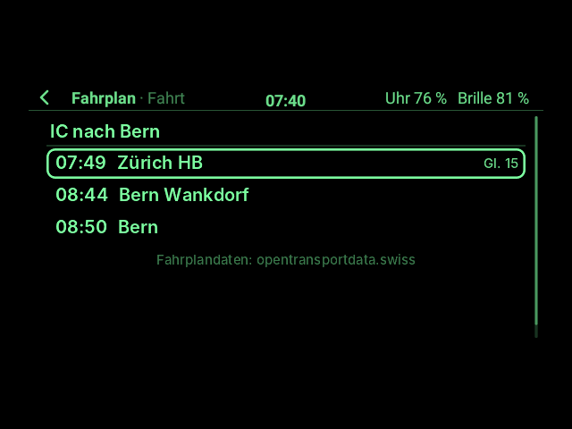
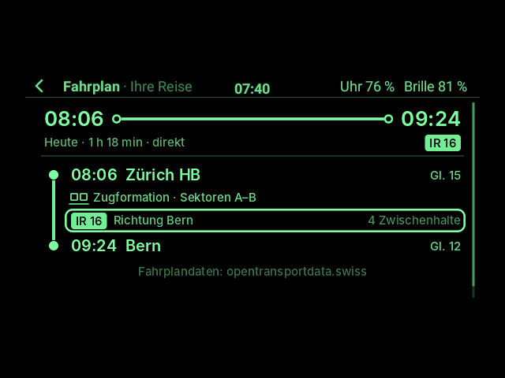
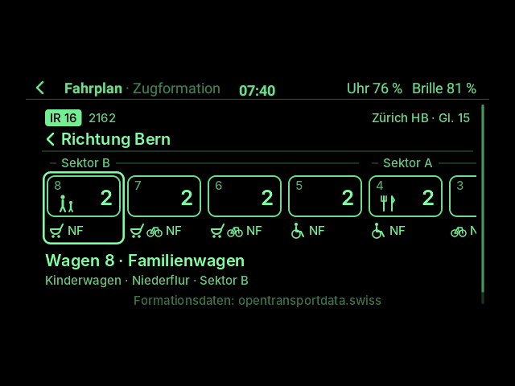
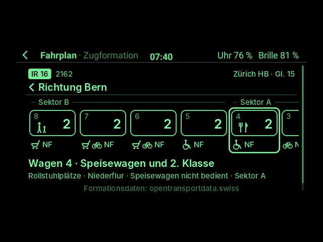

# Fahrplan auf der Brille (App-Paket)

**Der Schweizer Fahrplan auf dem Glas, aufgebaut und bedient wie die SBB-App** (SBB Mobile): **Planen** mit
„Aktueller Standort“ und „Nach“, die **Verbindungen** als Karten mit dem Reisebalken, **Ihre Reise** von Halt zu
Halt mit aufklappbaren **Zwischenhalten**, die **Abfahrten** einer Haltestelle, die **Fahrt** eines Zuges und die
**Haltestellen in der Nähe**, und ab 1.2.0 die **Zugformation** mit den Sektoren. Mit Gleis, Verspätung,
Gleiswechsel, Umsteigezeit und Fußwegen, für den ganzen öffentlichen Verkehr der Schweiz: Züge, Busse, Trams,
Schiffe, Bergbahnen.

Eingegeben wird wie bei der YouTube-App: Ist eine **Bluetooth-Tastatur** an der Uhr, tippt man die Haltestelle
**direkt auf der Brille**, und die passenden Haltestellen erscheinen schon beim Tippen, wie in der SBB-App. Ohne
Tastatur fragt die **Uhr** (Tastatur oder Sprache); die zuletzt benutzten Haltestellen schlägt sie gleich vor.

> **Ehrlicher Stand (1.2.0):** gebaut und ohne Hardware getestet, mit Antworten des echten Fahrplans, die ich
> am 31.10.2026 aufgenommen habe (für Montag, 2.11.2026, ab 07:45). Die Zugformation ist mit einer Antwort getestet,
> die einer echten nachgebildet ist (siehe [Zugformation](#zugformation-ab-120)); gegen den echten Dienst konnte ich
> sie ohne Schlüssel nicht prüfen. Vorlage für Aussehen und Verhalten waren die
> Bildschirmfotos der SBB-App im App Store und ihre Abläufe (Planen → Verbindungen → Ihre Reise); die Seiten sind
> in den Grüntönen der Brille nachgezeichnet, keine Kopie der SBB-Grafik. **Nichts davon ist auf Hardware
> erprobt**: weder die Abfrage über WLAN oder LTE der Uhr noch das GPS für „Aktueller Standort“ noch die
> Bedienung auf der Brille. Braucht **G2 Watch ab 0.13.0** (Schnittstelle 6).

| **Planen** | **Haltestelle tippen** (mit Tastatur, auf der Brille) | **Verbindungen** (die erste verspätet, nachgestellt) |
|---|---|---|
|  |  |  |
| **Ihre Reise** mit Umsteigen | **Fußwege und Bus** (Zürich, Central → Zermatt) | **Zwischenhalte** aufgeklappt |
|  |  |  |
| **Abfahrten** einer Haltestelle | **Fahrt** eines Zuges | **In der Nähe** |
|  |  |  |
| **Ihre Reise** mit Zugformation | **Zugformation** am Gleis | **Zugformation**, Speisewagen im Rahmen |
|  |  |  |

Gezeichnet von der App selbst und gezeigt vom echten App-Host und Desktop der Uhr-App, in den 16 Grünstufen der
Brille (`FahrplanSnapshotTest`); durch die Seiten führen dabei die Bügel, wie beim Tragen. Die Verbindungen sind
der echte Fahrplan von Montag, 2.11.2026; nur die Verspätung der ersten Verbindung ab Zürich HB (+3, Gleis 16
statt 15) ist nachgestellt, damit man sieht, wie eine aussieht.

## Abo als QR-Code auf der Uhr: geht nicht

Gewünscht war auch, sich anzumelden und das Abo als QR-Code auf der Uhr zu zeigen. Das baue ich nicht ein,
weil es keinen gültigen Weg gibt:

- Das Abo zeigt die SBB als **SwissPass Mobile** in ihren eigenen Apps (SBB Mobile, SBB Preview) auf Smartphone
  oder Tablet ([sbb.ch](https://www.sbb.ch/de/angebote/swisspass-karte-mobile)). Der QR-Code darin erneuert
  sich laufend, deshalb muss die Uhrzeit des Handys stimmen.
- Ein **Foto oder Screenshot** des Codes gilt bei der Kontrolle nicht, und **Uhren** unterstützt die SBB dafür
  aus Sicherheitsgründen nicht (so die Moderation der [SBB-Community](https://community.sbb.ch/d/7403-wann-gibt-es-von-der-sbb-und-von-swisspass-eine-sinnvolle-unterstuetzung-fuer-die),
  [Beitrag zum QR-Code](https://community.sbb.ch/d/14100-swisspass-qr-auf-handy)).
- Eine **Anmeldung bei SwissPass für fremde Apps** gibt es nicht. Sie nachzubauen hieße, die Schnittstellen der
  SBB-App zu umgehen, und ergäbe trotzdem keinen Code, der bei der Kontrolle gilt.

Das Abo also weiter mit der SwissPass-Karte oder der SBB-App auf dem Handy zeigen.

## Wie in der SBB-App: die Seiten

- **Planen:** „Aktueller Standort“ (das GPS der Uhr) und „Nach“ untereinander, verbunden durch die Linie, daneben
  das Zeichen zum Tauschen. Darunter „Jetzt · Abfahrt“ und die letzten Suchen, dann „Abfahrten in der Nähe“ und
  „Abfahrten einer Haltestelle“. Die Zeile mit dem Rahmen ist die, die ein Tippen öffnet.
- **Haltestelle:** das Suchfeld mit „Von“, „Nach“ oder „Abfahrten von“ und darunter die Haltestellen, jede mit
  ihrem Zeichen (Zug, Tram, Bus …). Leer stehen dort „Aktueller Standort“ und die zuletzt benutzten.
- **Verbindungen:** je eine Karte mit den Linien und der Richtung, groß die Abfahrt links und die Ankunft
  rechts, dazwischen der **Reisebalken** mit einem Ring bei jedem Umsteigen und gepunkteten Fußwegen. Unter der
  Abfahrt das Gleis (oder die Kante), rechts Dauer und Umsteigen. Eine Verspätung steht als „+3“ hinter der
  Zeit, ein **Gleiswechsel** ist eingerahmt.
- **Ihre Reise:** oben Abfahrt, Ankunft und der Balken der ganzen Verbindung, die Linien hintereinander; darunter
  die Linie von Halt zu Halt: jede Fahrt mit Linie, Richtung und „3 Zwischenhalte“, dazwischen „Umsteigen in
  Aarau · 11 Min.“ und die Fußwege („4 Min. zu Fuß bis Visp, Bahnhof Süd“).
- **Abfahrten:** Zeit, Linie, Ziel und Gleis, die nächsten 15, mit Verspätung und Gleiswechsel.
- **Fahrt:** alle Halte eines Zuges, Busses oder Trams ab der Haltestelle, mit Zeiten und Gleisen.
- **In der Nähe:** die Haltestellen um die Uhr, mit Entfernung.

- **Zugformation** (ab 1.2.0, mit Schlüssel): oben Linie, Zugnummer, Halt und Gleis, darunter „‹ Richtung Bern“ wie
  in der SBB-App, dann die Wagen von der Spitze des Zuges an unter ihren Sektoren: Nummer, Klasse, Speisewagen,
  Familienwagen, darunter Kinderwagen, Rollstuhl, Velo und Niederflur (NF). Der Wagen im Rahmen steht unten in Worten.

Am Ende jeder Seite mit Daten steht „Fahrplandaten: opentransportdata.swiss“ (auf der Zugformation
„Formationsdaten: opentransportdata.swiss“).

## Zugformation (ab 1.2.0)

Wie auf der Seite „Zugformation“ der SBB-App: wo der Zug am Gleis steht und welcher Wagen was hat. In **Ihre
Reise** steht unter dem Halt, an dem man einsteigt, „Zugformation · Sektoren A–B“; auf der Seite **Fahrt** einer
Abfahrt ist das die erste Zeile. Antippen öffnet die Formation: wischen geht von Wagen zu Wagen (ein langer Zug
scrollt mit), lange drücken fragt neu.

Die Daten kommen vom **Train Formation Service** von opentransportdata.swiss. Er braucht einen **eigenen,
kostenlosen Schlüssel**, den ich nicht für dich anlegen kann:

1. Auf [opentransportdata.swiss](https://opentransportdata.swiss) im **API-Manager** ein Konto anlegen.
2. Dort für den **Train Formation Service** einen Schlüssel (API Key) erzeugen und kopieren.
3. Auf die Uhr bringen, eine von zwei Arten:
   - als Datei `zugformation.txt`, die nur den Schlüssel enthält, in den Ordner der App:
     `adb push zugformation.txt /sdcard/Android/data/ch.madtreasures.g2watch/files/app-data/ch.madtreasures.fahrplan/`
     (oder in Android Studio im Device Explorer dorthin hochladen, wie eine Karte für Navi);
   - oder eintippen: App-Menü in Ihre Reise → „Zugformation einrichten“, dann tippen (am besten mit der Tastatur
     auf der Brille).

Ohne Schlüssel bleibt alles wie in 1.1.0, nur das App-Menü in Ihre Reise und auf der Fahrt bietet „Zugformation
einrichten“ an.

**Grenzen der Zugformation:**
- Nur **heutige** Züge: Der Dienst kommt aus dem Echtzeitsystem und kennt keine anderen Tage („Zugformation am
  Reisetag“).
- Nur die Bahnen, die ihre Formation veröffentlichen: SBB, BLS, SOB, Thurbo, RhB, MBC, ÖBB, TPF, transN, VDBB und
  zb. Busse, Trams und andere Bahnen haben keine Zeile „Zugformation“.
- Die Reihenfolge der Wagen nehme ich so, wie der Dienst sie schreibt, von der Spitze des Zuges an; darum zeigt
  der Pfeil nach links. Auf der echten Brille ist das noch nicht erprobt.
- **Keine Belegung** (die Männchen der SBB-App): transport.opendata.ch liefert sie zurzeit leer, und die
  Belegungsprognose von opentransportdata.swiss gibt es nur als tägliche Datei von rund 100 MB, zu groß für die
  Uhr.

## Wie in der SBB-App: das Verhalten

- **Ziel gewählt, Verbindungen da:** Sobald „Nach“ feststeht, sucht die App, ohne Knopf „Suchen“. Eine der
  letzten Suchen antippen sucht ebenso.
- **Weiterwischen lädt weiter:** Über die letzte Verbindung hinaus kommen **spätere**, über die erste hinaus
  **frühere**, wie beim Scrollen in der SBB-App. Bei den Abfahrten kommen am Ende die späteren.
- **Antippen geht tiefer:** eine Verbindung → Ihre Reise; „3 Zwischenhalte“ → klappt sie auf (und scrollt sie ins
  Bild), nochmals → zu; ein Halt → seine Abfahrten; eine Abfahrt → ihre Fahrt; ein Halt der Fahrt → seine
  Abfahrten.
- **Tippen mit Tastatur:** Jeder Buchstabe verfeinert die Liste der Haltestellen, kurz nach dem letzten fragt
  die App den Fahrplan; ↑ ↓ wählen, Enter nimmt. Passt ein auf der Uhr eingegebener Name genau („bern“), nimmt die
  App ihn gleich; Groß- und Kleinschreibung und Umlaute spielen keine Rolle („zuerich hb“).
- **Live:** Solange Verbindungen, Ihre Reise oder Abfahrten auf der Brille stehen, fragt die App **jede Minute
  neu**; Verspätungen und Gleise folgen. Eine gewählte Verbindung bleibt auf ihrer Seite, auch wenn der Zug
  schon abgefahren ist, und wird weiter nachgefragt: So kann man sie unterwegs verfolgen.
- **Aktueller Standort** ist am Anfang „Von“; das GPS läuft auf Planen schon vor, damit die Position bei der
  Suche da ist. Die Verbindung beginnt dann mit dem Fußweg von der Adresse zur Haltestelle.
- **Wann:** „jetzt“, eine Uhrzeit („17:30“, „1730“, „17 Uhr“), ein Tag („morgen 7:15“, „Fr 18:00“,
  „24.12. 8:00“) oder „in 20 Min.“; mit **„an“ davor** („an 8:30“) gilt die Zeit für die Ankunft, mit „ab“ für
  die Abfahrt. Eine Uhrzeit, die schon mehr als eine Stunde vorbei ist, gilt für morgen.
- **Zuletzt gesucht:** Die letzten Suchen stehen auf Planen; die App merkt sich auch Von und Nach für den nächsten
  Start.

## Bedienung

Jede Seite ist ein Bild mit einem **Rahmen** um eine Zeile; die Gesten bewegen ihn, wie der Finger in der
SBB-App über die Liste fährt:

| | Bügel oder Ring | Uhr (Touchpad) | Tastatur, Maus |
|---|---|---|---|
| Rahmen zur nächsten / vorigen Zeile | wischen | Finger hoch / runter | ↓ ↑, Mausrad |
| Öffnen, was im Rahmen steht | tippen | tippen oder doppeltippen | Enter, Leertaste, Maus links |
| Das Zweite der Seite (unten) | lange drücken | lange drücken | – |
| Zurück | doppeltippen | nach rechts wischen | Esc, Rücktaste (beim Tippen löscht sie) |
| App-Menü | tippen, dann halten | – | Menütaste, F10, Maus rechts |

**Lange drücken:** auf Planen Von und Nach tauschen, bei den Verbindungen, auf Ihre Reise und auf der Zugformation
aktualisieren, bei den Abfahrten „Verbindung ab hier“, auf der Seite Haltestelle die Frage an die Uhr (etwa für Sprache; mit
Tastatur steht sie zuerst auf der Brille, dort „Auf der Uhr eingeben“).

**App-Menü:**

| Seite | Einträge |
|---|---|
| Planen | Von und Nach tauschen · Von: Aktueller Standort · Zeit gilt für die Ankunft (Abfahrt) · Verlauf löschen |
| Haltestelle | Auf der Uhr eingeben |
| Verbindungen | Aktualisieren · Rückfahrt · Frühere Verbindungen · Spätere Verbindungen |
| Ihre Reise | Aktualisieren · Alle Zwischenhalte zeigen (ausblenden) · Zugformation einrichten (ohne Schlüssel) |
| Abfahrten | Aktualisieren · Verbindung ab hier |
| Fahrt | Zugformation einrichten (ohne Schlüssel) |
| Zugformation | Aktualisieren · Schlüssel eingeben (ändern) |
| In der Nähe | Standort neu suchen |

## Die Daten

Der Fahrplan kommt von **[transport.opendata.ch](https://transport.opendata.ch)**, einer offenen Schnittstelle
von Opendata.ch, frei und ohne Konto. Die Daten selbst sind von **opentransportdata.swiss**, der offenen
Plattform des Schweizer ÖV; die App nennt sie am Ende jeder Seite mit Daten, wie die Schnittstelle es verlangt.
Eine feste Grenze für Abfragen gibt es nicht, aber die Bitte, nicht alle paar Sekunden dasselbe zu fragen: Die
App fragt höchstens einmal pro Minute nach, und beim Tippen erst einen Moment nach dem letzten Buchstaben.

Die Zugformation kommt vom [Train Formation Service](https://opentransportdata.swiss/en/cookbook/realtime-prediction-cookbook/formationsdaten/)
von opentransportdata.swiss (Formationsdaten: opentransportdata.swiss), mit dem eigenen Schlüssel; die App fragt
einen Zug höchstens alle zehn Minuten.

Jede Abfrage verlangt nur die Felder, die die App liest: Eine Antwort ist so etwa ein Drittel so groß
(Zürich, Central → Zermatt: 27 statt 72 KB), eine Abfahrtstafel ein Zwanzigstel. Das zählt über LTE. Die
Antworten liest und die Seiten zeichnet die App im Hintergrund der Uhr, nicht im Takt der Brille.

## Wie es gebaut ist

Alles ist eigenes Kotlin im Paket, ohne fremde Bibliothek. Jede Seite ist **ein Bild** (Baustein `image`,
544 × 260, 16 Grünstufen), das die App selbst zeichnet; die Seiten laufen im Modus `gestures` und bekommen die
Gesten von Bügeln, Uhr und Tastatur roh ([02 §7](../../docs/app-entwicklung/02_App-Modell.md#7-eingabe-und-fokus)).
Nur beim Tippen einer Haltestelle abonniert die App die Tasten. Die Uhr-App gibt ihr Internet, das GPS der Uhr,
die Hintergrundarbeit (Schnittstelle 5), die Frage nach Text auf der Uhr und die Tastatur (Schnittstelle 3).

| Datei | Inhalt |
|---|---|
| `FahrplanApp.kt` | die App: Seiten und Gesten, Haltestellen tippen, Verbindungen (frühere, spätere), Ihre Reise, Abfahrten, Fahrt, Standort, jede Minute neu, App-Menü, was sie sich merkt |
| `Screens.kt` | was jede Seite zeigt, als Daten (die Tests lesen sie), und `Painter`, der daraus das Bild zeichnet: Karten, Reisebalken, Linie von Halt zu Halt, Zeichen der Verkehrsmittel |
| `Raster.kt`, `Font.kt` | Zeichnen mit Kantenglättung und Schrift in 16 Graustufen, aus dem Paket Navi übernommen |
| `Timetable.kt` | die Abfragen bei transport.opendata.ch und das Lesen ihrer Antworten; Haltestelle, Linie (mit Zugnummer), Fahrt, Verbindung |
| `Formation.kt` | die Zugformation: Abfrage beim Train Formation Service, ihre Antwort und die Kurzschreibweise der Formation (`@B,[(FA:8#KW;NF,2:7#VH;KW;NF,…`) mit Sektoren, Wagen, Klassen und Angeboten |
| `Format.kt` | wie Zeiten, Verspätungen, Gleise, Dauer und Entfernungen auf der Brille stehen |
| `When.kt` | was „Wann?“ verstehen soll: „17:30“, „morgen 7:15“, „in 20 Min.“ … |
| `src/main/assets/…/fonts` | die Schrift Inter in drei Größen (SIL Open Font License, `OFL.txt`) |
| `symbol.py` | zeichnet das Symbol für den Starter (`python3 packages/fahrplan/symbol.py`, braucht Pillow) |

**Was die App sich merkt** (256-KiB-Speicher der App): Von und Nach, die letzten acht Suchen, die letzten
zwölf Haltestellen (für die Vorschläge) und einen eingetippten Schlüssel für die Zugformation.

## Bauen, auf die Uhr legen, installieren

```sh
./gradlew :packages:fahrplan:g2app   # → packages/fahrplan/build/g2app/ch.madtreasures.fahrplan-1.2.0.g2app
adb push packages/fahrplan/build/g2app/ch.madtreasures.fahrplan-1.2.0.g2app /sdcard/Android/data/ch.madtreasures.g2watch/files/apps/
```

Dann auf der Uhr: Zahnrad halten → *Einstellungen → Apps installieren* → unter „Neu auf der Uhr“ antippen
([09 §4](../../docs/app-entwicklung/09_App-Pakete.md#4-auf-die-uhr-bringen-und-installieren)). Eine ältere
Fahrplan-Version wird dabei ersetzt; was sie sich gemerkt hat, bleibt. Braucht die Uhr-App 0.13.0 oder neuer
(Schnittstelle 6). Beim ersten Start fragt die Brille nach „Internet“ und „Standort“; ohne Standort geht alles
außer „Aktueller Standort“ und „In der Nähe“.

## Tests

Tests in `src/test/kotlin`, laufen mit `./gradlew :app:testDebugUnitTest`; die aufgenommenen Antworten liegen in
`src/test/fixtures` (Fahrplandaten: opentransportdata.swiss):

- `TimetableTest`: Verbindungen mit Gleisen, Linien, Umsteigen, Fußwegen, Bus und Bahnersatz nach Zermatt, ab
  einer Adresse, Verspätung und Gleiswechsel, Abfahrten mit ihrer Fahrt, Haltestellen nach Namen und in der Nähe
  mit ihrem Verkehrsmittel, Antworten, die keine sind, und die Abfragen selbst.
- `WhenTest`: was „Wann?“ versteht und was nicht.
- `FormationTest`: die Zugformation von IR 16 an jedem Halt, Sektoren, Wagen, Klassen und Angebote,
  geschlossene, abgestellte und erfundene Wagen, ein Zug, der sich teilt, Zugnummer und Bahn eines Zuges, die
  Abfrage, Antworten, die keine sind. Die Antwort (`zugformation-ir16-2162.json`) ist einer echten nachgebildet:
  IR 16 2166 vom 24.9.2026, dieselbe Linie mit denselben Halten und Gleisen zwei Stunden später; die
  Formationen sind die echten, Zugnummer, Datum und Zeiten verschoben.
- `FahrplanAppTest` (mit `FakeAppContext`): was jede Seite zeigt; Planen, Haltestellen auf der Uhr und mit
  Tastatur tippen (Treffer beim Tippen), die Karten mit Reisebalken, Weiterwischen lädt spätere und frühere,
  Ihre Reise mit Zwischenhalten und Halt → Abfahrten, Fußwege nach Zermatt, Abfahrten → Fahrt → Verbindung ab
  hier, Aktueller Standort mit und ohne GPS, eine Ankunftszeit, jede Minute neu, Fahrplan nicht erreichbar oder
  unlesbar, was die App sich merkt, das App-Menü; die Zugformation mit Schlüssel (eingetippt oder als Datei),
  ohne Schlüssel, nur heute und nur bei Bahnen, die sie veröffentlichen, Schlüssel ungültig, keine Formation.
- `FahrplanHostTest`: im echten App-Host; die Bügel wischen, tippen, halten und gehen zurück, die Tastatur tippt
  auf der Brille und bedient danach die Seiten wie die Bügel, Hintergrundarbeit und GPS laufen, die Abfrage der
  Zugformation geht mit dem Schlüssel durch den Host, der Host lehnt keinen Befehl ab (auch kein Bild).

Bilder neu zeichnen:

```sh
./gradlew :app:testDebugUnitTest --tests 'ch.madtreasures.fahrplan.FahrplanSnapshotTest' -PsnapshotDir=$PWD/packages/fahrplan/bilder
```

Testdaten neu aufnehmen: Die Abfragen stehen in `FahrplanHostTest.fixtureFor`; dieselben URLs wie die App
(`Timetable`), mit Datum und Zeit von Montag, 2.11.2026.

## Grenzen

- **Kein Billett und kein Abo** (siehe oben), keine Preise, keine Belegung, keine Störungsmeldungen.
- Die Verspätungen sind die, die der offene Fahrplan kennt; Ausfälle meldet er nicht ausdrücklich.
- **Aktueller Standort** braucht das GPS der Uhr und den Standort für Fahrplan; findet die Uhr in 30 Sekunden
  keinen, sagt die App das und schlägt vor, „Von“ selbst zu wählen. Ein Tippen sucht nochmals.
- Ohne WLAN oder LTE der Uhr gibt es keinen Fahrplan; die App sagt dann „Der Fahrplan ist gerade nicht
  erreichbar“, und ein Tippen fragt nochmals.
