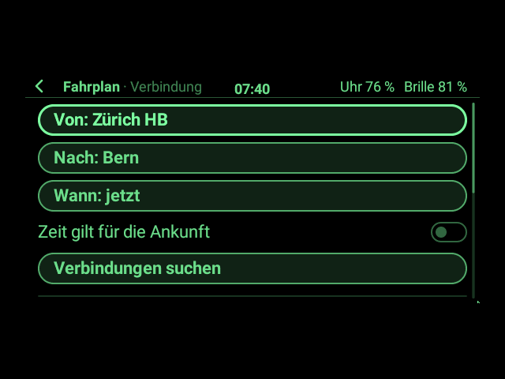
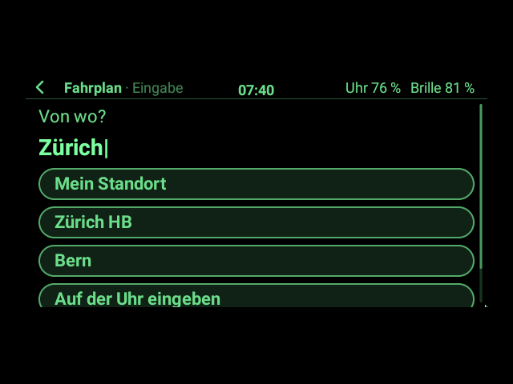
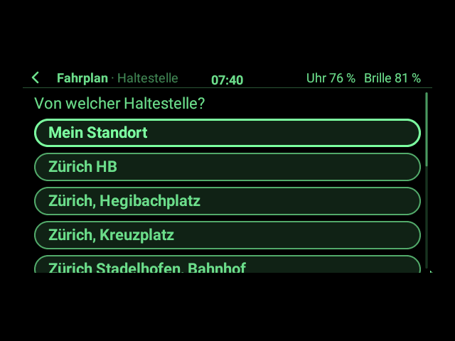
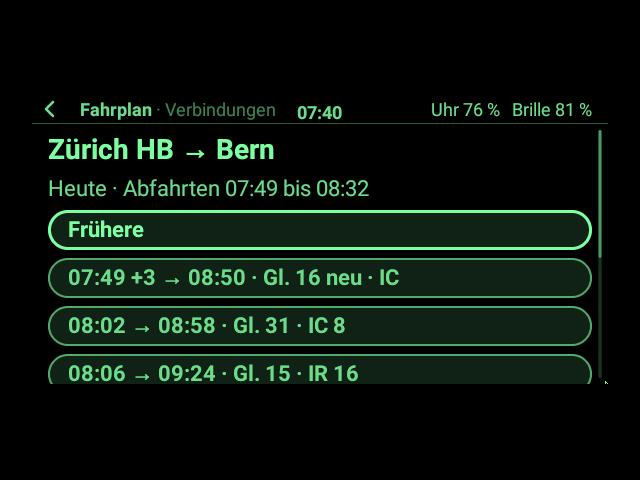
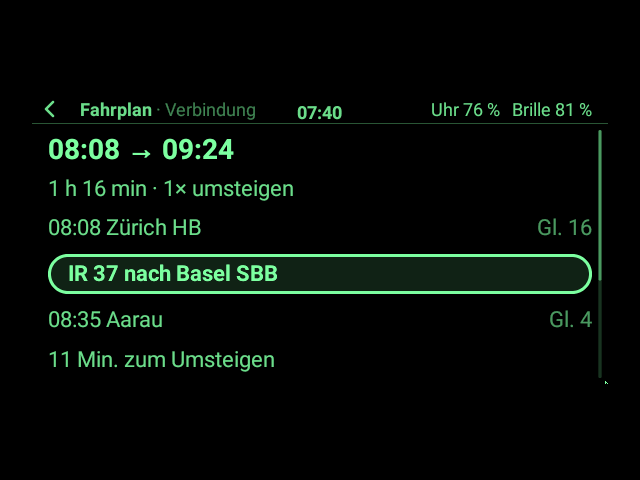
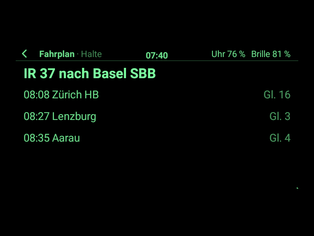
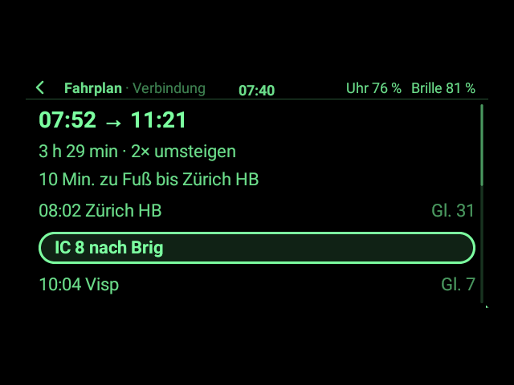
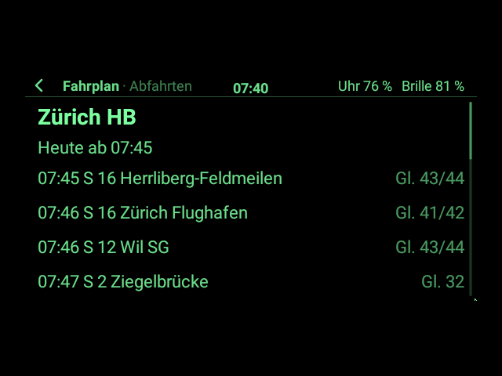
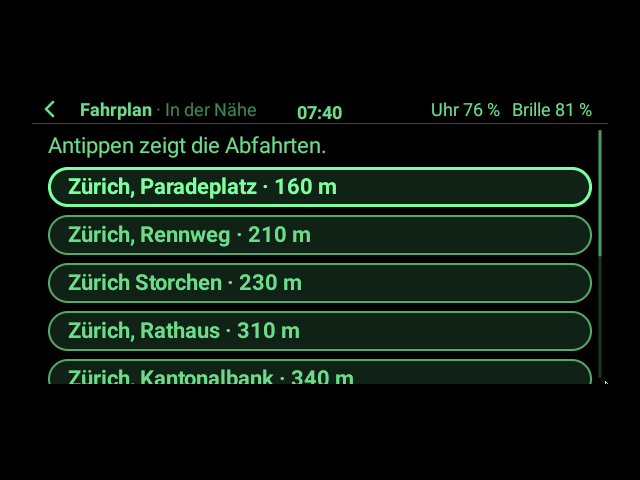

# Fahrplan auf der Brille (App-Paket)

**Der Schweizer Fahrplan auf dem Glas**, wie in der Fahrplan-App auf dem Handy, nur kürzer: **Verbindungen**
von einer Haltestelle – oder von dort, wo die Uhr ist – zu einer anderen, jetzt oder zu einer Zeit, mit
**Gleis, Verspätung, Umsteigen, Fußwegen** und den **Halten** unterwegs. Dazu die **Abfahrten** einer Haltestelle
und die **Haltestellen in der Nähe**. Für den ganzen öffentlichen Verkehr der Schweiz: Züge, Busse, Trams,
Schiffe, Bergbahnen.

Eingegeben wird wie bei der YouTube-App: Ist eine **Bluetooth-Tastatur** an der Uhr, steht die Frage auf der
**Brille** und man tippt dort; sonst fragt die **Uhr** (Tastatur oder Sprache). Die zuletzt benutzten
Haltestellen schlägt sie gleich vor.

> **Ehrlicher Stand (1.0.0):** gebaut und ohne Hardware getestet, mit Antworten des echten Fahrplans, die ich
> am 31.10.2026 aufgenommen habe (für Montag, 2.11.2026, ab 07:45). Die Abfragen der App habe ich gegen den
> echten Dienst geprüft. **Nichts davon ist auf Hardware erprobt**: weder die Abfrage über WLAN oder LTE der
> Uhr noch das GPS für „Mein Standort“ noch die Bedienung auf der Brille. Braucht **G2 Watch ab 0.13.0**
> (Schnittstelle 6, wie jedes Paket, das ab dann gebaut wird).

| Start | Frage auf der Brille (mit Tastatur) | Welche Haltestelle? |
|---|---|---|
|  |  |  |
| **Verbindungen** (die erste verspätet, nachgestellt) | **Eine Verbindung** mit Umsteigen | **Halte** einer Fahrt |
|  |  |  |
| **Fußwege und Bus** (Zürich, Central → Zermatt) | **Abfahrten** einer Haltestelle | **In der Nähe** |
|  |  |  |

Gezeichnet vom echten App-Host und Desktop der Uhr-App mit Androids Schrift, in den 16 Grünstufen der Brille
(`FahrplanSnapshotTest`). Die Verbindungen sind der echte Fahrplan von Montag, 2.11.2026; nur die Verspätung der
ersten Verbindung (+3, Gleis 16 statt 15) ist nachgestellt, damit man sieht, wie eine aussieht.

## Abo als QR-Code auf der Uhr: geht nicht

Gewünscht war auch, sich anzumelden und das Abo als QR-Code auf der Uhr zu zeigen. Das baue ich nicht ein,
weil es keinen gültigen Weg gibt:

- Das Abo zeigt die SBB als **SwissPass Mobile** in ihren eigenen Apps (SBB Mobile, SBB Preview) auf Smartphone
  oder Tablet ([sbb.ch](https://www.sbb.ch/de/angebote/swisspass-karte-mobile)). Der QR-Code darin erneuert
  sich laufend, deshalb muss die Uhrzeit des Handys stimmen.
- Ein **Foto oder Screenshot** des Codes gilt bei der Kontrolle nicht, und **Uhren** unterstützt die SBB dafür
  aus Sicherheitsgründen nicht (so die Moderation der [SBB-Community](https://community.sbb.ch/d/7403-wann-gibt-es-von-der-sbb-und-von-swisspass-eine-sinnvolle-unterstuetzung-fuer-die),
  [Beitrag zum QR-Code](https://community.sbb.ch/d/14100-swisspass-qr-auf-handy)).
- Eine **Anmeldung bei SwissPass für fremde Apps** gibt es nicht. Sie nachzubauen hieße, die Schnittstellen der
  SBB-App zu umgehen, und ergäbe trotzdem keinen Code, der bei der Kontrolle gilt.

Das Abo also weiter mit der SwissPass-Karte oder der SBB-App auf dem Handy zeigen.

## Was die App kann

- **Verbindungen:** Von, Nach, Wann. „Von“ ist am Anfang **Mein Standort** (das GPS der Uhr); die Verbindung
  beginnt dann mit dem Fußweg zur Haltestelle. Bis zu fünf Verbindungen auf einmal, je in einer Zeile:
  Abfahrt, Ankunft, Gleis der ersten Fahrt, Linien (`07:49 → 08:50 · Gl. 15 · IC`). Mit **Frühere** und
  **Spätere** blättern, **Rückfahrt** dreht die Richtung um.
- **Eine Verbindung:** jede Fahrt mit Abfahrt, Gleis oder Kante, Linie und Richtung, Ankunft; dazwischen die
  Zeit zum Umsteigen und die Fußwege („4 Min. zu Fuß bis Visp, Bahnhof Süd“). Eine Fahrt antippen zeigt ihre
  **Halte** mit Zeiten und Gleisen.
- **Verspätungen und Gleiswechsel**, soweit der Fahrplan sie kennt: `+3` hinter der Zeit, `Gl. 16 neu`.
  Solange Verbindungen oder Abfahrten auf der Brille stehen, fragt die App **jede Minute neu**. Eine gewählte
  Verbindung bleibt auf ihrer Seite, auch wenn der Zug schon abgefahren ist, und wird weiter nachgefragt: So
  kann man sie unterwegs verfolgen.
- **Wann:** „jetzt“, eine Uhrzeit („17:30“, „1730“, „17 Uhr“), ein Tag („morgen 7:15“, „Fr 18:00“,
  „24.12. 8:00“) oder „in 20 Min.“. Eine Uhrzeit, die schon mehr als eine Stunde vorbei ist, gilt für morgen.
  Der Schalter **Zeit gilt für die Ankunft** sucht Verbindungen, die bis dann ankommen.
- **Haltestellen eingeben:** Den Namen tippen oder sagen. Passt ein Name genau („Bern“), nimmt die App ihn
  gleich; sonst zeigt sie die ähnlichen zur Auswahl („Zürich“ → Zürich HB, Zürich Stadelhofen …).
  Groß- und Kleinschreibung und Umlaute spielen keine Rolle („zuerich hb“).
- **Abfahrten** einer Haltestelle (die nächsten 15, mit Gleis oder Kante und Verspätung), **Spätere**, und
  **Verbindung ab hier** übernimmt sie als „Von“.
- **In der Nähe:** die Haltestellen um die Uhr, mit Entfernung; antippen zeigt ihre Abfahrten.
- **Zuletzt gesucht:** Die letzten Suchen stehen auf der Startseite und starten mit einem Klick; die App merkt
  sich auch Von und Nach für den nächsten Start.

## Bedienung

Wie jede App mit Zeiger: über das Touchpad der Uhr oder die Bügel den Fokus auf eine Zeile bringen und
klicken; lange Seiten scrollen. Zurück geht wie überall (Wischen nach rechts auf der Uhr, Doppeltippen am Bügel).

**App-Menü** (Bügel antippen, dann halten):

| Seite | Einträge |
|---|---|
| Start | Von und Nach tauschen · Von: Mein Standort · Verlauf löschen |
| Verbindungen | Aktualisieren · Rückfahrt |
| Verbindung, Halte | Aktualisieren |
| Abfahrten | Aktualisieren · Verbindung ab hier |
| In der Nähe | Standort neu suchen |

## Die Daten

Der Fahrplan kommt von **[transport.opendata.ch](https://transport.opendata.ch)**, einer offenen Schnittstelle
von Opendata.ch, frei und ohne Konto. Die Daten selbst sind von **opentransportdata.swiss**, der offenen
Plattform des Schweizer ÖV; die App nennt sie auf jeder Seite mit Daten („Fahrplandaten:
opentransportdata.swiss“), wie die Schnittstelle es verlangt. Eine feste Grenze für Abfragen gibt es nicht,
aber die Bitte, nicht alle paar Sekunden dasselbe zu fragen; die App fragt höchstens einmal pro Minute nach.

Jede Abfrage verlangt nur die Felder, die die App liest: Eine Antwort ist so etwa ein Drittel so groß
(Zürich, Central → Zermatt: 27 statt 72 KB), eine Abfahrtstafel ein Zwanzigstel (3 statt 63 KB). Das zählt über
LTE. Die Antworten liest die App im Hintergrund der Uhr, nicht im Takt der Brille.

## Wie es gebaut ist

Alles ist eigenes Kotlin im Paket, ohne fremde Bibliothek. Die Uhr-App gibt ihm Internet, das GPS der Uhr
(Schnittstelle 5), die Hintergrundarbeit (Schnittstelle 5) und die Frage nach Text, die mit Tastatur auf der
Brille steht (Schnittstelle 3).

| Datei | Inhalt |
|---|---|
| `FahrplanApp.kt` | die App: Seiten, Eingaben, Verbindungen, Abfahrten, Standort, jede Minute neu, App-Menü, was sie sich merkt |
| `Timetable.kt` | die Abfragen bei transport.opendata.ch und das Lesen ihrer Antworten; Haltestelle, Linie, Fahrt, Verbindung |
| `Format.kt` | wie Zeiten, Verspätungen, Gleise, Dauer und Entfernungen auf der Brille stehen |
| `When.kt` | was „Wann?“ verstehen soll: „17:30“, „morgen 7:15“, „in 20 Min.“ … |
| `Shown.kt` | schickt nur, was sich auf den Seiten ändert (wie im Paket Musik) |
| `symbol.py` | zeichnet das Symbol für den Starter (`python3 packages/fahrplan/symbol.py`, braucht Pillow) |

**Was die App sich merkt** (256-KiB-Speicher der App): Von und Nach, die letzten acht Suchen und die letzten
zwölf Haltestellen (für die Vorschläge der Uhr).

## Bauen, auf die Uhr legen, installieren

```sh
./gradlew :packages:fahrplan:g2app   # → packages/fahrplan/build/g2app/ch.madtreasures.fahrplan-1.0.0.g2app
adb push packages/fahrplan/build/g2app/ch.madtreasures.fahrplan-1.0.0.g2app /sdcard/Android/data/ch.madtreasures.g2watch/files/apps/
```

Dann auf der Uhr: Zahnrad halten → *Einstellungen → Apps installieren* → unter „Neu auf der Uhr“ antippen
([09 §4](../../docs/app-entwicklung/09_App-Pakete.md#4-auf-die-uhr-bringen-und-installieren)). Braucht die
Uhr-App 0.13.0 oder neuer (Schnittstelle 6). Beim ersten Start fragt die Brille nach „Internet“ und
„Standort“; ohne Standort geht alles außer „Mein Standort“ und „In der Nähe“.

## Tests

Tests in `src/test/kotlin`, laufen mit `./gradlew :app:testDebugUnitTest`; die aufgenommenen Antworten liegen in
`src/test/fixtures` (Fahrplandaten: opentransportdata.swiss):

- `TimetableTest`: Verbindungen mit Gleisen, Linien, Umsteigen, Fußwegen, Bus und Bahnersatz nach Zermatt, ab
  einer Adresse, Verspätung und Gleiswechsel, Abfahrten, Haltestellen nach Namen und in der Nähe, Antworten, die
  keine sind, und die Abfragen selbst.
- `WhenTest`: was „Wann?“ versteht und was nicht.
- `FahrplanAppTest` (mit `FakeAppContext`): Haltestellen eingeben und wählen, Verbindungen und eine davon mit
  ihren Halten, Frühere, Spätere, Rückfahrt, jede Minute neu, eine abgefahrene Verbindung bleibt, Mein Standort
  mit und ohne GPS, Fahrplan nicht erreichbar oder unlesbar, Abfahrten, In der Nähe, eine eingetippte Zeit,
  was die App sich merkt, das App-Menü.
- `FahrplanHostTest`: im echten App-Host; die Bügel führen durch die Seiten, die Frage geht an die Uhr oder mit
  Tastatur an die Brille, Hintergrundarbeit und GPS laufen, der Host lehnt keinen Befehl ab.

Bilder neu zeichnen:

```sh
./gradlew :app:testDebugUnitTest --tests 'ch.madtreasures.fahrplan.FahrplanSnapshotTest' -PsnapshotDir=$PWD/packages/fahrplan/bilder
```

Testdaten neu aufnehmen: Die Abfragen stehen in `FahrplanHostTest.fixtureFor`; dieselben URLs wie die App
(`Timetable`), mit Datum und Zeit von Montag, 2.11.2026.

## Grenzen

- **Kein Billett und kein Abo** (siehe oben), keine Preise, keine Auslastung.
- Die Verspätungen sind die, die der offene Fahrplan kennt; Ausfälle meldet er nicht ausdrücklich.
- **Mein Standort** braucht das GPS der Uhr und den Standort für Fahrplan; findet die Uhr in 30 Sekunden keinen,
  sagt die App das und schlägt vor, „Von“ selbst zu wählen.
- Ohne WLAN oder LTE der Uhr gibt es keinen Fahrplan; die App sagt dann „Der Fahrplan ist gerade nicht
  erreichbar“ und bietet „Nochmals“ an.
