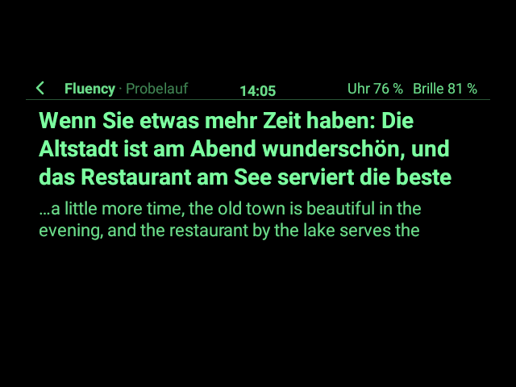
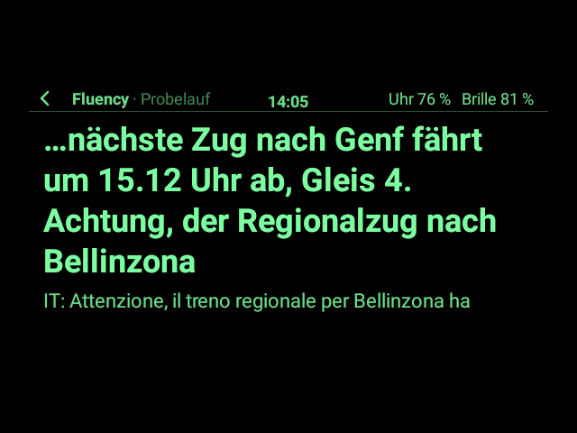
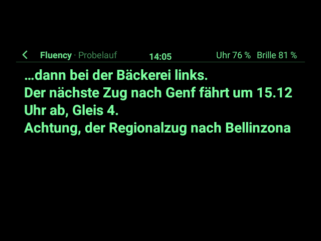
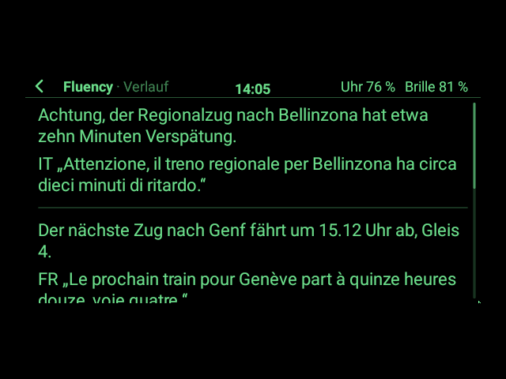

# Fluency auf der Brille (App-Paket)

Die Brücke zu **Fluency**, dem Offline-Übersetzer auf dem Handy ([Repo `playground`](https://github.com/MADTreasures/playground)):
Fluency erkennt, was Menschen sagen – oder was ein Video, das Radio, eine Durchsage sagt – und übersetzt es;
dieses Paket zeigt die Übersetzung als **rollenden Untertitel auf der Brille** und steuert Fluency von der Uhr
und den Bügeln aus. Der Ton kommt vom **Mikrofon der Uhr** (die Uhr-App streamt ihn zu Fluency) oder vom
**Mikrofon des Handys**.

> **Ehrlicher Stand (1.1.0):** Der ganze Weg ist gebaut und ohne Hardware getestet: Paket → Uhr-App
> (Schnittstelle 4, G2 Watch 0.10.0) → Wear-OS-Datenschicht → „G2 Handy“ auf dem Handy → Fluency 1.9.0, dazu
> das Mikrofon der Uhr. **Nichts davon ist auf Hardware erprobt.** Wie die Teile zusammenhängen und was auf
> der echten Hardware zu klären ist: [PLATTFORM.md](PLATTFORM.md). Der **Probelauf** (ein erfundenes
> Gespräch über denselben Weg wie Fluencys Nachrichten) geht auch ohne Handy, um Lesbarkeit, Schriftgröße und
> Takt der Untertitel auf der echten Brille zu prüfen.

**Was es braucht:** G2 Watch ab 0.10.0 auf der Uhr; auf dem gekoppelten Handy „G2 Handy“ 0.10.0 (einmal öffnen,
„Für die Uhr bereit“ bleibt an) und Fluency 1.9.0 mit **Optionen → „Brille (G2 Watch)“** an. Beim ersten
Start fragt die Brille nach „Verbindung zum Handy“ und „Mikrofon der Uhr“; beim ersten Einschalten des
Uhr-Mikrofons fragt zusätzlich Android auf dem Bildschirm der Uhr.

| Start | Probelauf: Untertitel rollen, darunter das Original | Mit Fluency (simuliert): „Live“ |
|---|---|---|
|  |  |  |
| **Große Schrift** | **Ohne Original** | **Verlauf** |
|  |  |  |

Gezeichnet vom echten App-Host und Desktop der Uhr-App mit Androids Schrift, in den 16 Grünstufen der Brille
(`FluencySnapshotTest`); „Start“ und „Live“ mit einer simulierten Verbindung zu Fluency.

## Seiten

| Seite | Inhalt |
|---|---|
| **Start** | Zustand der Verbindung („Handy: verbindet … / Fluency 1.9.0 / getrennt“; kommt sie nicht zustande, sagt ein Hinweis warum), **Übersetzen**, **Probelauf**, **Ton:** Uhr- oder Handy-Mikrofon, **Sprachen** („Automatisch → Deutsch (Schweiz)“), **Anzeige**, **Verlauf** |
| **Live** (Untertitel) | Oben die Übersetzung groß und hell: die letzten fertigen Sätze, jeder auf eigener Zeile, darunter der Satz, der gerade gesprochen wird; wird es zu viel, rollt der Text, die neuesten Wörter bleiben immer sichtbar („…“ vorne). Darunter kleiner das Original des neuesten Satzes („EN: Where is …“). Die Kopfzeile sagt, was los ist: „Fluency · Live / Pause / Startet … / Verbindet … / Getrennt / Probelauf / Ende“. |
| **Sprachen** | Von (Automatisch und die 54 Sprachen von Fluency, die sieben wichtigsten zuerst, der Rest unter „Weitere Sprachen“), Nach, Tauschen |
| **Anzeige** | Original zeigen, Große Schrift, Schon beim Sprechen zeigen (sonst nur fertige Sätze, ruhiger), Am Handy vorlesen |
| **Verlauf** | die letzten 30 fertigen Sätze dieser Sitzung, neueste zuerst, mit Original; „Verlauf löschen“. Bleibt nur im Speicher, bis die App endet. |

## Bedienung auf der Live-Seite

| | Bügel / Ring | Uhr (Gesten) | Tastatur |
|---|---|---|---|
| Pause / weiter | Tippen | Tippen | Leertaste, Enter, K, Play/Pause |
| Schrift groß / normal | Wischen vor / zurück | Finger hoch / runter | + / −, ↑ / ↓ |
| Original an / aus | lang drücken | nach links wischen | O |
| Sprachen tauschen | App-Menü | – | T (nicht bei „Automatisch“) |
| Verlauf | App-Menü | – | V |
| Zurück | Doppeltippen | nach rechts wischen | Esc |
| App-Menü | Tippen, dann halten | – | Menütaste, F10 |

Das App-Menü der Live-Seite hat Pause/Weiter, Original aus/an, Schrift groß/normal, Sprachen tauschen und
Verlauf; auf den anderen Seiten Probelauf und Ton wechseln. Im Gesten-Modus öffnet die Uhr allein das App-Menü
nicht (wie beim Video in YouTube); Sprachen und Verlauf gibt es dann auf der Startseite. Die übrigen Seiten
bedient man wie jede App mit Zeiger, Bügel oder Tastatur (Pfeile, Enter).

**Verdeckt** (App-Menü → „Apps“) hört Fluency auf und das Mikrofon geht aus; sichtbar wieder, geht es weiter.
**Zurück** von der Live-Seite stoppt Fluency.

## Einstellungen, die das Paket sich merkt

Ton-Quelle (Standard: Uhr-Mikrofon), Von (Standard: Automatisch), Nach (Standard: Deutsch (Schweiz), also
„ss“ statt „ß“), Original zeigen (an), Große Schrift (aus), Schon beim Sprechen zeigen (an), Am Handy vorlesen
(aus). Der Verlauf wird nicht gespeichert.

## Bauen, auf die Uhr legen, installieren

```sh
./gradlew :packages:fluency:g2app   # → packages/fluency/build/g2app/ch.madtreasures.fluency-1.1.0.g2app
adb push packages/fluency/build/g2app/ch.madtreasures.fluency-1.1.0.g2app /sdcard/Android/data/ch.madtreasures.g2watch/files/apps/
```

Dann auf der Uhr: Zahnrad halten → *Einstellungen → Apps installieren* → unter „Neu auf der Uhr“ antippen
([09 §4](../../docs/app-entwicklung/09_App-Pakete.md#4-auf-die-uhr-bringen-und-installieren)). Braucht die
Uhr-App 0.10.0 (Schnittstelle 4); eine ältere lehnt das Paket mit einer Meldung ab.

## Aufbau

| Datei | Inhalt |
|---|---|
| `FluencyApp.kt` | die App: Seiten, Bedienung, Live-Seite, Probelauf, Einstellungen |
| `Captions.kt` | welche Äußerungen die Live-Seite zeigt, in welcher Reihenfolge; der Verlauf |
| `TextBudget.kt` | schätzt die Breite von Text auf der Brille (großzügig), damit der Untertitel nie mehr Zeilen braucht, als Platz ist |
| `Protocol.kt` | die Nachrichten zwischen Paket und Fluency, `fluency-g2@1` ([PLATTFORM.md §7](PLATTFORM.md#7-app-protokoll-fluency-g21-paket--fluency)) |
| `PhoneLink.kt` | die Verbindung zum Handy: `WatchPhoneLink` über die Uhr-App (Schnittstelle 4), `NoPhoneLink` ohne |
| `Demo.kt` | der Probelauf: ein kurzes Gespräch auf Englisch, Französisch, Italienisch, Spanisch, im Takt von Fluency |
| `Languages.kt` | Fluencys Sprachen mit ihren Codes |
| `symbol.py` | zeichnet das Symbol im Starter (`python3 packages/fluency/symbol.py`, braucht Pillow) |

Tests (`src/test/kotlin`, laufen mit `./gradlew :app:testDebugUnitTest`): `FluencyAppTest` (Seiten, Probelauf,
Bügel, Uhr, Tastatur, Einstellungen, Sprachen, Verlauf), `FluencyLinkTest` (mit simulierter Verbindung:
hello/welcome, Start mit Mikrofon der Uhr, Untertitel, Pause, Verdecken, verlorene Verbindung, alte Antworten),
`WatchPhoneLinkTest` (die Verbindung über die Uhr-App, Gründe auf der Startseite), `FluencyHostTest` (im echten
App-Host: Bügel, Gesten-Seite, Tasten, Timer, Zurück, und der ganze Weg bis zur Leitung von „G2 Handy“), `ProtocolTest`,
`CaptionsTest`, `TextBudgetTest` und `LivePageFitTest` (mit Androids echter Schrift und dem Layout des Hosts:
Der Untertitel passt in jeder Einstellung in die App-Fläche, auch mit Chinesisch, Emoji und langen Wörtern; die
Breitenschätzung ist nie schmaler als der echte Text und nur etwa 8–10 % breiter).

Bilder neu zeichnen:

```sh
./gradlew :app:testDebugUnitTest --tests 'ch.madtreasures.fluency.FluencySnapshotTest' -PsnapshotDir=$PWD/packages/fluency/bilder
```
