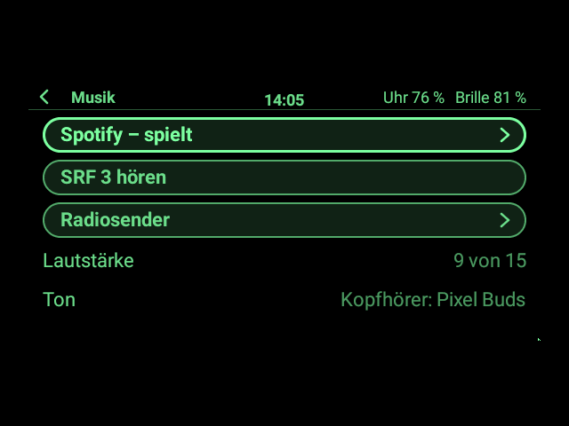
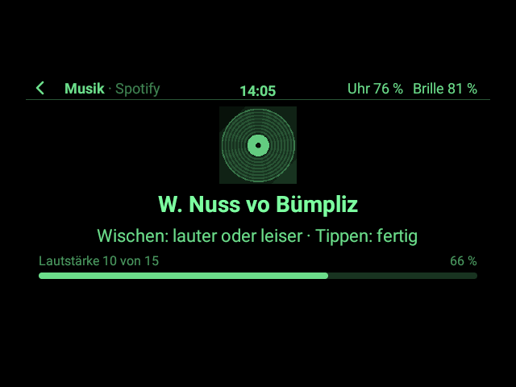
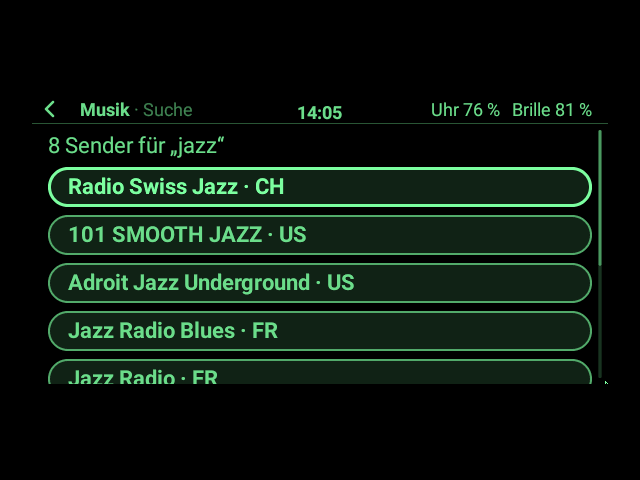
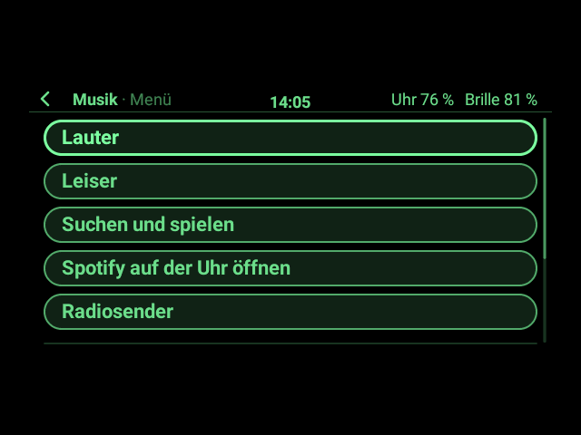
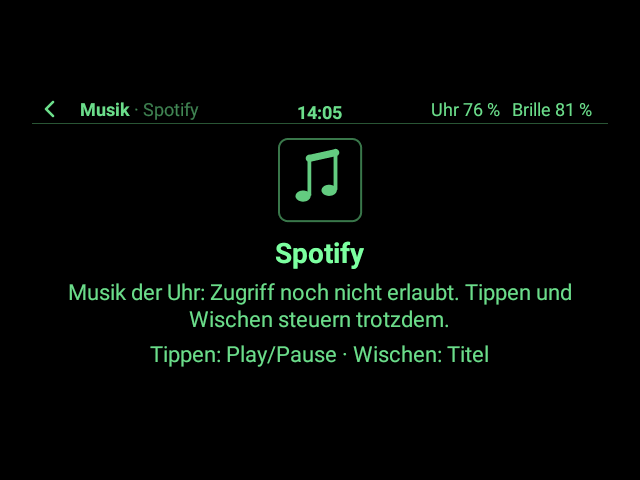

# Musik auf der Brille (App-Paket)

**Spotify von der Brille aus bedienen** – und jeden anderen Player auf der Uhr (YouTube Music, Podcasts …):
Titel, Interpret, Cover und Zeit auf dem Glas, Tippen für Play/Pause, Wischen für den nächsten Titel, langes
Drücken für die Lautstärke. Dazu **Radio**: die Schweizer Sender, die man über **DAB+** hört (SRF, RTS, RSI,
Swiss Pop/Jazz/Classic, Energy, Radio 24 …), als Internet-Stream über WLAN oder LTE der Uhr, und jeder andere
Sender der Welt über die offene Senderliste radio-browser.info.

Der Ton kommt **von der Uhr**: über Kopfhörer, die mit ihr gekoppelt sind, oder ihren Lautsprecher. Die Brille
hat keinen Lautsprecher, und die Uhr keinen DAB-Empfänger – deshalb kommt das Radio als Stream aus dem Netz,
mit denselben Sendern.

> **Ehrlicher Stand (1.0.0):** gebaut und ohne Hardware getestet (Fakes für die Player und den Stream, Bilder
> vom echten App-Host der Uhr-App). **Nichts davon ist auf Hardware erprobt**: weder Spotify auf der Pixel
> Watch noch ein Stream über ihre Kopfhörer noch die Bedienung von der Brille. Die Senderadressen habe ich am
> 28.10.2026 einzeln abgerufen: Alle lieferten Ton. Braucht **G2 Watch ab 0.13.0** (Schnittstelle 6:
> Musik der Uhr und eigener Ton, [03 §15](../../docs/app-entwicklung/03_Uhr-Apps.md#15-musik-der-uhr-und-eigener-ton-v0130-schnittstelle-6)).

| Start | Spotify (Tippen: Play/Pause, Wischen: Titel) | Lautstärke (lange drücken, dann wischen) |
|---|---|---|
|  |  |  |
| **Radiosender** (Favoriten zuerst) | **Ein Sender spielt** (Wischen: nächster Sender) | **Sender suchen** (weltweit) |
|  |  |  |
| **App-Menü** (Tippen, dann halten) | **Ohne Zugriff** auf die Mediensteuerung | |
|  |  | |

Gezeichnet vom echten App-Host und Desktop der Uhr-App mit Androids Schrift, in den 16 Grünstufen der Brille
(`MusikSnapshotTest`). Was Spotify meldet, ist ausgedacht (Lied, Cover); was SRF 3 sendet und die Treffer für
„jazz“ sind so, wie sie am 28.10.2026 kamen.

## Was die App kann

- **Spotify und die anderen Player der Uhr:** was spielt, mit Cover (grau), Titel, Interpret · Album und der
  Zeit, die jede Sekunde weiterläuft. Play/Pause, nächster und voriger Titel, Lautstärke der Uhr, Spotify auf
  dem Bildschirm der Uhr öffnen. **Suchen und spielen** („Patent Ochsner“) fragt Spotify so, wie ein
  Sprachassistent fragt; ob Spotify auf der Uhr darauf antwortet, ist nicht erprobt. Spielt ein anderer Player
  (YouTube Music …), zeigt und steuert die App diesen.
- **Radio:** 44 Schweizer Sender fest eingebaut, in drei Gruppen (SRG SSR: alle SRF-, RTS- und RSI-Programme,
  RTR, Swiss Pop/Jazz/Classic; Privatradios der Deutschschweiz; der Romandie), alle über https. Auf der Seite
  des Senders: was er gerade spielt (wenn er es mitschickt, wie SRF 3: „PAOLO CONTE - VIA CON ME“), Live,
  Format. **Wischen dreht weiter** zum nächsten Sender der Liste, aus der er kam – wie am Drehknopf.
- **Favoriten:** im App-Menü des Senders „Als Favorit merken“; sie stehen zuoberst in der Senderliste, Wischen
  geht dann durch die Favoriten. Den zuletzt gehörten Sender bietet die Startseite an („SRF 3 hören“).
- **Sender suchen:** weltweit bei radio-browser.info nach Namen („jazz“, „BBC“, „Bayern 3“), die meistgehörten
  zuerst, Schweizer Treffer ganz oben, jeder Name eines Landes nur einmal. Die letzten fünf Suchen bietet die
  Uhr als Vorschläge an.
- **Radio und Spotify geben einander Platz:** Startet ein Sender, pausiert Spotify; spielt Spotify wieder,
  pausiert der Sender („Pause – Eine andere App spielt“). Kopfhörer weg: Pause. Das Radio spielt weiter, wenn
  man die App verlässt (Starter oder andere App); mit dem Schließen der App endet es.
- **Wenn ein Sender umzieht:** Liefert eine eingebaute Adresse keinen Ton mehr, fragt die App radio-browser.info
  nach der neuen und spielt von dort weiter; die App merkt sie sich.

## Bedienung

| | Bügel / Ring | Uhr (Gesten) |
|---|---|---|
| Spotify bzw. Sender: Play/Pause | Tippen | Tippen |
| Nächster Titel bzw. nächster Sender | Wischen wie zum nächsten Eintrag einer Liste | ebenso |
| Voriger Titel bzw. voriger Sender | Wischen wie zum vorigen Eintrag einer Liste | ebenso |
| Lautstärke: an | lange drücken | nach links wischen |
| Lautstärke: lauter / leiser | Wischen wie zum vorigen / nächsten Eintrag | ebenso |
| Lautstärke: fertig | Tippen (oder 5 s nichts) | Tippen |
| App-Menü (Lauter, Leiser, Suchen und spielen, Spotify öffnen, Favorit, Radio aus, Senderliste) | Tippen, dann halten | – |
| Zurück | Doppeltippen | nach rechts wischen |

Start, Senderliste und Suche bedient man wie jede App mit Zeiger, Bügel oder Tastatur. Auf den Seiten mit
Gesten wirkt auch eine Bluetooth-Tastatur an der Uhr: Leertaste oder Play/Pause = Tippen, Pfeile = Wischen.

## Einmal: Zugriff auf die Mediensteuerung erlauben

Damit die App **Titel, Cover und Zustand** sieht, braucht die Uhr-App G2 Watch einmal den Zugriff auf die
Mediensteuerung der Uhr. Android vergibt ihn über „Zugriff auf Benachrichtigungen“; G2 Watch liest damit
**keine** Benachrichtigungen, nur, welche Player es gibt. Falls die Uhr unter *Einstellungen → Apps →
Spezieller App-Zugriff* keinen solchen Eintrag hat (auf Wear OS üblich), geht es einmal am Computer, mit der Uhr
über WLAN-Debugging verbunden wie beim Aufspielen:

```sh
adb shell cmd notification allow_listener ch.madtreasures.g2watch/ch.madtreasures.g2watch.apps.media.MediaAccessService
```

Zurücknehmen: dasselbe mit `disallow_listener`. **Ohne den Zugriff** geht trotzdem: Play/Pause, nächster und
voriger Titel (als Tasten an den Player, der zuletzt spielte), Lautstärke und das ganze Radio. Die App sagt
dann „Musik der Uhr: Zugriff noch nicht erlaubt“ (Bild „Ohne Zugriff“ oben).

## Woher die Sender kommen

- **Die eingebaute Liste** (`Stations.kt`): die Streams der Sender selbst (stream.srg-ssr.ch, streambase.ch von
  CH Media, Infomaniak, Somedia …), MP3 mit 128 bis 256 kbit/s, Radio Top als AAC+. Am 28.10.2026 lieferten
  alle 44 Ton; Songtitel kamen in Stichproben (SRF 1, SRF 3, Swiss Pop, Energy Zürich, Radio Zürisee).
- **[radio-browser.info](https://www.radio-browser.info/):** eine freie, offene Senderliste ohne Konto. Die App
  fragt sie nur bei einer Suche, bei einem Sender, dessen Adresse nicht mehr geht, und wenn ein Sender startet,
  der dort verzeichnet ist: Dann zählt sie einen Klick, worum radio-browser.info seine Nutzer bittet. Dabei
  sieht der Server die Adresse der Uhr im Netz und den Sender, sonst nichts. Die App nennt sich dort
  „G2-Musik/1.0“ und fragt reihum mehrere Server, falls einer nicht antwortet.
- Viele Sender senden noch unverschlüsselt (http); die Uhr-App erlaubt das für den Ton der Apps, alles andere
  (Abfragen, Downloads, Videos) bleibt https.

## Wie es gebaut ist

Alles ist eigenes Kotlin im Paket; die Uhr-App leiht ihm ihre Mediensteuerung und einen Audio-Stream
(Schnittstelle 6). Kein fremder Code, keine Spotify-Schnittstelle, kein Konto.

| Datei | Inhalt |
|---|---|
| `MusikApp.kt` | die App: Seiten, Gesten, Lautstärke, Radio, Favoriten, Suche, App-Menü, was sie sich merkt |
| `Stations.kt` | ein Sender; die 44 Schweizer Sender mit ihren Adressen und ihren Einträgen bei radio-browser.info |
| `RadioBrowser.kt` | die Anfragen an radio-browser.info und das Lesen ihrer Antworten |
| `TextFit.kt` | kürzt Titel und Namen auf die Zeilen, die sie auf den Seiten mit Gesten haben (die nicht scrollen) |
| `Shown.kt` | schickt nur, was sich auf den Seiten ändert (die Zeit jede Sekunde als kleiner `patch`) |
| `symbol.py` | zeichnet Symbol, Noten- und Radiobild (`python3 packages/musik/symbol.py`, braucht Pillow) |

**Was die App sich merkt** (256-KiB-Speicher der App): die Favoriten (höchstens 30), den letzten Sender, die
letzten fünf Suchen nach Sendern und in Spotify und neue Adressen umgezogener Sender.

## Bauen, auf die Uhr legen, installieren

```sh
./gradlew :packages:musik:g2app   # → packages/musik/build/g2app/ch.madtreasures.musik-1.0.0.g2app
adb push packages/musik/build/g2app/ch.madtreasures.musik-1.0.0.g2app /sdcard/Android/data/ch.madtreasures.g2watch/files/apps/
```

Dann auf der Uhr: Zahnrad halten → *Einstellungen → Apps installieren* → unter „Neu auf der Uhr“ antippen
([09 §4](../../docs/app-entwicklung/09_App-Pakete.md#4-auf-die-uhr-bringen-und-installieren)). Braucht die
Uhr-App 0.13.0 (Schnittstelle 6); eine ältere lehnt das Paket mit einer Meldung ab. Beim ersten Start fragt die
Brille nach „Musik der Uhr steuern“ und „Internet“.

## Tests

Tests in `src/test/kotlin`, laufen mit `./gradlew :app:testDebugUnitTest`:

- `MusikAppTest` (mit `FakeAppContext`): Startseite, Player mit Cover und laufender Zeit, Gesten, Lautstärke,
  ohne Zugriff, nichts spielt, lange Titel, App-Menü mit Suche in Spotify, Sender spielen, pausieren,
  weiterdrehen, Radio aus, Favoriten über zwei Sitzungen, Suche bei radio-browser.info, Server, die nicht
  antworten, ein Sender, der umgezogen ist.
- `MusikHostTest`: im echten App-Host mit Fakes für die Player und den Stream; die Bügel steuern Spotify und das
  Radio, der Stream spielt hinter dem Starter weiter, der Host lehnt keinen Befehl ab, die Bilder laden.
- `MusikPageFitTest` (mit Androids echter Schrift): Spotify- und Senderseite wachsen bei keinem Titel über die
  Brillenfläche, auch nicht bei Chinesisch, Emoji oder einer Verkehrsmeldung in Großbuchstaben.
- `RadioBrowserTest`: Antworten von radio-browser.info, die eingebaute Liste, gemerkte Sender, gekürzte Texte,
  Größe eines Covers.

Bilder neu zeichnen:

```sh
./gradlew :app:testDebugUnitTest --tests 'ch.madtreasures.musik.MusikSnapshotTest' -PsnapshotDir=$PWD/packages/musik/bilder
```

## Grenzen

- **Kein echtes DAB+** (geprüft am 28.10.2026): Die Pixel Watch 5 hat laut Google keinen Radio-Empfänger, nur
  LTE, Bluetooth, WLAN, NFC, UWB, GPS und Satelliten-Notruf. Einen USB-Anschluss für einen DAB-Stick hat sie
  nicht, nur die Ladekontakte. Und Android lässt Apps an keinen Radio-Empfänger heran: Die Schnittstelle dafür
  (`RadioManager`) gibt es nur für Autos mit eingebautem Empfänger, im SDK für Apps fehlt sie. Die Brille hat
  weder Empfänger noch Lautsprecher. Ein DAB-Stick an einem Rechner oder Handy mit USB-Anschluss könnte zwar
  empfangen, käme aber auch nur über WLAN oder LTE zur Uhr, also ohne Vorteil gegenüber dem Stream.
  Deshalb braucht das Radio WLAN oder LTE der Uhr und verbraucht Daten (128 kbit/s sind knapp 60 MB pro Stunde).
- **Playlists und Bibliothek von Spotify** kann eine fremde App auf der Uhr nicht durchblättern; dafür gibt es
  „Spotify auf der Uhr öffnen“ und „Suchen und spielen“ (ohne Gewähr, siehe oben).
- Ob Spotify auf der Pixel Watch seine Titel und sein Cover an Android meldet und auf die Medientasten hört, ist
  der verbreitete Weg, aber hier nicht erprobt.
- Die eingebauten Senderadressen können sich ändern; dann hilft radio-browser.info (wenn der Sender dort
  verzeichnet ist; bei Energy Luzern nicht) oder die Suche.
