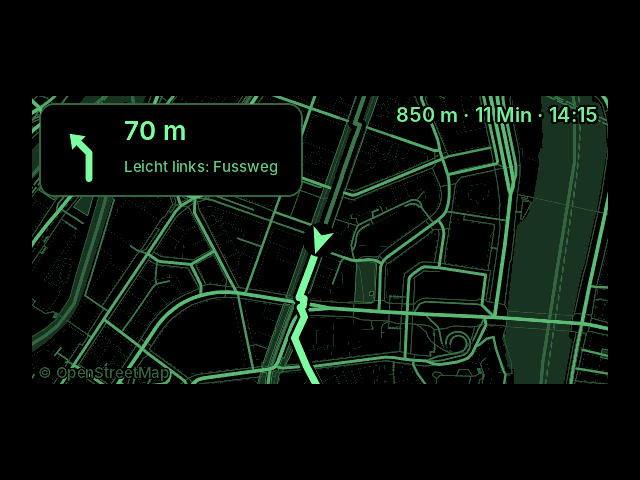
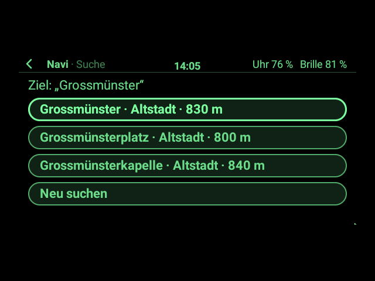
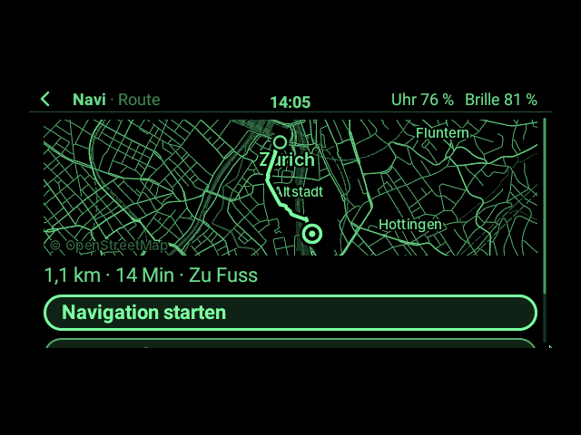
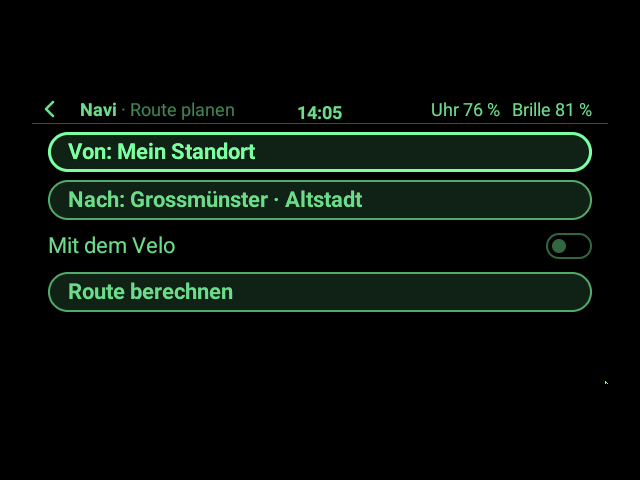
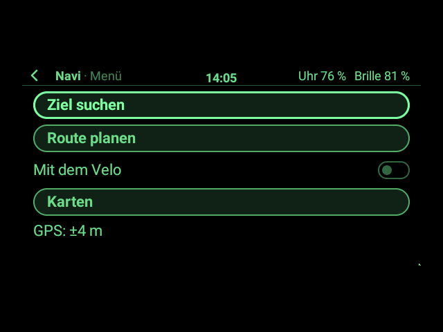
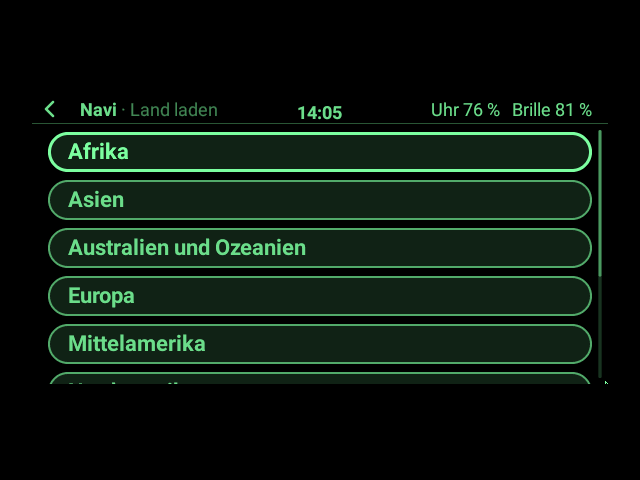
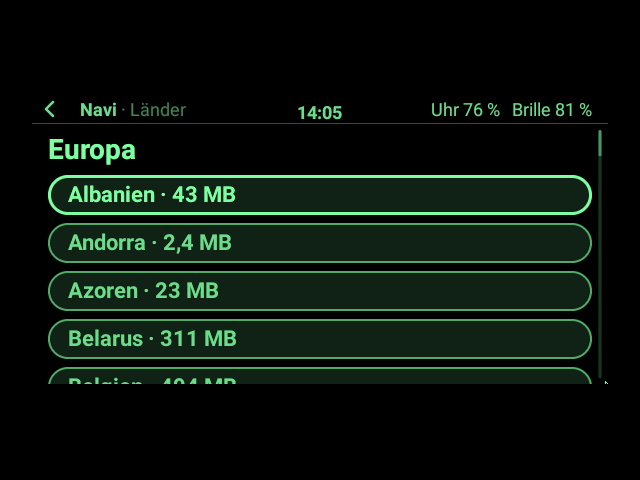
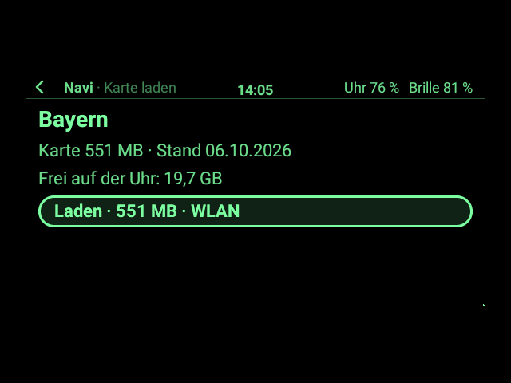

# Navi auf der Brille (App-Paket)

Navigation **ganz offline** zu Fuß und mit dem Velo: Die Karten liegen auf der Uhr, **jedes Land der Welt
einzeln ladbar** (zum Beispiel nur die Schweiz), den Standort liefert das **GPS der Uhr**, und die Brille zeigt
Karte und Abbiegehinweise im Stil von Evens eigener Navigation. Start und Ziel sucht man auf der Uhr; die Route,
die Suche und die Bilder rechnet die Uhr selbst, ohne Netz.

> **Ehrlicher Stand (1.0.0):** gebaut und ohne Hardware getestet, mit der echten Karte der ganzen Schweiz
> (Suche, Routen bis Zürich–Bern, Bilder, Speicher). **Nichts davon ist auf Hardware erprobt**: weder das GPS
> der Pixel Watch noch ein Download auf der Uhr noch die Bilder auf dem Glas. Braucht **G2 Watch ab 0.12.0**
> (Schnittstelle 5: GPS, große Dateien, Hintergrundarbeit, [03 §14](../../docs/app-entwicklung/03_Uhr-Apps.md#14-gps-große-dateien-und-hintergrundarbeit-v0120-schnittstelle-5)).

| Karte mit Standort | Navigation (wie bei Even) | Navigation, ganze Karte (Tippen) |
|---|---|---|
|  |  |  |
| **Ziel suchen** | **Route** | **Route planen: Start und Ziel** |
|  |  |  |
| **Menü** | **Karten auf der Uhr** (ein Land lädt) | **Alle Erdteile** |
|  |  |  |
| **Länder eines Erdteils** | **Ein Land (hier eine Region)** | |
|  |  | |

Gezeichnet vom echten App-Host und Desktop der Uhr-App mit Androids Schrift, in den 16 Grünstufen der Brille,
auf der Karte der Schweiz von download.mapsforge.org (`NaviSnapshotTest`); der Standort am Zürcher
Hauptbahnhof ist gesetzt, nicht gemessen.

## Was die App kann

- **Karte mit Standort:** ein ruhiges Bild der Straßen, Wege, Bahnen, Gewässer und Orte; der Standort als Pfeil
  (in Fahrtrichtung, sobald man geht) mit Genauigkeitskreis, oben links „±4 m“, unten rechts der Maßstab.
  Scrollen am Bügel zoomt.
- **Ziel suchen:** Orte, Straßen, Haltestellen, Sehenswürdigkeiten, Läden … mit dem Ort, in dem sie liegen
  („Bahnhofstrasse · Zürich“), nahe Treffer zuerst. Mehrere Wörter in beliebiger Folge („Zürich Bahnhofstrasse“),
  ohne Umlaute und Akzente („aulestrasse“), jeder Ort in allen Sprachen der Karte („Genève“ findet Genf). Die
  letzten fünf Ziele bietet die Uhr als Vorschläge an.
- **Route planen:** Start frei wählen (Standard: *Mein Standort*) und Ziel; zu Fuß oder mit dem Velo. Das Velo
  hält sich an Einbahnstraßen und nimmt lieber Velowege und Nebenstraßen als Hauptstraßen; zu Fuß gehen
  Treppen, Wege und Fußgängerzonen. Autobahnen nie, private Wege nur im Notfall.
- **Navigation** wie Evens Navigation: unten links der nächste Hinweis mit Pfeil, Entfernung und Straße
  („Rechts abbiegen: Limmatquai“, darunter „Dann links“, wenn der nächste gleich folgt), rechts eine kleine Karte,
  die sich mit der Fahrtrichtung dreht, oben rechts Rest, Dauer und Ankunftszeit. **Tippen** zeigt die ganze
  Karte nach Norden ausgerichtet. Vor jeder Abbiegung tickt die Uhr am Handgelenk (30 m vorher zu Fuß, 60 m mit
  dem Velo), am Ziel vibriert sie lang. Wer die Route verlässt, bekommt nach zwei Positionen eine neue (die Uhr
  vibriert doppelt).
- **Demo-Fahrt:** fährt die Route von selbst ab (dreifaches Gehtempo, mit dem Velo doppeltes), um die Anzeige im
  Sitzen auszuprobieren; das GPS wartet so lange.
- **Karten:** jedes Land der Welt, große Länder auch nach Regionen (Deutschland als Ganzes oder nur Bayern, die
  USA nach Bundesstaaten, China nach Provinzen), beliebig viele nebeneinander. Laden über WLAN (auf Wunsch auch
  über LTE), abgebrochene Downloads gehen weiter, wo sie standen. Nach dem Laden prüft die App die Karte, zeigt
  sie sofort und baut im Hintergrund ihr Suchverzeichnis. Neuere Stände auf dem Server bietet sie zum
  Aktualisieren an; Löschen fragt einmal nach.

## Bedienung

| | Bügel / Ring | Uhr (Gesten) |
|---|---|---|
| Karte: Menü öffnen | Tippen | Tippen |
| Karte und Navigation: zoomen | Wischen vor / zurück | Finger hoch / runter |
| Navigation: kleine ↔ ganze Karte | Tippen | Tippen |
| App-Menü (Karte: Ziel suchen, Karten, Navigation; Navigation: beenden, neu berechnen, Demo beenden) | Tippen, dann halten | – |
| Zurück | Doppeltippen | nach rechts wischen |

Karte und Navigation sind Vollbild-Seiten mit Gesten; die übrigen Seiten (Menü, Route, Treffer, Karten,
Länder) bedient man wie jede App mit Zeiger, Bügel oder Tastatur. Ziele und Start tippt oder spricht man auf der
Uhr. Zurück von der Navigation führt zur Karte, die Navigation läuft weiter („Navigation fortsetzen“ im Menü).

## Karten: alle Länder, aktueller Stand

Die Karten kommen von **[download.mapsforge.org](https://download.mapsforge.org/maps/v5/)**: OpenStreetMap-Daten
im offenen mapsforge-Format (Version 5), dort laufend neu erzeugt. Das Paket bringt den **Katalog aller 423
Einträge** mit (`catalog.json`: 9 Gruppen – Afrika, Asien, Australien und Ozeanien, Europa, Mittelamerika,
Nordamerika, Russland, Südamerika, eine Welt-Übersicht –, über 200 Länder und Gebiete, große auch in Regionen, je mit
Größe, Stand und Ausdehnung; Namen deutsch). Beim Blättern fragt die App die Ordnerliste des Servers nach dem
**neuesten Stand** jeder Karte; ist er ein paar Tage neuer als der auf der Uhr, steht beim Land „neuer Stand“ und
„Aktualisieren“. Die Suche nach dem Stand braucht Netz, alles andere nicht.

Auf der Uhr liegen die Karten im eigenen Ordner der App (`Android/data/ch.madtreasures.g2watch/files/app-data/ch.madtreasures.navi/`):
`maps/<land>.map` und `index/<land>.idx`. Ein Download, der unterbricht, wartet als `.part` und geht mit
„Weiter laden“ an derselben Stelle weiter. Vor dem Laden prüft die App den Platz: Karte, rund 7 % für das
Suchverzeichnis und 500 MB, die die Uhr immer frei lässt.

## Passt das auf die Pixel Watch 5?

Die Pixel Watch 5 (45 mm) hat **64 GB Speicher** und 2–3 GB Arbeitsspeicher (Angaben je nach Quelle, etwa
Android Authority und GSMArena zur Vorstellung); ein Teil des Speichers gehört dem System. Gerechnet mit den
Größen aus dem Katalog (Stand 27.10.2026) und einem Suchverzeichnis von 6 % der Karte (gemessen an der Schweiz:
19 MB zu 319 MB):

| Was | Karten | mit Suchverzeichnis | Passt auf 64 GB? |
|---|---|---|---|
| Schweiz | 319 MB | 340 MB | ja, gut 150-mal |
| Österreich | 528 MB | 560 MB | ja |
| Deutschland (ganz) | 3,0 GB | 3,2 GB | ja |
| Frankreich (ganz, das größte Land) | 3,3 GB | 3,5 GB | ja |
| ganz Europa (jedes Land einmal) | 24,8 GB | 26,3 GB | ja |
| die ganze Welt (jedes Land einmal) | rund 80 GB | rund 85 GB | **nein** – aber eine Auswahl bis etwa 50 GB, je nach freiem Platz |

**Arbeitsspeicher:** Das Suchverzeichnis der ganzen Schweiz entsteht mit 64 MB (auf dem Test-Rechner in 4 bis
20 s, auf der Uhr vermutlich eine knappe Minute, nicht gemessen), und so auch für die größten Länder, weil die
App es in Stücken sortiert, die in Dateien warten.
Routen Zürich–Bern (95 km Luftlinie) zu Fuß und mit dem Velo und Zürich–Luzern finden sich mit 64 MB in 1–3 s
(`HeapTest`). Lange Routen nehmen dafür den Weg Richtung Ziel etwas zielstrebiger: höchstens ein paar Prozent
länger als die kürzeste (Zürich–Bern zu Fuß +1 %). Das Paket selbst ist 270 KB groß.

## Wie es rechnet

Alles ist eigenes Kotlin im Paket; die Uhr-App leiht ihm nur GPS, den Ordner mit Downloads und
Hintergrundarbeit. Kein fremder Code, keine Bibliothek von mapsforge oder einer Routing-Software.

| Datei | Inhalt |
|---|---|
| `NaviApp.kt` | die App: Seiten, Bedienung, Navigation, Demo, Downloads, Bilder als Hintergrundarbeit |
| `MapFile.kt`, `MapTags.kt` | liest mapsforge-Karten (Version 3 bis 5) Block für Block; was ein Weg oder Ort ist |
| `MapRenderer.kt`, `Raster.kt`, `Font.kt`, `Screens.kt` | zeichnet die Bilder für die Brille: Graustufen mit Kantenglättung, eigene Schrift, PNG mit 16 Stufen unter 48 KB |
| `Router.kt`, `Route.kt` | Wegnetz aus den Blöcken der Karte, A*-Suche zu Fuß und mit dem Velo, Abbiegehinweise aus der Geometrie |
| `Navigator.kt` | wo auf der Route man ist, was als Nächstes kommt, ob man sie verlassen hat; die Demo-Fahrt |
| `Search.kt` | baut das Suchverzeichnis (sortiert, in Stücken) und sucht darin mit binärer Suche in der Datei |
| `Catalog.kt` | der Katalog aller Karten, die Ordnerlisten des Servers, was die App sich merkt |
| `Geo.kt`, `Collections.kt` | Koordinaten, Abstände, Kacheln; Hash-Tabellen und Heap ohne Boxen |
| `tools/catalog.py` | erzeugt `catalog.json` aus den Ordnern von download.mapsforge.org (nur Python-Standardbibliothek) |
| `tools/font.py` | zeichnet die Schrift Inter in die kleinen Schrift-Dateien des Pakets (braucht Pillow) |
| `tools/cut_map.py` | schneidet die Test-Karte Vaduz Byte für Byte aus einer mapsforge-Karte |
| `symbol.py` | zeichnet das Symbol im Starter (`python3 packages/navi/symbol.py`, braucht Pillow) |

**Was die App sich merkt** (256-KiB-Speicher der App): die geladenen Karten, zu Fuß oder Velo, LTE erlaubt, den
letzten Standort (für die Karte beim Start) und die letzten fünf Ziele.

## Lizenzen und Quellen

- **Kartendaten © OpenStreetMap-Mitwirkende**, Lizenz ODbL 1.0 ([openstreetmap.org/copyright](https://www.openstreetmap.org/copyright)).
  Jede Karte auf der Brille zeigt „© OpenStreetMap“ (die kleine Karte der Navigation „© OSM“).
- Die Karten-Dateien erzeugt das Projekt mapsforge auf download.mapsforge.org; das Paket liest ihr offenes
  Format mit eigenem Code.
- **Schrift Inter** von Rasmus Andersson, SIL Open Font License 1.1 (`src/main/assets/…/fonts/OFL.txt`).
- Keine Daten oder Server von Even Realities; das Aussehen der Navigation ist nach Beschreibungen und Bildern
  von Evens Navigate-App nachgebaut.

## Bauen, auf die Uhr legen, installieren

```sh
./gradlew :packages:navi:g2app   # → packages/navi/build/g2app/ch.madtreasures.navi-1.0.0.g2app
adb push packages/navi/build/g2app/ch.madtreasures.navi-1.0.0.g2app /sdcard/Android/data/ch.madtreasures.g2watch/files/apps/
```

Dann auf der Uhr: Zahnrad halten → *Einstellungen → Apps installieren* → unter „Neu auf der Uhr“ antippen
([09 §4](../../docs/app-entwicklung/09_App-Pakete.md#4-auf-die-uhr-bringen-und-installieren)). Braucht die
Uhr-App 0.12.0 (Schnittstelle 5); eine ältere lehnt das Paket mit einer Meldung ab. Beim ersten Start fragt die
Brille nach „Standort“ und „Internet“, beim ersten GPS zusätzlich Android auf dem Bildschirm der Uhr.

## Tests

Tests in `src/test/kotlin`, laufen mit `./gradlew :app:testDebugUnitTest`:

- `NaviAppTest` (mit `FakeAppContext`): Katalog aller Länder und Regionen, Download über WLAN und LTE mit
  Fortschritt, Prüfung und Suchverzeichnis, zu wenig Platz, Abbruch, Fehler, Weiterladen, abgelehnter Download,
  Aktualisieren, Löschen, Karte für hier, Suche, Start und Ziel, Route, Navigation mit GPS (Ticks vor den
  Abbiegungen, langes Vibrieren am Ziel, neue Route abseits), Demo-Fahrt, Zoomen, die Seiten beim Zurückgehen.
- `NaviHostTest`: im echten App-Host mit Fakes für GPS und Downloads; die Bügel bedienen die Seiten, die
  Hintergrundarbeit läuft wie auf der Uhr, der Host lehnt keinen Befehl ab und kein Bild ist zu groß.
- `CatalogTest` (Katalog, Ordnerlisten des Servers mit seiner Zeitzone, was die App sich merkt, Ereignisse
  bleiben unter 25 ms), `MapFileTest`, `MapRendererTest`, `RouterTest`, `SearchTest` (auf der Test-Karte Vaduz,
  `src/test/fixtures/vaduz.map`, 140 KB aus der Karte Liechtensteins).
- Mit echten Karten: `-PnaviData=<Ordner mit switzerland.map>` liest zusätzlich jeden Block der Schweiz, baut ihr
  Suchverzeichnis, rechnet Routen durch Zürich und Bern und prüft in eigenen JVMs mit 64 MB den Speicher
  (`HeapTest`). Ohne den Ordner werden diese Tests übersprungen.

Bilder neu zeichnen (braucht die Karte der Schweiz, 319 MB, von download.mapsforge.org):

```sh
./gradlew :app:testDebugUnitTest --tests 'ch.madtreasures.navi.NaviSnapshotTest' \
    -PsnapshotDir=$PWD/packages/navi/bilder -PnaviData=<Ordner mit switzerland.map>
```

## Grenzen

- Zu Fuß und mit dem Velo, wie Evens Navigation; kein Auto.
- Hausnummern sucht die App nicht, nur Namen.
- „Hier“ auf der Seite *Karten* schlägt die kleinsten Karten vor, deren Rechteck den Standort enthält; nahe einer
  Grenze kann das auch das Nachbarland sein.
- Sehr lange Routen (gut 100 km mit dem Velo) gehen an die Grenze dessen, was die Uhr in Ruhe rechnet; darüber
  sagt die App „Die Route ist zu lang für die Uhr“.
- Die Welt-Übersicht des Servers ist von 2016 und zeigt nur Land und Meer bis Zoom 10.
